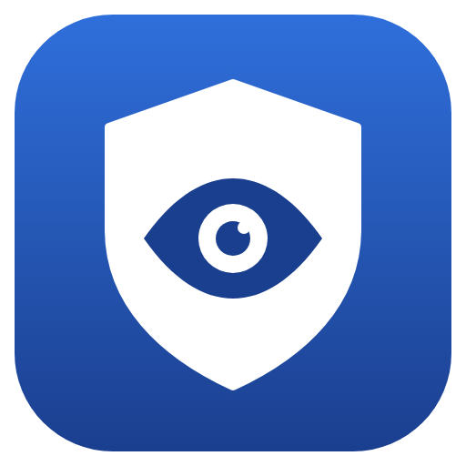
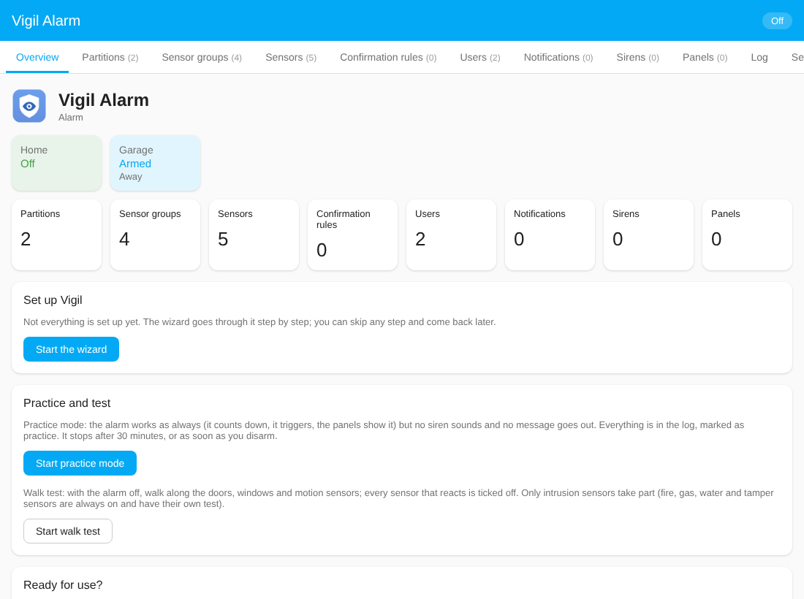

<p align="center">
  
</p>

<h1 align="center">Vigil Alarm</h1>

<p align="center">
  A modular alarm system for Home Assistant: modes, entry and exit delays, confirmation rules,
  notifications, sirens, self-monitoring, and an admin panel to set it all up.
</p>

<p align="center">
  <a href="https://my.home-assistant.io/redirect/hacs_repository/?owner=lightyearcoder&repository=vigil-alarm&category=integration"></a>
  <a href="https://github.com/lightyearcoder/vigil-alarm/releases"></a>
  <a href="https://github.com/lightyearcoder/vigil-alarm/actions/workflows/tests.yml"></a>
  <a href="LICENSE"></a>
  
</p>

> **Not a certified alarm system.** Vigil Alarm is a home automation project. It does not meet
> any alarm, fire-detection or insurance standard. Do not rely on it as your only protection for
> life or property, and test it regularly.

## What it does

- **One alarm entity** (`alarm_control_panel`) with the modes *Home*, *Away* and *Night*, exit
  and entry delays per mode, and codes per user. It works with the standard alarm panel card,
  the tile card and the Companion app.
- **Sensors with a class:** intrusion (instant, delayed or follower), fire, gas, water and
  tamper. Fire and gas always watch; intrusion sensors watch in the modes of their
  **sensor groups**, for example *Perimeter* (doors and windows) in every mode and *Interior*
  (motion) in Away only.
- **Confirmation rules:** an alarm only follows when, say, two different motion sensors trigger
  within a minute. Handy against a false alarm from one PIR.
- **Notifications** through any `notify` service, per kind of message, with optional
  escalation to a second channel when nobody reacts.
- **Sirens** (optional) with tone and volume per cause, a maximum duration, and a preset for
  the Sonoff SNZB-09P (Zigbee2MQTT).
- **Self-monitoring:** unreachable sensors, low batteries, siren availability and mains power.
- **Survives restarts:** the alarm state and running timers are saved. An alarm that went off
  during a restart is still raised.
- **Admin panel** in the sidebar (administrators only) to set up sensors, groups, users,
  notifications and sirens in clear tables, with live status.
- **Built for automations:** every decision is published as an event, so lights, speech,
  cameras and anything else are *your* automations. Ready-made [blueprints](#blueprints) and an
  [example dashboard](#example-dashboard) are included.

The core decides and publishes events; it never calls a device itself. Only the safety minimum
(notifications and sirens) is built in.

<p align="center">
  
</p>

## Installation

### With HACS (recommended)

1. In Home Assistant open **HACS**, three dots top right, **Custom repositories**.
2. Add `https://github.com/lightyearcoder/vigil-alarm` with category **Integration**, or use
   the button:

   [](https://my.home-assistant.io/redirect/hacs_repository/?owner=lightyearcoder&repository=vigil-alarm&category=integration)
3. Download **Vigil Alarm**, then **restart Home Assistant**.
4. **Settings → Devices & services → Add integration → Vigil Alarm.**

### Manually

Copy the folder `custom_components/vigil_alarm` to `config/custom_components/vigil_alarm` in your Home
Assistant, restart, and add the integration as above.

Requires Home Assistant **2026.2.3** or newer. The integration icon is shown from Home
Assistant 2026.3.

## First steps

1. Add the integration. Give the alarm a name and check the basic settings (exit delays,
   entry delay, whether a code is needed to arm). Two **sensor groups** are created for you:
   *Perimeter* and *Interior*.
2. Open **Vigil Alarm** in the sidebar. Add your **sensors** (a door contact goes in *Perimeter*, a
   motion sensor in *Interior*; the panel suggests this), a **user** with a code, and a
   **notification** channel.
3. Arm the alarm from the alarm panel card and open a door to see what happens.

The full manual is in the **[user guide](docs/user-guide.md)**
(Dutch: **[gebruikershandleiding](docs/gebruikershandleiding.nl.md)**). If the alarm does not do what you expect, see
**[troubleshooting](docs/troubleshooting.md)** (Dutch: [problemen oplossen](docs/problemen-oplossen.nl.md)).

## Blueprints

Import a blueprint with the button, then **Settings → Automations → Create automation → Use
blueprint**. HACS does not install blueprints, so the buttons are the easy way.

| Blueprint | What it does | |
|---|---|---|
| **Flash lights during an alarm** | Flashes lights while the alarm is triggered and puts them back as they were. Choose which causes flash; gas is off by default for safety. | [](https://my.home-assistant.io/redirect/blueprint_import/?blueprint_url=https%3A%2F%2Fgithub.com%2Flightyearcoder%2Fvigil-alarm%2Fblob%2Fmain%2Fblueprints%2Fautomation%2Fvigil_alarm%2Fflash_lights_on_alarm.yaml) |
| **Announce alarm events with speech** | Speaks a message on your speakers when the alarm arms, disarms, starts the entry delay or goes off. | [](https://my.home-assistant.io/redirect/blueprint_import/?blueprint_url=https%3A%2F%2Fgithub.com%2Flightyearcoder%2Fvigil-alarm%2Fblob%2Fmain%2Fblueprints%2Fautomation%2Fvigil_alarm%2Fannounce_with_speech.yaml) |
| **Arm when everyone has left** | Arms the alarm when everyone has been away for a while, and tells you if arming was refused. Never disarms. | [](https://my.home-assistant.io/redirect/blueprint_import/?blueprint_url=https%3A%2F%2Fgithub.com%2Flightyearcoder%2Fvigil-alarm%2Fblob%2Fmain%2Fblueprints%2Fautomation%2Fvigil_alarm%2Farm_when_everyone_leaves.yaml) |
| **Arm at a set time** | Arms (for example Night) at a set time on chosen days. | [](https://my.home-assistant.io/redirect/blueprint_import/?blueprint_url=https%3A%2F%2Fgithub.com%2Flightyearcoder%2Fvigil-alarm%2Fblob%2Fmain%2Fblueprints%2Fautomation%2Fvigil_alarm%2Farm_on_schedule.yaml) |
| **Remind when arriving at an armed home** | Sends a message when someone arrives while the alarm is still armed. | [](https://my.home-assistant.io/redirect/blueprint_import/?blueprint_url=https%3A%2F%2Fgithub.com%2Flightyearcoder%2Fvigil-alarm%2Fblob%2Fmain%2Fblueprints%2Fautomation%2Fvigil_alarm%2Farrival_reminder.yaml) |
| **Run your own actions on alarm events** | The general building block: pick events, add any actions. | [](https://my.home-assistant.io/redirect/blueprint_import/?blueprint_url=https%3A%2F%2Fgithub.com%2Flightyearcoder%2Fvigil-alarm%2Fblob%2Fmain%2Fblueprints%2Fautomation%2Fvigil_alarm%2Frun_actions_on_events.yaml) |

Arming from an automation needs a code unless *Code required to arm* is switched off in the
panel. See the note in the [user guide](docs/user-guide.md#automatic-arming) before putting a
code in an automation.

## Presets

Presets fill in the settings of a known device. Today there is one: **Sonoff SNZB-09P
(Zigbee2MQTT)** for sirens. In the panel, add a siren, pick its on/off entity, then choose the
preset: tone, volume and duration are filled in, and Vigil looks for the other entities of the
same device (tone, volume, flash light, battery, power mode). Everything stays editable.
Zigbee2MQTT exposes these entities; other setups (such as ZHA) can use any `siren`, `switch`
or `light` entity as the on/off control and fill in the rest by hand.

## Example dashboard

[`examples/dashboard.yaml`](examples/dashboard.yaml) is a complete dashboard with the standard
cards: the alarm panel, a status card, a card that only shows when something needs attention,
alarms, sensors with their bypass switches, a history and a *Silence the siren* button. Paste it
in the raw configuration editor of a new dashboard and change the example sensor names.

## For automations

Vigil publishes everything as an **event entity** (`event.<name>_alarm_events`). Trigger on a
change of that entity and look at `event_type` and the data in its attributes:

```yaml
triggers:
  - trigger: state
    entity_id: event.vigil_alarm_alarm_events
conditions:
  - condition: template
    value_template: "{{ trigger.to_state.attributes.event_type == 'triggered' }}"
actions:
  - action: notify.mobile_app_phone
    data:
      message: "Alarm: {{ trigger.to_state.attributes.cause }} ({{ trigger.to_state.attributes.sensor_name }})"
```

| Event | When | Data |
|---|---|---|
| `arming_started` / `armed` / `disarmed` | Exit delay starts, alarm armed, alarm off | `mode`, `user` |
| `arm_refused` | Arming was refused | `reason`, `sensors`, `mode` |
| `pending_started` | Entry delay started | `sensor`, `sensor_name`, `end` |
| `triggered` / `trigger_cause_changed` / `trigger_ended` | The alarm goes off, gets a worse cause, ends | `cause`, `sensor`, `confirmed_by` |
| `sensor_faulted` | A sensor fired | `sensor`, `sensor_name` |
| `sensor_unconfirmed` / `sensor_unconfirmed_escalated` | A confirmation rule saw one trigger, or reported it | `rule`, `sensor(s)` |
| `sensor_bypassed` / `sensor_bypassed_at_arm` / `sensor_unbypassed` / `bypass_refused` | Bypass changes | `sensor`, `reason`, `user` |
| `supervision_lost` / `supervision_restored` | A sensor became unreachable or came back | `sensor` |
| `technical_alarm_started` / `technical_alarm_ended` | Water | `sensor`, `cause`, `reason` |
| `siren_started` / `siren_stopped` / `siren_failed` / `siren_unavailable` / `siren_available` | Siren activity | `siren`, `cause`, `verified`, `reason`, `error` |
| `siren_power_lost` / `siren_power_restored` / `battery_low` / `battery_ok` | Self-monitoring | `siren` or `name`, `level` |
| `alarm_silenced` / `alarm_acknowledged` | A person silenced the sirens or confirmed the alarm | `user` |
| `code_rejected` | Someone entered a wrong code | `source` (for example a panel), `action` |
| `code_locked` | 5 wrong codes within 5 minutes: all codes are locked for 5 minutes | `source`, `action` |
| `selftest_checked` | The quiet daily check ran (it never changes `last_event`) | `result` (`ok` or `problems`), `problems` |
| `selftest_reminder` | A reminder to test the siren was sent | `number` (1 or 2) |
| `selftest_siren_tested` | The siren was tested | `how` (`manual`, `notification` or `auto`) |
| `notification_failed` / `state_restore_failed` | Vigil itself had a problem | `channel`, `error`, `reason` |

Entities per alarm: `alarm_control_panel.<name>` (with attributes `cause`, `open_sensors`,
`faults`, `bypassed_sensors`, `problems`, `delay_end`, `refuse_reason`, `mode`, and text versions
for displays),
`binary_sensor.<name>_<class>_alarm` (the ids always end on the English name, also on a Dutch Home Assistant; always there for intrusion, fire, gas, tamper and water), `sensor.<name>_last_event`, and per sensor
`sensor.<sensor>_status` and `switch.<sensor>_bypass`.

Actions: `vigil_alarm.arm`, `vigil_alarm.disarm`, `vigil_alarm.silence`, `vigil_alarm.acknowledge`, `vigil_alarm.bypass`, `vigil_alarm.unbypass`, `vigil_alarm.check_code` (only checks a code, changes nothing)
(all take an optional `source`, the name of a control point such as a panel),
`vigil_alarm.test_siren`, `vigil_alarm.test_notification`, plus the standard `alarm_control_panel` actions.

## Development

```bash
pip install pytest pyyaml                       # core only
pytest tests/test_core.py tests/test_scenarios.py

pip install pytest-homeassistant-custom-component home-assistant-frontend   # everything
pytest
```

The core (`custom_components/vigil_alarm/vigil_core`) has no Home Assistant imports and is specified
by scenarios as data in `tests/scenarios/`. The integration, panel, blueprints and example
dashboard are tested against a real Home Assistant test instance in `tests/ha/`.

Bug reports and ideas: [GitHub issues](https://github.com/lightyearcoder/vigil-alarm/issues).
Please include the log lines that mention `vigil`.

## License

GPL-3.0-or-later, see [LICENSE](LICENSE).
