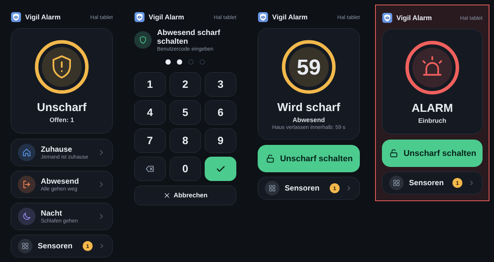
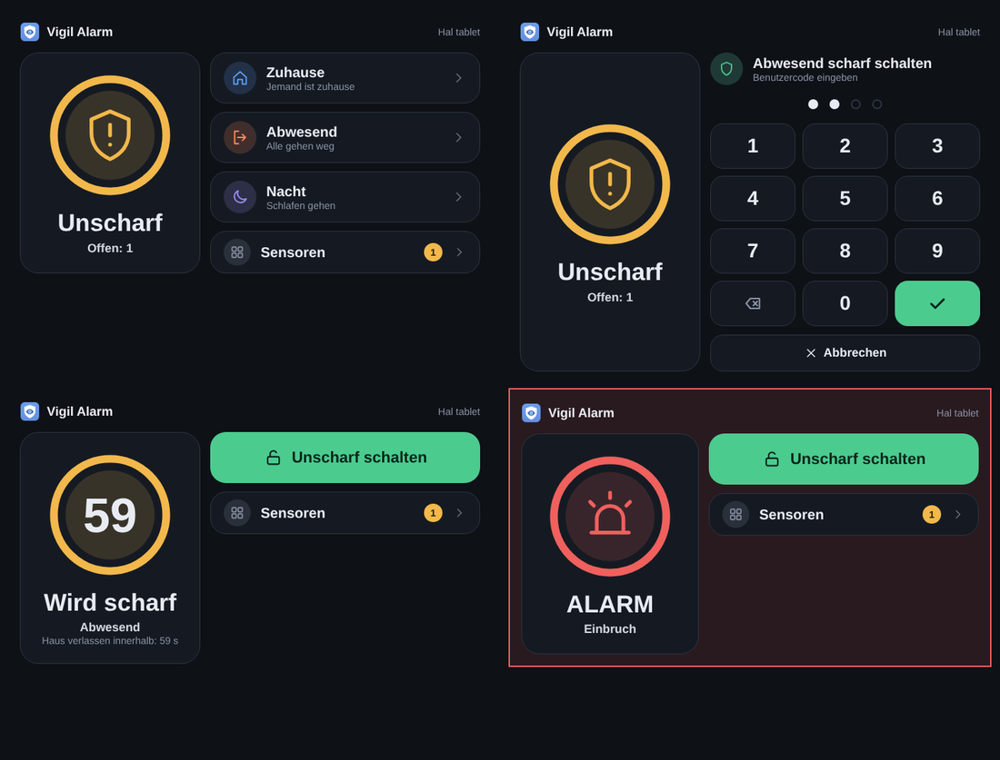

# Ein Tablet an der Wand als Bedienteil

Dies ist eine Übersetzung von [tablet.md](tablet.md), übersetzt von Claude (einer KI) und nicht von Muttersprachlern geprüft. Fehler bitte als Issue melden.

Du kannst Vigil mit einem Tablet bedienen, das ein Home-Assistant-Dashboard zeigt, statt des ESPHome-Bedienteils (oder neben ihm). Das Tablet ist ein Bedienteil im Register, an einen Home-Assistant-Benutzer gebunden, und zeigt die **Vigil-Karte**: den Zustand, die Tasten für die Modi, die es verwenden darf, ein Tastenfeld und, nach dem Installateurcode des Bedienteils, die Sensoren.

## Einrichten

1. **Lege einen Benutzer für das Tablet an.** In Home Assistant: *Einstellungen → Personen → Benutzer → Benutzer hinzufügen*. Verwende einen gewöhnlichen Benutzer. Du kannst stattdessen ein Administratorkonto wählen (es erscheint als *(admin)* in der Liste), aber das liegt in deiner Verantwortung: Die Einstellungen des Bedienteils gelten dann für alles, was dieses Konto tut, auf jedem Gerät, auf dem es angemeldet ist, und ein gestohlenes oder unbeaufsichtigtes Gerät ist als Administrator angemeldet. Vigil gibt einem solchen Konto am Bedienteil keine Administratorrechte (zum Unscharfschalten und Umgehen ist immer ein Code nötig), und der bessere Weg ist ein zweites, gewöhnliches Konto für den Alltag.
2. **Registriere das Tablet in Vigil.** Öffne *Vigil Alarm → Bedienteile → Bedienteil hinzufügen*. Gib einen Namen ein, wähle *Tablet oder Telefon mit Home Assistant* als Gerätetyp und wähle das Konto unter *Home-Assistant-Konto (Tablet oder Telefon)*. Lege fest, was das Tablet darf (Modi, Unscharfschalten, Umgehen, Stummschalten, Sensorliste, Sprache), genau wie bei einem ESPHome-Bedienteil. Lege einen **Installateurcode** für das Bedienteil fest, wenn das Tablet die Sensoren anzeigen können soll.
3. **Melde das Tablet als diesen Benutzer an** und öffne ein Dashboard mit der Vigil-Karte. Im Dashboard-Editor wähle *Karte hinzufügen → Benutzerdefiniert: Vigil*, oder in YAML:

   ```yaml
   type: custom:vigil-card
   ```

   Vigil lädt die Karte selbst; es muss nichts installiert oder als Ressource hinzugefügt werden. Die Karte hat keine Einstellungen außer `idle_timeout` (Sekunden ohne Berührung, bis sie einen halb getippten Code vergisst, Standard 30). Für ein Wandtablet benutze eine Panel-Ansicht (einzelne Karte) oder ein Kiosk-Dashboard, wie es etwa der Fully Kiosk Browser zeigen kann, damit die Seitenleiste verborgen ist.
4. Benutze **HTTPS** für Home Assistant. Über reines `http://` läuft der Code lesbar durch dein WLAN.

## Was die Karte tut





Mit einer Tastatur (ein Tablet mit Tastatur oder ein Computer) kannst du den Code tippen: Ziffern, Rücktaste zum Löschen, Enter zum Bestätigen, Escape zum Schließen des Tastenfelds.

Die Karte zeigt den Zustand als Ring mit einem Symbol in der Farbe des Zustands; während der Ausgangs- und Eingangsverzögerung ist der Ring der Countdown. Sie folgt der Breite, in der sie steht: eine Spalte auf einem Telefon, zwei Spalten auf einem Tablet. Sie hat dasselbe Aussehen wie das Touch-Bedienteil.

- Folgt dem Profil des Bedienteils des Tablets: nur die Modi, in denen dieses Bedienteil scharfschalten darf, *Unscharf* nur wenn es darf, Umgehen-Tasten nur wenn es umgehen darf, die Sprache, die du für das Bedienteil gewählt hast, und gar keine Sensorliste, wenn diese auf *nie* steht.
- **Unscharfschalten und Umgehen verlangen immer einen Benutzercode**; Scharfschalten verlangt nur dann einen, wenn *Code zum Scharfschalten erforderlich* aktiv ist. Das Tastenfeld öffnet sich nie von selbst: Während der Eingangsverzögerung und eines Alarms zeigt der Bildschirm zuerst, was los ist, und wer unscharf schalten will, drückt *Unscharf*.
- **Die Sensorliste** öffnet sich mit dem Code eines beliebigen Vigil-Benutzers oder dem Installateurcode des Bedienteils (über `vigil_alarm.unlock_panel`), für die eingestellte Zeit. Umgehen und Wiederherstellen verlangen einen Benutzer mit dem Recht zum Umgehen (Sabotagesensoren: das zusätzliche Sabotagerecht). Bis dahin zeigt die Karte nur, *wie viele* Sensoren offen sind, nie ihre Namen. Beim Verlassen der Liste oder nach 30 Sekunden ohne Berührung vergisst die Karte die Entsperrung.
- **Partitionen:** Die Karte zeigt *Vigil Alarm* und die Partition (oder *Alle*), die sie bedient, auch bei nur einer Partition. Bei mehreren lässt sich über Chips umschalten; nach der Rückkehrzeit (*Einstellungen*, *Bedienteil-Bildschirm*) springt sie zur Standardpartition des Bedienteils zurück. Auf der Seite *Sensoren* haben die Schaltflächen auch *Immer aktiv*: die Sensoren, die zu keiner Partition gehören (Brand, Gas, Wasser, Sabotage, 24 Stunden). Die Liste einer Partition lässt sie weg.
- Ein Benutzer, der mit keinem Bedienteil verknüpft ist, sieht *Nicht verknüpft*; ein gesperrtes Bedienteil zeigt *Gesperrt* und tut nichts.

## Was Vigil durchsetzt

- Vigil erkennt das Tablet am **Home-Assistant-Benutzer** hinter jedem Aufruf. Home Assistant setzt diesen Benutzer selbst ein, er lässt sich also nicht durch einen anderen `source`-Text nachahmen. Das ist stärker als bei einem ESPHome-Bedienteil, dessen Aufrufe keinen Benutzer tragen.
- Was auch immer die Karte zeigt, der Server entscheidet: Ein Aufruf, den das Profil nicht erlaubt, wird abgelehnt und protokolliert (`panel_refused`). Die Karte ist nur ein hübscheres Gesicht davor.
- Das Tablet hat einen eigenen Sperrtimer für falsche Codes und wird von Vigil nie als Administrator behandelt. *Gesperrt* lehnt alles von diesem Tablet ab; *Sperre aufheben* und *Entsperren* funktionieren wie bei jedem Bedienteil.
- Ein ausgeschaltetes Telefon ist keine Störung: Für ein Tablet oder Telefon ist *Überwachen, ob dieses Bedienteil erreichbar ist* standardmäßig aus, also keine Reparatur und keine Nachricht. Schalte es für ein Tablet ein, das den ganzen Tag an der Wand hängt.
- Der Verlauf zeigt, wer es getan hat, zum Beispiel als *Anna (hall-tablet)*.

## Offline

Die Karte meldet sich jede Minute bei Vigil, solange das Dashboard offen ist. Hat Vigil 10 Minuten lang nichts von ihr gehört, erhältst du eine Reparatur *Bedienteil nicht erreichbar* und eine Nachricht auf deinen Störungskanälen (`panel_offline`, und `panel_online`, wenn es zurück ist), genau wie bei einem ESPHome-Bedienteil. Der Alarmzustand ändert sich dadurch nie. Die Bedienteilliste zeigt *Vigil-Karte aktiv* für ein Tablet, das sich gemeldet hat.

- Nur ein Tablet, dessen Karte sich mindestens einmal gemeldet hat, wird überwacht. Ein Tablet, das die eigene Alarmkarte von Home Assistant zeigt, kann nichts melden und wird deshalb nie gemeldet.
- Vigil merkt sich, dass ein Tablet die Karte verwendet, sodass eines, das beim Neustart von Home Assistant tot ist, trotzdem gemeldet wird, zehn Minuten nach dem Neustart.
- Ein Tablet mit ausgeschaltetem Bildschirm und geschlossenem Browser ist für Vigil offline. Lass ein Wandtablet das Dashboard offen halten.

## Was es nicht tut

- Home Assistant hat keine Berechtigungen pro Entität. Der Benutzer des Tablets kann jeden Dienst aufrufen, den ein gewöhnlicher Benutzer aufrufen darf, und jeden Zustand lesen. Vigil schützt die Alarmanlage (Codes, Profil, Sperre) und die Karte fragt nur nach dem, was das Profil erlaubt, aber der Benutzer kann das Dashboard trotzdem verlassen. Gib diesem Benutzer nicht mehr, als das Tablet braucht.
- Die eigene Alarmkarte von Home Assistant funktioniert für ein Tablet weiterhin, zeigt aber alle Modi (ein Modus, den das Profil nicht erlaubt, wird beim Drücken abgelehnt) und hat keine Sensorliste.
- Die Karte hat keine Infoseite wie das ESPHome-Bedienteil; dafür hat das Tablet Home Assistant.
- Wenn das Tablet gestohlen wird: Setze das Bedienteil in Vigil auf *Gesperrt* und deaktiviere den Benutzer in Home Assistant oder lösche seine Refresh-Tokens (*Profil → Sicherheit*).

## Zwei Konten für den Administrator und ein Schloss am Browser

Die Schwachstelle jedes Dashboards ist das Konto dahinter. Ein Administrator wird von Vigil nie eingeschränkt, ein Administrator, der auf einem Tablet oder Telefon angemeldet bleibt, gibt diesem Gerät also alle Rechte. Halte dein **Administratorkonto nur zum Verwalten** und lege ein zweites, gewöhnliches Konto für den Alltag an (und für das Tablet, wenn du eines willst). Sperre den Browser des Tablets auf das Dashboard (ein Kiosk-Browser wie der Fully Kiosk Browser oder der Kioskmodus von Home Assistant), damit ein Besucher es nicht verlassen kann.

Zwei Dinge schützen die Alarmanlage vor einem Passanten am Wandtablet: Vigil behandelt das Konto des Tablets als gewöhnliches, was es in Home Assistant auch ist (zum Unscharfschalten und Umgehen ist immer ein Code nötig), und **Scharfschalten** braucht ebenfalls einen Code, wenn du im Tab Einstellungen *Code zum Scharfschalten erforderlich* einschaltest. Diese Einstellung gilt systemweit: Ist sie aus, kann jeder, der die Taste drücken kann, scharfschalten.

## Ein Telefon oder Tablet: dasselbe Register

Ein Tablet an der Wand und das Telefon eines Mitbewohners werden gleich behandelt: Beide sind ein Eintrag im Tab *Bedienteile*, der an ein Home-Assistant-Konto gebunden ist (das Feld *Home-Assistant-Konto (Tablet oder Telefon)*, vorzugsweise ein gewöhnliches Konto; ein Administrator kann auch gewählt werden, mit der oben beschriebenen Vorsicht). Pro Eintrag legst du fest, was er darf (Modi, Unscharfschalten, Umgehen, Stummschalten, Sensorliste, Sprache), genau wie bei einem ESPHome-Bedienteil, und die Sensorliste folgt überall denselben Regeln: verborgen, bis der Installateurcode des Eintrags sie freischaltet. Der einzige Unterschied ist, wie Vigil das Gerät erkennt: ein ESPHome-Bedienteil an seiner Bedienteil-ID, ein Konto am Benutzer hinter dem Aufruf.

- **Jeder gültige Code funktioniert** auf einem solchen Gerät, und der Verlauf zeigt, wessen Code es war, zum Beispiel *Bob (cleo-phone)*. Kein Code, keine Bedienung (wo ein Code nötig ist).
- **Jeder Eintrag hat einen eigenen Sperrtimer**: Falsche Codes auf Cleos Telefon sperren dieses Telefon (stufenweise, siehe *Einstellungen*, *Sperre*), nicht das Tablet oder sonst jemanden.
- **Nur registrierte Konten dürfen bedienen.** Sobald ein Konto registriert ist, wird jedes andere gewöhnliche Home-Assistant-Konto (zum Beispiel das der Kinder) abgelehnt, bevor ein Code angesehen wird (Ereignis `user_refused`, der Fehler *Benutzer ist nicht registriert*), und das zählt nicht für eine Sperre. Administratoren, Automatisierungen, Skripte und ESPHome-Bedienteile (Aufrufe ohne Home-Assistant-Benutzer) bleiben unberührt. Solange kein Konto registriert ist, ändert sich nichts, ein Update von einer älteren Version ändert also nichts.
