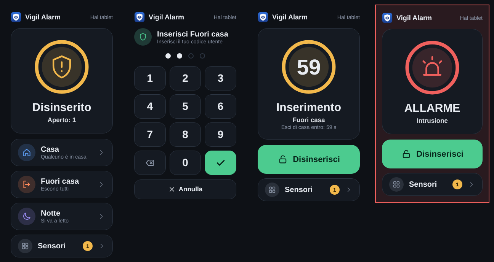
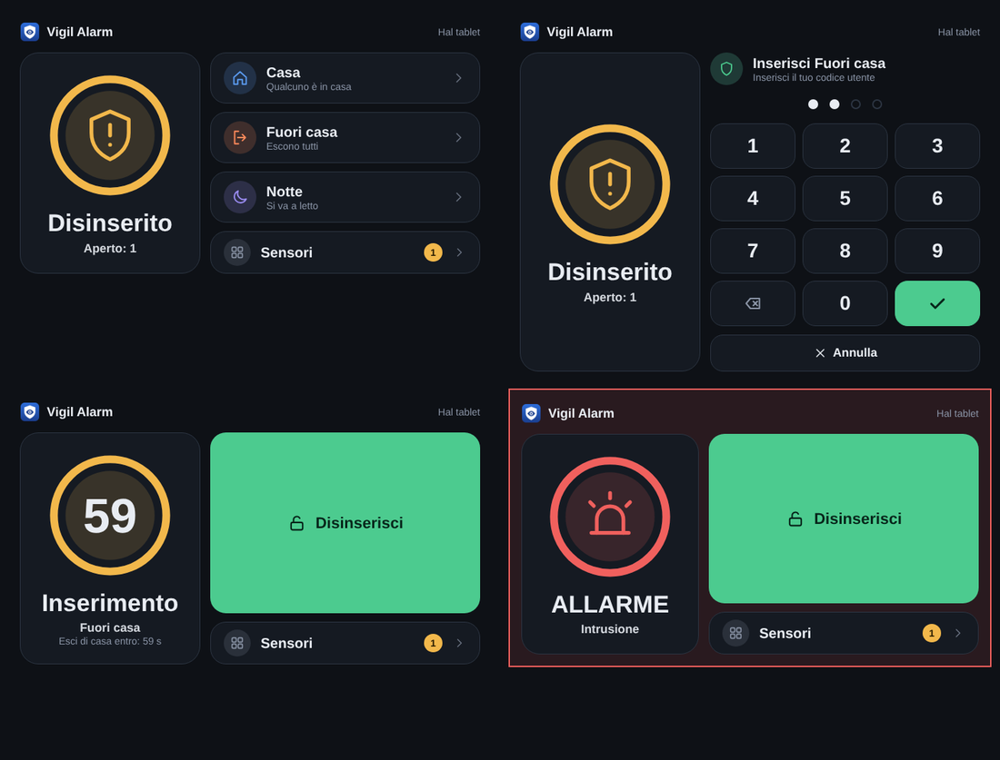

# Un tablet a parete come tastiera dell'allarme

Questa è una traduzione di [tablet.md](tablet.md), tradotta da Claude (un'IA) e non rivista da un madrelingua. Segnala gli errori aprendo una issue.

Puoi usare Vigil con un tablet che mostra una dashboard di Home Assistant, al posto della tastiera ESPHome (o accanto). Il tablet è un pannello nel registro, legato a un utente di Home Assistant, e mostra la **scheda Vigil**: lo stato, i pulsanti per le modalità che può usare, un tastierino e, dopo il codice installatore del pannello, i sensori.

## Configurarlo

1. **Crea un utente per il tablet.** In Home Assistant: *Impostazioni → Persone → Utenti → Aggiungi utente*. Usa un utente normale. Puoi scegliere invece un account amministratore (compare come *(admin)* nell'elenco), ma è una tua responsabilità: le impostazioni del pannello valgono allora per tutto ciò che quell'account fa, su ogni dispositivo in cui è connesso, e un dispositivo rubato o incustodito è connesso come amministratore. Vigil non dà a un tale account diritti di amministratore sul pannello (per disattivare ed escludere serve sempre un codice), e la via migliore è un secondo account normale per l'uso quotidiano.
2. **Registra il tablet in Vigil.** Apri *Vigil Alarm → Pannelli → Aggiungi pannello*. Dagli un nome, scegli *Tablet o telefono con Home Assistant* come tipo di dispositivo e scegli l'account in *Account Home Assistant (tablet o telefono)*. Imposta cosa può fare il tablet (modalità, disattivazione, esclusione, silenziamento, elenco dei sensori, lingua), esattamente come per un pannello ESPHome. Imposta un **codice installatore** per il pannello se il tablet deve poter mostrare i sensori.
3. **Accedi con il tablet come quell'utente** e apri una dashboard con la scheda Vigil. Nell'editor della dashboard scegli *Aggiungi scheda → Personalizzata: Vigil*, oppure in YAML:

   ```yaml
   type: custom:vigil-card
   ```

   Vigil carica la scheda da sé; non c'è nulla da installare né da aggiungere come risorsa. La scheda non ha impostazioni tranne `idle_timeout` (secondi senza tocco prima che dimentichi un codice digitato a metà, predefinito 30). Per un tablet a parete usa una vista pannello (scheda singola) o una dashboard in stile kiosk, come quella che può mostrare Fully Kiosk Browser, così la barra laterale è nascosta.
4. Usa **HTTPS** per Home Assistant. Con un semplice `http://` il codice viaggia leggibile sul tuo Wi-Fi.

## Cosa fa la scheda





Con una tastiera (un tablet che ne ha una, o un computer) puoi digitare il codice: cifre, Backspace per cancellare, Invio per confermare, Esc per chiudere il tastierino.

La scheda mostra lo stato come un anello con un'icona, del colore dello stato; durante i ritardi d'uscita e d'ingresso l'anello è il conto alla rovescia. Segue la larghezza in cui si trova: una colonna su un telefono, due colonne su un tablet. Ha lo stesso aspetto della tastiera touch.

- Segue il profilo del pannello del tablet: solo le modalità in cui quel pannello può inserire, *Disattiva* solo se può, i pulsanti di esclusione solo se può escludere, la lingua scelta per il pannello, e nessun elenco di sensori quando è impostato su *mai*.
- **Disattivare ed escludere chiedono sempre un codice utente**; inserire ne chiede uno solo se *codice richiesto per inserire* è attivo. Il tastierino non si apre mai da solo: durante il ritardo d'ingresso e un allarme lo schermo mostra prima cosa sta succedendo, e chi vuole disattivare preme *Disattiva*.
- **L'elenco dei sensori** si apre con il codice di qualsiasi utente Vigil, o il codice installatore del pannello (tramite `vigil_alarm.unlock_panel`), per il tempo impostato. Escludere e ripristinare richiedono un utente che abbia il diritto di escludere (sensori antimanomissione: il diritto aggiuntivo per l'antimanomissione). Fino ad allora la scheda mostra solo *quanti* sensori sono aperti, mai i loro nomi. Lasciare l'elenco, o 30 secondi senza tocco, fa dimenticare lo sblocco alla scheda.
- **Partizioni:** la scheda mostra *Vigil Alarm* e la partizione (o *Tutte*) che usa, anche con una sola partizione. Con più partizioni, dei chip permettono di cambiare; dopo il tempo di ritorno (*Impostazioni*, *Schermo del pannello*) torna alla partizione predefinita del pannello.
- Un utente non collegato a un pannello vede *Non collegato*; un pannello bloccato mostra *Bloccato* e non fa nulla.

## Cosa impone Vigil

- Vigil riconosce il tablet dall'**utente Home Assistant** dietro ogni chiamata. Home Assistant lo inserisce da sé, quindi non può essere imitato inviando un altro testo `source`. È più forte che per un pannello ESPHome, le cui chiamate non portano alcun utente.
- Qualunque cosa mostri la scheda, decide il server: una chiamata che il profilo non consente viene rifiutata e registrata (`panel_refused`). La scheda è solo un volto più bello sopra di esso.
- Il tablet ha un proprio timer di blocco per i codici errati e non viene mai trattato da Vigil come amministratore. *Bloccato* rifiuta tutto da quel tablet; *Revoca il blocco* e *Sblocca* funzionano come per qualsiasi pannello.
- Un telefono spento non è un guasto: per un tablet o un telefono *Controlla se questo pannello è raggiungibile* è disattivato per impostazione predefinita, quindi nessuna Riparazione e nessun messaggio. Attivalo per un tablet che resta appeso al muro tutto il giorno.
- La cronologia mostra chi l'ha fatto, per esempio *Anna (hall-tablet)*.

## Offline

La scheda saluta Vigil ogni minuto finché la dashboard è aperta. Se Vigil non ha sentito nulla da essa per 10 minuti, ricevi una Riparazione *Pannello irraggiungibile* e un messaggio sui tuoi canali dei guasti (`panel_offline`, e `panel_online` al ritorno), come per un pannello ESPHome. Lo stato dell'allarme non cambia mai per questo. L'elenco dei pannelli mostra *Scheda Vigil attiva* per un tablet che ha salutato.

- Viene sorvegliato solo un tablet la cui scheda ha salutato almeno una volta. Un tablet che mostra la scheda di allarme propria di Home Assistant non può dire nulla, quindi non viene mai segnalato.
- Vigil ricorda che un tablet usa la scheda, così uno che è spento al riavvio di Home Assistant viene comunque segnalato, dieci minuti dopo il riavvio.
- Un tablet con lo schermo spento e il browser chiuso è, per Vigil, offline. Lascia che un tablet a parete tenga aperta la dashboard.

## Cosa non fa

- Home Assistant non ha permessi per entità. L'utente del tablet può chiamare qualsiasi servizio che un utente normale possa chiamare e leggere ogni stato. Vigil protegge l'allarme (codici, profilo, blocco) e la scheda chiede solo ciò che il profilo consente, ma l'utente può comunque lasciare la dashboard. Non dare a quell'utente più di ciò che serve al tablet.
- La scheda di allarme propria di Home Assistant funziona ancora per un tablet, ma mostra tutte le modalità (una modalità che il profilo non consente viene rifiutata alla pressione) e non ha un elenco dei sensori.
- La scheda non ha una pagina info come il pannello ESPHome; per questo il tablet ha Home Assistant.
- Se il tablet viene rubato: imposta il pannello su *Bloccato* in Vigil, e disattiva l'utente in Home Assistant o elimina i suoi token di aggiornamento (*Profilo → Sicurezza*).

## Due account per l'amministratore e un lucchetto sul browser

Il punto debole di ogni dashboard è l'account che sta dietro. Un amministratore non è mai limitato da Vigil, quindi un amministratore che resta connesso su un tablet o un telefono dà a quel dispositivo ogni diritto. Tieni il tuo **account amministratore solo per amministrare**, e crea un secondo account normale per l'uso quotidiano (e per il tablet, se ne vuoi uno). Blocca il browser del tablet sulla dashboard (un browser kiosk come Fully Kiosk Browser, o la modalità kiosk di Home Assistant) così un visitatore non può uscirne.

Due cose proteggono l'allarme da un passante davanti a un tablet a parete: Vigil tratta l'account del tablet come normale, qualunque cosa sia in Home Assistant (per disattivare ed escludere serve sempre un codice), e anche **inserire** richiede un codice se attivi *Codice richiesto per inserire* nella scheda Impostazioni. Quell'impostazione vale per tutto il sistema: quando è disattivata, chiunque possa premere il pulsante può inserire.

## Un telefono o un tablet: lo stesso registro

Un tablet a parete e il telefono di un coinquilino sono trattati allo stesso modo: entrambi sono una voce nella scheda *Pannelli* legata a un account Home Assistant (il campo *Account Home Assistant (tablet o telefono)*, preferibilmente un account normale; si può scegliere anche un amministratore, con la cautela descritta sopra). Per ogni voce imposti cosa può fare (modalità, disattivazione, esclusione, silenziamento, elenco dei sensori, lingua), esattamente come per un pannello ESPHome, e l'elenco dei sensori segue ovunque le stesse regole: nascosto finché il codice installatore della voce non lo sblocca. L'unica differenza è come Vigil riconosce il dispositivo: un pannello ESPHome dal suo identificativo di pannello, un account dall'utente dietro la chiamata.

- **Qualsiasi codice valido funziona** su un tale dispositivo, e la cronologia mostra di chi era il codice, per esempio *Bob (cleo-phone)*. Nessun codice, nessuna operazione (dove serve un codice).
- **Ogni voce ha il proprio timer di blocco**: codici errati sul telefono di Cleo bloccano quel telefono (a gradini, vedi *Impostazioni*, *Blocco*), non il tablet né nessun altro.
- **Solo gli account registrati possono operare.** Appena un account è registrato, ogni altro account ordinario di Home Assistant (per esempio quello dei figli) viene rifiutato prima che venga esaminato qualsiasi codice (evento `user_refused`, l'errore *L'utente non è registrato*), e ciò non conta per un blocco. Amministratori, automazioni, script e pannelli ESPHome (chiamate senza utente Home Assistant) non sono toccati. Finché nessun account è registrato non cambia nulla, quindi un aggiornamento da una versione più vecchia non cambia nulla.
