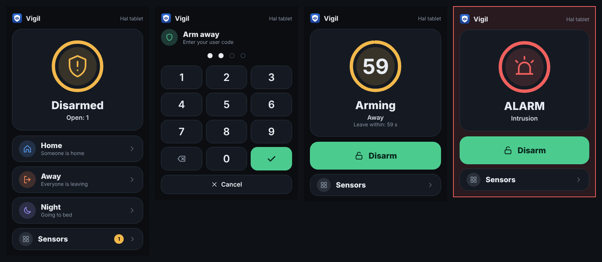
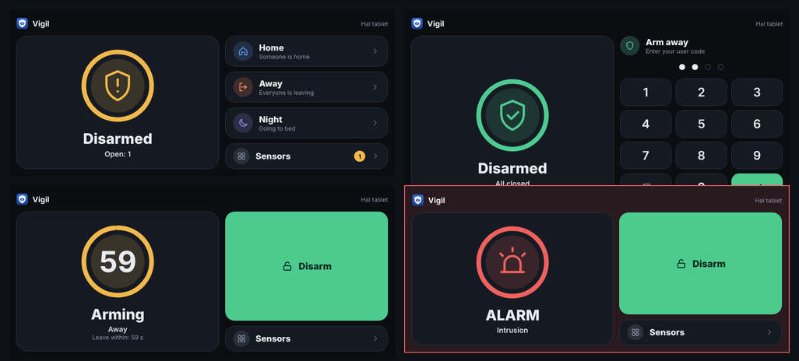

# A tablet on the wall as an alarm panel

You can operate Vigil with a tablet that shows a Home Assistant dashboard, instead of (or next to) the ESPHome panel. The tablet is a panel in the register, bound to a Home Assistant user, and it shows the **Vigil card**: the state, the buttons for the modes it may use, a keypad and, after the panel's installer code, the sensors.

## Set it up

1. **Make a user for the tablet.** In Home Assistant: *Settings → People → Users → Add user*. Use an ordinary user. You may choose an administrator account instead (it shows as *(admin)* in the list), but that is your responsibility: the settings of the panel then apply to everything that account does, on every device it is logged in on, and a stolen or unattended device is logged in as an administrator. Vigil gives such an account no administrator rights on the panel (a code is always needed to disarm and bypass), and the better way is a second, ordinary account for daily use.
2. **Register the tablet in Vigil.** Open *Vigil Alarm → Panels → Add panel*. Give it a name, choose *Tablet or phone running Home Assistant* as the kind of device, and pick the account under *Home Assistant account (tablet or phone)*. Set what the tablet may do (modes, disarm, bypass, silence, sensor list, language), exactly as for an ESPHome panel. Set an **installer code** for the panel if the tablet should be able to show the sensors.
3. **Log the tablet in as that user** and open a dashboard with the Vigil card. In the dashboard editor choose *Add card → Custom: Vigil*, or in YAML:

   ```yaml
   type: custom:vigil-card
   ```

   Vigil loads the card by itself; there is nothing to install or add as a resource. The card takes no settings except `idle_timeout` (seconds without touch before it forgets a half typed code, default 30). For a wall tablet use a panel (single card) view, or a kiosk style dashboard such as the one Fully Kiosk Browser can show, so the sidebar is hidden.
4. Use **HTTPS** for Home Assistant. On plain `http://` the code travels readable over your Wi-Fi.

## What the card does





With a keyboard (a tablet with one, or a computer) you can type the code: digits, Backspace to delete, Enter to confirm, Escape to close the keypad.

The card shows the state as a ring with an icon, in the colour of the state; during the exit and entry delay the ring is the countdown. It follows the width it is in: one column on a phone, two columns on a tablet. It uses the same look as the touch panel.

- Follows the profile of the tablet's panel: only the modes that panel may arm in, *Disarm* only if it may, bypass buttons only if it may bypass, the language you chose for the panel, and no sensor list at all when that is set to *never*.
- **Disarming and bypassing always ask a user code**; arming asks one only if *a code is required to arm* is on. The keypad never opens by itself: during the entry delay and an alarm the screen first shows what is going on, and whoever wants to disarm presses *Disarm*.
- **The sensor list** opens with the code of any Vigil user, or the installer code of the panel (through `vigil_alarm.unlock_panel`), for the time you set. Bypassing and restoring need a user who has the right to bypass (tamper sensors: the extra tamper right). Until then the card only shows *how many* sensors are open, never their names. Leaving the list, or 30 seconds without touch, forgets the unlock on the card.
- A user that is not linked to a panel sees *Not linked*; a blocked panel shows *Blocked* and does nothing.

## What Vigil enforces

- Vigil recognises the tablet by the **Home Assistant user** behind each call. Home Assistant puts that user there itself, so it cannot be imitated by sending another `source` text. This is stronger than for an ESPHome panel, whose calls carry no user.
- Whatever the card shows, the server decides: a call the profile does not allow is refused and logged (`panel_refused`). The card is only a nicer face on it.
- The tablet has its own lockout timer for wrong codes, and is never treated as an administrator by Vigil. *Blocked* refuses everything from that tablet; *Clear lock* and *Unlock* work as for any panel.
- A phone that is switched off is no fault: for a tablet or phone *Watch whether this panel is reachable* is off by default, so no Repair and no message. Switch it on for a tablet that hangs on the wall all day.
- The history shows who did it as, for example, *Anna (hall-tablet)*.

## Offline

The card says hello to Vigil every minute while the dashboard is open. If Vigil has heard nothing from it for 10 minutes you get a Repair *Panel not reachable* and a message on your fault channels (`panel_offline`, and `panel_online` when it is back), the same as for an ESPHome panel. The alarm state never changes because of it. The panel list shows *Vigil card active* for a tablet that has said hello.

- Only a tablet whose card has said hello at least once is watched. A tablet that shows Home Assistant's own alarm card cannot say anything, so it is never reported.
- Vigil remembers that a tablet uses the card, so one that is dead when Home Assistant restarts is still reported, after ten minutes from the restart.
- A tablet whose screen is off and whose browser is closed is, for Vigil, offline. Let a wall tablet keep the dashboard open.

## What it does not do

- Home Assistant has no permissions per entity. The tablet's user can call any service an ordinary user may call and can read every state. Vigil protects the alarm (codes, profile, lockout) and the card only asks for what the profile allows, but the user can still leave the dashboard. Give that user no more than the tablet needs.
- Home Assistant's own alarm card still works for a tablet, but it shows all modes (a mode the profile does not allow is refused when pressed) and has no sensor list.
- The card has no info page like the ESPHome panel; the tablet has Home Assistant for that.
- If the tablet is stolen: set the panel to *Blocked* in Vigil, and disable the user in Home Assistant or delete its refresh tokens (*Profile → Security*).

## Two accounts for the administrator, and a lock on the browser

The weak spot of every dashboard is the account behind it. An administrator is never restricted by Vigil, so an administrator who stays logged in on a tablet or phone gives that device every right. Keep your **administrator account for administering only**, and make a second, ordinary account for daily use (and for the tablet, if you want one). Lock the tablet's browser to the dashboard (a kiosk browser such as Fully Kiosk Browser, or Home Assistant's kiosk mode) so a visitor cannot leave it.

Two things protect the alarm from a passer-by at a wall tablet: Vigil treats the tablet's account as an ordinary one, whatever it is in Home Assistant (a code is always needed to disarm and bypass), and **arming** needs a code too if you turn on *Code required to arm* in the Settings tab. That setting is system-wide: when it is off, anybody who can press the button can arm.

## A phone or tablet: the same register

A tablet on the wall and a housemate's phone are treated the same way: both are an entry in the tab *Panels* that is bound to a Home Assistant account (the field *Home Assistant account (tablet or phone)*, preferably an ordinary account; an administrator may be chosen too, with the care described above). Per entry you set what it may do (modes, disarm, bypass, silence, sensor list, language), exactly as for an ESPHome panel, and the sensor list follows the same rules everywhere: hidden until the entry's installer code unlocks it. The only difference is how Vigil recognises the device: an ESPHome panel by its panel id, an account by the user behind the call.

- **Any valid code works** on such a device, and the history shows whose code it was, for example *Bob (cleo-phone)*. No code, no operation (where a code is needed).
- **Each entry has its own lockout timer**: wrong codes on Cleo's phone lock that phone (in steps, see *Settings*, *Locking*), not the tablet or anyone else.
- **Only registered accounts may operate.** As soon as one account is registered, every other ordinary Home Assistant account (for example the children's) is refused before any code is looked at (event `user_refused`, the error *User is not registered*), and that does not count towards a lockout. Administrators, automations, scripts and ESPHome panels (calls without a Home Assistant user) are not touched. As long as no account is registered nothing changes, so an update from an older version changes nothing.
