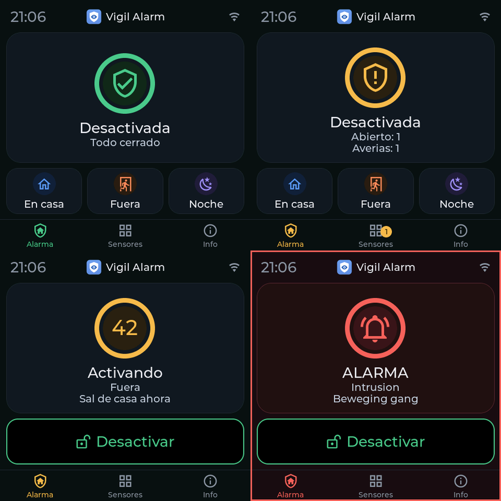
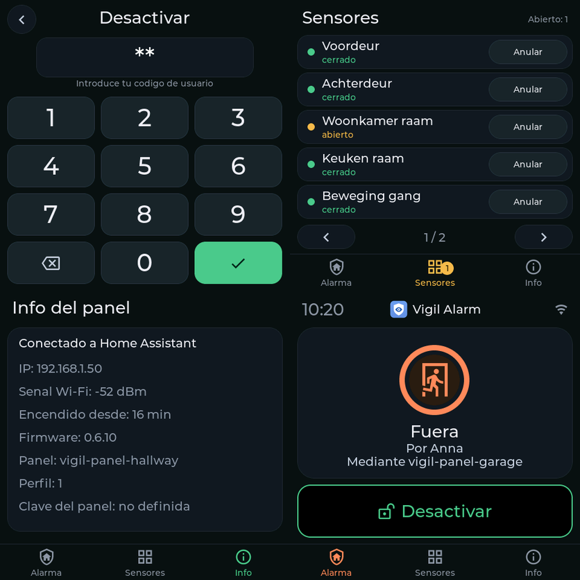
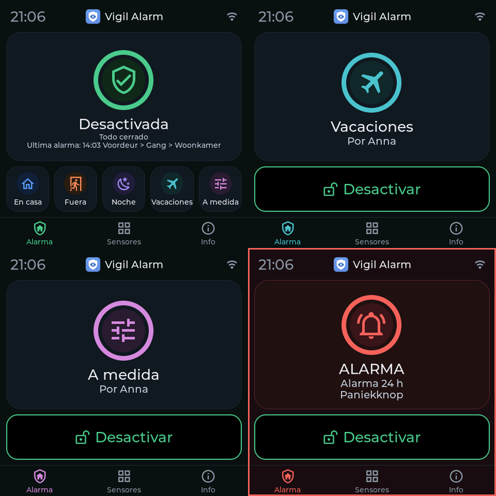

# Vigil Alarm: guía del usuario

Esta guía explica cómo configurar y usar Vigil Alarm. Para la instalación, consulta el
[README](../README.md) (en inglés). La versión original es la guía en inglés
[user-guide.md](user-guide.md); también existen versiones en
[neerlandés](user-guide.nl.md), [alemán](user-guide.de.md),
[francés](user-guide.fr.md) e [italiano](user-guide.it.md).

> Vigil Alarm no es un sistema de alarma certificado. Pruébalo con regularidad y no confíes
> en él como única protección.

> Los textos en español han sido traducidos por Claude (una IA) y no han sido revisados por un hablante nativo.
> Si encuentras una redacción torpe o incorrecta, avísanos abriendo una issue.

## Contenido

1. [Cómo encaja todo](#cómo-encaja-todo)
2. [La configuración, paso a paso](#la-configuración-paso-a-paso)
3. [Usar la alarma a diario](#usar-la-alarma-a-diario)
4. [Qué ocurre durante una alarma](#qué-ocurre-durante-una-alarma)
5. [Referencia: el panel, pestaña por pestaña](#referencia-el-panel-pestaña-por-pestaña)
6. [Automatizaciones y blueprints](#automatizaciones-y-blueprints)
7. [Activación automática](#activación-automática)
8. [Autovigilancia](#autovigilancia)
9. [Reinicios y actualizaciones](#reinicios-y-actualizaciones)
10. [Solución de problemas](#solución-de-problemas)
11. [Límites que conviene conocer](#límites-que-conviene-conocer)

## Cómo encaja todo

| Elemento | Qué es |
|---|---|
| **Alarma** | Una entidad `alarm_control_panel`. Estados: *disarmed* (apagada), *arming* (retardo de salida), *armed home / away / night / vacation / custom* (activada), *pending* (retardo de entrada) y *triggered* (disparada). |
| **Modos** | *En casa* (estás tú, se vigila el exterior), *Fuera* (nadie en casa, se vigila todo) y *Noche* (duermes, se vigila el exterior). Se pueden activar otros dos modos en *Particiones* (en el formulario de la partición): *Vacaciones* (ausencia prolongada) y *Personalizado* (una elección tuya; Home Assistant lo llama *custom bypass*). Cada modo tiene su propio retardo de salida y puede tener grupos de sensores activos, como los demás modos. Vigil no decide qué significan: tú eliges qué grupos de sensores vigilan en ellos. |
| **Sensor** | Un detector, vinculado a un `binary_sensor` (activo = abierto o alarma). Cada sensor tiene una **clase**. |
| **Grupo de sensores** | Decide **en qué modos** vigilan los sensores de intrusión que contiene. |
| **Regla de confirmación** | Opcional. Una alarma solo se produce si varios sensores distintos se disparan dentro de una ventana de tiempo. |
| **Usuario** | Una persona con un código, opcionalmente limitada a ciertos modos. |
| **Notificación** | Un servicio `notify` que recibe mensajes, opcionalmente con retraso (escalada). |
| **Sirena** | Opcional. Algo que hace ruido durante una alarma. |

### Clases de sensores

| Clase | Comportamiento |
|---|---|
| **Intrusión** | Vigila en los modos de sus grupos de sensores. Tipo *instantáneo* (alarma al momento), *retardado* (primero el retardo de entrada, para la puerta de entrada) o *seguidor* (solo se dispara si antes se abrió un sensor retardado, por ejemplo un detector de movimiento del pasillo tras la puerta de entrada). |
| **Incendio** | Vigila siempre, en todos los modos, incluso con la alarma apagada. Alarma al momento. |
| **Gas** | Vigila siempre. Elige el tipo de gas: monóxido de carbono, gas natural, GLP u otro. Con gas natural o GLP, Vigil nunca enciende el flash, por el riesgo de chispas. |
| **Sabotaje** | Vigila siempre. Un contacto de sabotaje que se abre dispara una alarma. |
| **Agua** | Vigila siempre. Una *alarma técnica*: nunca cambia el estado de la alarma, solo publica eventos y un sensor de «alarma activa». |
| **24 horas con sonido** | Vigila siempre, en cualquier estado, incluso con la alarma apagada, como un contacto de sabotaje: al abrirse suena la sirena y los canales de alarma reciben un mensaje (causa *alarma 24 h*). Para un botón de pánico o una caja fuerte. Mientras esté abierto, se rechaza la activación. |
| **24 horas silencioso** | Vigila siempre, sin sirena: una *alarma técnica* como el agua, con un mensaje a los canales *Técnico* y una línea en el registro. Para un botón de pánico silencioso o un congelador que se calienta. |

### Grupos de sensores: qué sensores vigilan en qué modo

Un grupo de sensores es una lista de modos. Un sensor de intrusión pertenece a uno o más grupos y vigila
en cada modo en el que alguno de sus grupos esté activo. Se crean dos grupos por ti:

| Grupo | Activo en | Para |
|---|---|---|
| **Perímetro** | En casa, Fuera, Noche | puertas y ventanas |
| **Interior** | Fuera | detectores de movimiento |

Así, en *En casa* solo cuentan las puertas y ventanas y puedes moverte libremente. En *Fuera* cuentan también los
detectores de movimiento. Puedes añadir grupos, por ejemplo *Sótano* solo para *Noche*.

Por eso Vigil no usa las áreas (area) de Home Assistant para esto: un área dice **dónde** está un
sensor, un grupo de sensores dice **cómo quieres usarlo**. Un contacto de puerta y un detector de movimiento en la
misma habitación van a grupos distintos.

La pestaña **Resumen** muestra «Qué vigila cada modo», para que puedas comprobar el resultado.

## La configuración, paso a paso

Abre **Vigil Alarm** en la barra lateral (solo la ven los administradores). Cada guardado recarga Vigil Alarm;
el estado de la alarma se conserva.

1. **Revisa la partición** (pestaña *Particiones*, la primera fila es tu casa): modos, retardos de salida, retardo
   de entrada predeterminado y duración de la alarma. En *Ajustes* compruebas si hace falta un código para activar.
2. **Añade tus sensores.** La forma rápida es *Sensores → Buscar sensores*: Vigil lista los sensores de puerta, ventana, movimiento, humo, gas, agua y sabotaje que Home Assistant ya conoce, con el sensor de batería y de sabotaje del mismo dispositivo. Marca los que quieras, cambia un nombre si quieres, marca *Entrada* en las puertas por las que pasas (reciben un retardo de entrada) y añádelos de una vez. No se guarda nada hasta que pulses el botón de abajo. Sin grupos de sensores, pulsa primero *Crear los grupos predeterminados* (Perímetro para puertas y ventanas, Interior para el movimiento). Para añadir uno a mano, usa *Sensores → Añadir sensor*:
   - Ponle un nombre («Puerta de entrada»). El nombre determina los nombres de las entidades (`sensor.puerta_de_entrada_status`).
   - Elige el `binary_sensor`. Para un contacto de puerta o un detector de movimiento, el panel propone solo el grupo
     de sensores correcto.
   - Elige la clase y, para intrusión, el tipo y los grupos de sensores.
   - ¿El dispositivo tiene también un contacto de sabotaje (la mayoría de los contactos de puerta Zigbee lo tienen)? Indícalo en *Entidad de sabotaje*. Vigil añade por sí mismo un sensor de sabotaje llamado «Puerta de entrada (sabotaje)»: siempre vigilando, con su propio interruptor de anulación. Sigue al sensor cuando lo renombras, lo editas o lo eliminas, y no tiene fila propia en la tabla.
   - *Si está abierto al final del retardo de salida* decide qué ocurre con una puerta aún abierta al activar: **anular con un aviso** (predeterminado; vuelve a vigilarse en cuanto se cierra), **esperar a que se cierre**, **rechazar la activación** o **iniciar el retardo de entrada**.
   - *Cuando el sensor deja de ser alcanzable*: **bloquear la activación** (predeterminado para intrusión y
     sabotaje), **solo notificar** (predeterminado para incendio, gas y agua), **disparar la alarma** o **activar
     igualmente (anular)**. Incendio y gas nunca se pueden anular.
   - Si quieres, añade un sensor de batería; Vigil te avisa cuando se está agotando.
3. **Añade un usuario** (pestaña *Usuarios*): un nombre y un código. Sin usuarios no hace falta ningún código.
   Un usuario puede limitarse a ciertos modos. Anular un sensor es un derecho que das a un usuario (*Puede anular sensores*): sin él, un usuario no puede anular ni restablecer un sensor, ni siquiera con el código correcto. Quien puede anular un sensor también puede restablecerlo. Un sensor de sabotaje exige el derecho adicional *Puede anular el sabotaje*, tanto para anular como para restablecer. Los usuarios guardados antes de que existiera este derecho lo conservan hasta que lo desmarques.
4. **Añade una notificación** (pestaña *Notificaciones*): elige un servicio `notify` o una entidad notify (por ejemplo un *grupo de notificación* creado en *Ajustes → Dispositivos y servicios → Ayudantes → Grupo*, que aparece como `notify.familia`) y los tipos de
   mensaje que debe recibir. Una entidad notify solo recibe un título y un mensaje: sin datos específicos de la app, así que sin alerta crítica en un teléfono (para eso elige un servicio `mobile_app_…`). Con un *retraso*, el canal envía los mensajes de alarma solo si la alarma sigue
   activa pasado ese retraso: es un canal de escalada para una segunda persona o un segundo dispositivo.
5. **Opcional: una regla de confirmación** (pestaña *Reglas de confirmación*): elige los sensores de intrusión instantáneos,
   cuántos deben dispararse y en qué ventana de tiempo.
6. **Opcional: una sirena** (pestaña *Sirenas*). Véase más abajo.
0. **Novedad: el asistente de configuración.** Cuando la configuración es insuficiente, la pestaña *Resumen* empieza con la tarjeta *Configurar Vigil*, y la tarjeta *¿Listo para usar?* tiene un botón *Asistente de configuración*. El asistente recorre paso a paso los modos, los sensores, el usuario (también creado a partir de una persona de Home Assistant), el canal de notificación (un teléfono con la app en un clic), la sirena y el teclado, y termina con *¿Listo para usar?*. Cada paso se puede omitir, *Continuar más tarde* cierra el asistente y la tarjeta *Reanudar el asistente* te devuelve donde estabas. El asistente usa los mismos formularios que las pestañas y no guarda nada hasta que lo confirmas.
7. **Mira *¿Listo para usar?*** en la parte superior de la pestaña *Resumen*. Nombra lo que aún falta (un usuario con código, un canal de notificación, un modo que nada vigila, sensores sin sensor de batería) y tiene un botón al lugar correcto. Si aún no tienes un canal de notificación y Home Assistant conoce tu teléfono, un botón lo añade y envía un mensaje de prueba.
8. **Prueba todo** con los botones *Probar* y activando la alarma y abriendo una puerta. Usa la
   [guía de pruebas](installation-and-testing.md) (en inglés) para un plan de pruebas completo con sensores virtuales.

### Sirenas

Una sirena tiene una entidad de encendido/apagado (`siren`, `switch` o `light`) y extras opcionales: un flash,
una entidad de selección de tono y una entidad de volumen. Por causa (intrusión, incendio, gas, sabotaje) puedes
asignar un tono y un volumen. Se ajustan justo antes de que suene la sirena y se restablecen después. La
sirena se detiene al desactivar la alarma y tras una duración máxima. Una sirena que se detiene por sí sola
puede volver a encenderse cada N segundos.

Muchas sirenas no pueden decir si están realmente encendidas. Entonces `siren_started` lleva
`verified: false`, y un comando que falla produce `siren_failed` y una notificación.

**Preajuste para la Sonoff SNZB-09P (Zigbee2MQTT):** en
*Sirena* elige el interruptor de encendido/apagado de la sirena y luego el preajuste. Vigil rellena los tonos (clásico para intrusión, advertencia para incendio,
emergencia para gas, rápido para sabotaje), el volumen, la duración, y busca las entidades de tono, volumen, flash,
batería y modo de alimentación del mismo dispositivo. Si algo no se encuentra, lo eliges
tú. Con ZHA u otra integración, elige la entidad de encendido/apagado y rellena el resto a
mano.

## Usar la alarma a diario

### Activar y desactivar

Usa la tarjeta del panel de alarma (o la tarjeta tile, o la app Companion), las acciones *arm* en una
automatización, o el [panel de control](../examples/dashboard.yaml). Introduce el código si se pide.

- **Activar** inicia el retardo de salida (estado *arming*), luego la alarma está *armed*. Sal.
- **Desactivar** siempre pide un código cuando hay usuarios. Durante el retardo de entrada (*pending*) tienes
  la duración del retardo de entrada para introducirlo.
- Un usuario puede limitarse a ciertos modos; activar otro modo se rechaza.

### Cuando se rechaza la activación

Vigil te dice por qué: *una condición de alarma está abierta* (un sensor de incendio o de sabotaje está activo), *un sensor no es
alcanzable* (un sensor de intrusión no es alcanzable y está en bloquear) o *un sensor está abierto* (un
sensor configurado en rechazar). El atributo `refuse_reason` y la notificación dicen qué sensores. Repara
el sensor, o anúlalo.

**¿Por qué no puedo activar?** La pestaña *Resumen* del panel Vigil tiene una tarjeta con este nombre mientras algo
impida la activación: por sensor qué falla y en qué modos, con los botones *Mostrar* y *Anular* (un sensor de incendio o
gas no se puede anular: elimina primero la causa). En el teclado táctil y en la tarjeta Vigil, una activación rechazada
dice qué la impide (*No se puede activar: el sabotaje de la puerta de entrada está abierto*) y, si el teclado puede anular, muestra un único
botón, **Anular y activar**, que pide un código, luego anula lo que bloquea y activa. Exige los mismos
derechos que la anulación manual (el derecho de anular y, para un sensor de sabotaje, el derecho de anular el sabotaje), y nunca es posible para un sensor de incendio o gas. En tus propias automatizaciones, lo mismo es
la acción `vigil_alarm.arm` con `bypass_open: true`.

### Anular un sensor

La anulación deja un sensor aparte hasta que se desactive la alarma (o hasta que la deshagas).

**Anulación permanente.** Marca *Mantener la anulación tras desactivar (permanente)* en un sensor (no disponible para sensores de incendio y gas) y una anulación manual de ese sensor permanece tras desactivar la alarma, incluso tras reiniciar Home Assistant, hasta que alguien la restablezca a mano. Útil para un sensor que lleva tiempo averiado. El sensor sigue en la lista como *anulado*, la pestaña *Resumen* tiene una tarjeta **Anulados permanentemente** con un botón *Restablecer*, y la tarjeta Vigil y el teclado táctil muestran *Anulado: ventana rota* bajo *Apagada*, para que no se olvide; el registro tiene `sensor_bypassed` al principio y `sensor_unbypassed` (motivo *manual*) al final. Sin la casilla no cambia nada: la anulación termina al desactivar.

- En el panel y en el panel de control: el interruptor **Anular** del sensor (solo administradores).
- Mediante acción: `vigil_alarm.bypass` y `vigil_alarm.unbypass` con la entidad del sensor y, para quienes no son
  administradores, un código. Este código solo hace falta si la activación también lo pide (el ajuste
  *código necesario para activar*). Los sensores de sabotaje solo pueden ser anulados por administradores y por usuarios
  que tengan ese derecho.
- Los sensores de incendio y gas nunca se pueden anular.

### Un teclado táctil



El teclado y la tarjeta Vigil comparten el mismo aspecto. El estado es un **anillo con un icono** del color del estado: verde cuando la alarma está apagada y todo está cerrado, ámbar cuando algo está abierto o durante la activación, naranja durante el retardo de entrada, azul, coral, violeta, turquesa y rosa para en casa, fuera, noche, vacaciones y personalizado, rojo para una alarma (con un marco rojo alrededor de la pantalla), gris sin conexión. Durante los retardos de salida y de entrada el anillo es la **cuenta atrás**: los segundos en el centro, el anillo vaciándose hasta cero; a cero la alarma está activa. Bajo el anillo ves los botones de los modos que este teclado puede usar, o un botón grande *Desactivar* cuando la alarma está activa. Abajo están las pestañas *Alarma*, *Sensores* (con el número de sensores abiertos) e *Info*; el teclado numérico no tiene pestañas.



Con *Vacaciones* y *Personalizado* activados hay hasta cinco botones de modo en una fila (el texto se hace más pequeño), y *Apagada* muestra la última alarma bajo el estado:




Con el teclado ESPHome (Guition 4848) activas, desactivas y anulas sensores sin teléfono. Lee
su perfil de Vigil: solo muestra los modos en los que el teclado puede activar, pide un código como lo hace Vigil y usa el idioma que le hayas configurado.
La instalación y las opciones están en [esphome/README.md](../esphome/README.md). El nombre del dispositivo es el identificador del teclado y la `source` de cada llamada, que aparece en el historial como *Anna (vigil-panel-garage)*. Un código
incorrecto produce el evento `code_rejected`, nunca con el propio código. El bloqueo es escalonado y los valores se ajustan en *Ajustes*, *Bloqueo*. Predeterminado: tras 3 códigos incorrectos este teclado se bloquea 5 minutos, luego tras 2 códigos incorrectos más 15 minutos, luego tras 2 más 60 minutos, y tras 1 código incorrecto más de forma definitiva (eventos `code_locked` y `code_locked_permanent`, también enviados a tus canales de notificación de averías). Un bloqueo permanente solo desaparece con *Levantar el bloqueo* en el panel, y entonces todo empieza de nuevo en el primer escalón. Un código correcto también pone a cero el contador y el escalón. El bloqueo se mantiene cuando Home Assistant se reinicia; el temporizador compartido para todo lo que no sea un teclado registrado (*other*) nunca bloquea de forma definitiva, porque nadie podría levantarlo, sino que repite la última espera; un administrador en la interfaz siempre puede usar la alarma. Cada teclado registrado (véase abajo) tiene su propio temporizador; todo lo demás (un teléfono, una automatización, cualquier otro nombre) comparte uno.

#### Teclados, tabletas y teléfonos

La pestaña *Paneles* es el registro de todo lo que puede usar la alarma fuera de la interfaz de Home Assistant: los teclados ESPHome (reconocidos por su identificador de teclado) y las tabletas o teléfonos (reconocidos por su cuenta de Home Assistant). Todos se configuran de la misma manera. En cuanto hay una cuenta registrada, las demás cuentas ordinarias se rechazan antes de que se examine su código (evento `user_refused`); los administradores, las automatizaciones y los teclados ESPHome no se ven afectados. Los detalles, y el consejo de dar a un administrador una segunda cuenta ordinaria para el uso diario, están en la [guía de la tableta](tablet.md).

#### Registrar un teclado (pestaña *Paneles*)

Un teclado o una tableta que registras en la pestaña *Paneles* se trata como un terminal pasivo: Vigil decide qué puede hacer. Le das un nombre y un **identificador de teclado**, que es el nombre del dispositivo ESPHome y también la `source` que llevan sus llamadas. Por teclado ajustas:

Al añadir un teclado eliges primero el **tipo de dispositivo**. *Teclado ESPHome* pide el nombre del dispositivo ESPHome (el identificador del teclado). *Tableta o teléfono con Home Assistant* solo pide la cuenta de Home Assistant; Vigil crea por sí mismo el identificador del teclado a partir del nombre. Todo lo demás (modos, desactivación, anulación, idioma, lista de sensores, código de instalador) es igual para ambos. El idioma empieza con el de la persona que añade el teclado, inglés si no es ni neerlandés ni inglés.

- los modos en los que puede activar, y si puede desactivar, anular sensores, y silenciar o confirmar;
- el idioma (predeterminado: el de Home Assistant);
- si puede mostrar la lista de sensores: *siempre*, *solo tras desbloquear* (predeterminado) o *nunca*, y cuánto tiempo permanece desbloqueado (predeterminado 60 segundos);
- un **código de instalador** opcional para este teclado, guardado como hash, con su propio temporizador de códigos incorrectos. El teclado lo envía con `vigil_alarm.unlock_panel`; Vigil lo comprueba y desbloquea el teclado durante el tiempo ajustado. Abre las páginas de información y (como el código de cualquier usuario de Vigil) la lista de sensores, y nunca desactiva la alarma: desactivar siempre exige un código de usuario válido;
- lo que el firmware **informa** de sí mismo (su hardware, la versión del firmware y la versión del perfil) se muestra en la tarjeta del teclado, y *¿Listo para usar?* da un consejo cuando el firmware no entiende el perfil;
- **vigilar si es alcanzable** (*Vigilar si este teclado es alcanzable*): activado por defecto para un teclado ESPHome, desactivado por defecto para una tableta o un teléfono, porque un teléfono apagado no es una avería. Desactivado, no tienes Reparación ni mensaje cuando el teclado desaparece, y la lista dice *No vigilado*. Las entradas creadas antes de este ajuste siguen activadas;
- **bloqueado**: Vigil rechaza toda llamada con este identificador de teclado y lo registra.

Lo que se impone en el servidor: una llamada de un teclado registrado que su perfil no permite se rechaza y se registra (evento `panel_refused`, con el motivo). Anular un sensor desde un teclado registrado siempre exige un código de usuario. Un teclado bloqueado se rechaza antes de que se examine ningún código. Las llamadas con una source no registrada no están limitadas por nada de esto. **La clave del teclado.** La `source` de una llamada es texto simple y por sí sola no prueba nada: cualquiera que pueda llamar a una acción de Home Assistant podría escribir en ella el nombre de un teclado. Da a un teclado ESPHome una **clave** (el botón de la llave en *Paneles*): Vigil la muestra una vez y guarda solo una huella, tú la pones en el `secrets.yaml` del teclado y el teclado la envía en cada llamada. A partir de entonces, una llamada en nombre de ese teclado sin la clave correcta se rechaza y se registra (`panel_refused`, motivo `key`), la haga quien la haga. Esto protege frente a alguien con una cuenta normal de Home Assistant o un script que no conoce la clave; no protege frente a quien pueda leer tu configuración de ESPHome o tenga derechos de administrador. Las llamadas que no nombran ningún teclado, los demás teclados y las tabletas (reconocidas por su usuario de Home Assistant) no se ven afectados. Un teclado sin clave funciona como antes, y *¿Listo para usar?* aconseja crear una. Una clave nueva sustituye a la anterior de inmediato: vuelve a instalar el teclado con ella. Usa también el cifrado de la API de ESPHome, para que la clave no viaje en claro.

Cada teclado registrado recibe una entidad `sensor.<panel_id>_profile` (los guiones del identificador pasan a guiones bajos, así que `vigil-panel-garage` da `sensor.vigil_panel_garage_profile`) con lo que puede hacer y mostrar. Los nombres de los sensores solo aparecen mientras el teclado está desbloqueado (o la lista está en *siempre*), y los atributos que los contienen se mantienen fuera del historial. Nunca contiene códigos, hashes, claves ni contraseñas. **Sé honesto sobre lo que protege:** `source` es texto simple, así que Vigil no puede demostrar que una llamada venga realmente de ese teclado. El perfil protege contra errores y contra un teclado que no debería tener ciertos botones, no contra alguien que ya puede llamar a servicios. La protección real son el código, el bloqueo, la conexión cifrada del teclado y las reglas de acceso de Home Assistant mismo.

Dos botones por teclado, **Desbloquear** y **Levantar el bloqueo**, solo existen en el panel Vigil (solo administradores) y no como acciones de Home Assistant: una acción puede ser llamada por cualquier usuario, automatización o teclado, de modo que un teclado robado podría desbloquearse a sí mismo. *Desbloquear* muestra la lista de sensores durante el tiempo ajustado; *Levantar el bloqueo* quita el bloqueo registrado tras códigos incorrectos (sobrevive a un reinicio, así que así es como lo quitas). Ambos se registran con el administrador que lo hizo (`panel_unlocked`, `panel_lock_cleared`).

**Fuera de alcance.** Si Vigil no puede alcanzar el dispositivo ESPHome de un teclado durante 10 minutos, recibes una Reparación *Teclado no alcanzable* y un mensaje en tus canales de averías (eventos `panel_offline` y `panel_online`). Un teclado fuera de alcance nunca cambia el estado de la alarma. Un teclado bloqueado, y uno para el que *vigilar* está desactivado, no producen Reparaciones. Tras reiniciar Home Assistant, los diez minutos vuelven a empezar.

También se puede registrar una tableta, vinculada a un usuario de Home Assistant, que muestra la tarjeta Vigil (`type: custom:vigil-card`); véase la [guía de la tableta](tablet.md).

El firmware ESPHome lee este perfil por sí mismo. Un teclado que no está en el registro muestra *No vinculado* con el identificador de teclado que espera; un teclado bloqueado muestra *Bloqueado*. La lista de sensores y la página de información del teclado (dirección IP, señal, firmware, tiempo de funcionamiento) se abren con un código: la lista de sensores con el código de cualquier usuario de Vigil (o el código de instalador), la página de información solo con el código de instalador del teclado; mientras no esté desbloqueado, el teclado solo muestra el número de sensores abiertos. Las restricciones las impone además Vigil para cada llamada con la `source` del teclado, haga lo que haga el firmware.

### Silenciar y confirmar

- `vigil_alarm.silence` detiene las sirenas mientras la alarma sigue activa.
- `vigil_alarm.acknowledge` cancela los mensajes de escalada pendientes: ya lo has visto.

Ambos exigen un código de usuario, o un administrador en la interfaz.

## Qué ocurre durante una alarma

Un ejemplo con la alarma activada en *Fuera* y la puerta de entrada (un sensor retardado) que se abre:

| Momento | Qué ocurre |
|---|---|
| La puerta se abre | Estado *pending*. Evento `pending_started`. Notificación «Retardo de entrada iniciado». |
| Durante el retardo de entrada | Desactiva con un código: sin alarma. |
| El retardo de entrada termina | Estado *triggered*, causa *intrusión*. Evento `triggered`. Salen las notificaciones, suenan las sirenas, se activa «Alarma de intrusión». |
| Tras el retraso de un canal de escalada | Si la alarma sigue activa y sin confirmar, ese canal envía su mensaje. |
| Desactivación, o fin de la duración de la alarma | Las sirenas se detienen, `trigger_ended`, el estado vuelve a *disarmed* o *armed*. |

Un sensor instantáneo se salta el retardo de entrada. Incendio, gas y sabotaje disparan al momento, en cualquier estado. Una
causa más grave sustituye a una menos grave (`trigger_cause_changed`): el orden es incendio,
luego gas, sabotaje, fallo de sensor e intrusión.

Con una **regla de confirmación**, un solo disparo de uno de sus sensores no provoca una alarma. Publica
`sensor_unconfirmed` (y una notificación si has elegido que te avisen). Cuando el número requerido
de sensores distintos se dispara dentro de la ventana, la alarma se dispara con `confirmed_by`
en el evento.

## Referencia: el panel, pestaña por pestaña

Las acciones en las listas son botones con icono (editar, copiar, eliminar, probar); pasa el ratón para ver el nombre. Las reglas y los usuarios no tienen botón de copiar. Algunos campos tienen un ⓘ: haz clic para una explicación más completa.

| Pestaña | Qué haces ahí |
|---|---|
| **Resumen** | la tarjeta *Alarma* con el logo de Vigil y, con más de una partición, una baldosa de color por partición (verde apagada, azul activada, ámbar cuenta atrás, rojo alarma), la tarjeta *Practicar y probar* (*Iniciar el modo de práctica* e *Iniciar la ronda de prueba*, véase *Modo de práctica y ronda de prueba* más abajo), la tarjeta *Configurar Vigil* (el asistente, mientras falte algo), la tarjeta *Nuevos sensores encontrados* (sensores aparecidos en Home Assistant desde la última comprobación de Vigil; *Revisar y añadir* abre la lista con solo los nuevos, *Ahora no* deja de anunciarlos; nunca se añade nada por sí solo, y la pestaña *Sensores* muestra una insignia), *¿Listo para usar?* (lo que aún falta), la tarjeta *Autotest* (última comprobación, última prueba de sirena, próxima prueba, *Probar la sirena ahora*), la tarjeta *Heartbeat* (último éxito, *Probar ahora*), una tarjeta *Panel de control* con un botón que copia un panel de control con tus propios identificadores de entidad, el estado de la alarma, los puntos de atención (baterías bajas, dispositivos no alcanzables), qué vigila cada modo y el estado en vivo de cada sensor. |
| **Particiones** | Una fila por partición, incluida la primera (tu casa): nombre, modos, retardos de salida, retardo de entrada predeterminado, duración de la alarma y dispositivo de timbre, y debajo *Qué vigila cada modo*, una tarjeta por partición y una para los sensores siempre activos. Con más de una partición, las pestañas siguientes (*Grupos de sensores*, *Sensores*, *Reglas de confirmación*) tienen una tabla por partición. Una partición que aún tiene sensores o grupos de sensores no se puede eliminar. |
| **Sensores** | *Buscar sensores* propone sensores de Home Assistant; añadir, editar, copiar y eliminar sensores. Bajo cada nombre, una frase dice cómo reacciona el sensor y cuándo vigila. La tabla muestra el nivel de batería en su propia columna. Una entidad solo puede pertenecer a un sensor. El campo *Entidad de sabotaje* vincula la señal de sabotaje del mismo dispositivo: Vigil crea un sensor de sabotaje aparte que puede anularse por separado. También puedes crear un sensor de sabotaje independiente. |
| **Grupos de sensores** | Qué sensores vigilan en qué modos. Un grupo puede *proponerse a sí mismo* para los nuevos contactos de puerta o detectores de movimiento. Un grupo que aún se usa no se puede eliminar. |
| **Reglas de confirmación** | Varios sensores deben dispararse dentro de una ventana de tiempo. Un sensor que está en una regla no se puede eliminar. |
| **Usuarios** | (No se puede copiar.) Nombre, código, modos permitidos, derecho de anular, derecho de anular el sabotaje. Los códigos se guardan con hash y nunca se muestran. Deja el código vacío al editar para conservarlo. |
| **Notificaciones** | Servicio `notify`, tipos de mensaje (alarma, retardo de entrada, activación y desactivación, averías y avisos, alarmas técnicas), retraso, alta prioridad. *Probar* envía un mensaje de prueba. |
| **Sirenas** | Véase arriba. *Probar* hace sonar la sirena 3 segundos (se rechaza durante una alarma real). |
| **Registro** | Todo lo que Vigil publica como evento, el más reciente primero (se muestran los 200 más recientes). La columna *Usuario* dice quién lo hizo y *Vía* dónde (teclado o dispositivo); activada en un teclado sin código se lee *desconocido (sin código)*. *Descargar* da todo el registro en JSON Lines o CSV (RFC 4180), con horas en UTC (RFC 3339) y los campos `time`, `event`, `partition`, `source`, `user`, `item`, `result` y `detail`. Conserva 90 días por defecto (*Ajustes*), no contiene códigos y sobrevive a los reinicios. |
| **Copia de seguridad** | Las últimas 10 versiones de tu configuración (se conserva una en cada cambio, con lo que cambió), *Restaurar* para cada una (primero muestra qué cambiaría, y la propia restauración se puede deshacer del mismo modo), y *Exportar la configuración* e *Importar la configuración…* como archivo. Véase *Copias de seguridad, exportación e importación* más abajo. |
| **Ajustes** | Lo que vale para todo el sistema: cuánto esperar a los sensores lentos tras reiniciar Home Assistant (segundos, predeterminado 120), la pantalla de los teclados (segundos antes de que se apague la pantalla, predeterminado 30, si también puede apagarse durante una alarma, predeterminado no, y el tiempo antes de volver a la partición predeterminada, predeterminado 30 segundos, 0 = nunca), umbral de batería, código necesario para activar, longitud mínima del código (de 4 a 12 caracteres, predeterminado 4; vale para códigos nuevos y modificados, los códigos existentes siguen funcionando), días de conservación del registro (predeterminado 90), y el autotest: intervalo del recordatorio (predeterminado 30 días, 0 = desactivado), segundos que suena la sirena (de 1 a 5, predeterminado 2), sonido automático y las horas en que puede hacerlo, y la dirección del heartbeat y su intervalo en minutos (predeterminado 5). |
| **Acerca de** | Una insignia de «novedad» tras una actualización, la versión, enlaces a la guía del usuario y a GitHub, las notas de la versión (las más recientes primero) y un botón que copia los detalles para un informe de error. |

Vigil habla **inglés, neerlandés, alemán, francés, italiano y español**; cualquier otro idioma muestra inglés. El
idioma de los **textos de notificación** sigue el idioma del sistema de Home Assistant (Ajustes → Sistema → General).
El panel de administración y la tarjeta Vigil siguen el idioma de tu propio perfil. Un teclado táctil o una tableta tiene el idioma que
eliges para él en *Paneles* (un teclado nuevo empieza con el idioma de tu cuenta). Las traducciones al alemán,
francés, italiano y español las ha escrito Claude (una IA) y no las ha revisado un hablante nativo: avisa de
un texto torpe o incorrecto como issue. Un teclado táctil (ESPHome) necesita el firmware 0.5.6 para hablar los nuevos idiomas;
un firmware más antiguo muestra inglés para ellos.

## Modo de práctica y ronda de prueba

El **modo de práctica** te permite hacer funcionar la alarma de verdad sin asustar a los vecinos. En el Resumen: *Iniciar el modo de práctica* (solo con la alarma apagada). La alarma funciona entonces como siempre: cuenta atrás, el retardo de entrada transcurre, se dispara y los teclados (también la tarjeta Vigil y la pantalla táctil) lo muestran. Pero **no suena ninguna sirena** y **no sale ningún mensaje**, ni siquiera un mensaje de avería. Todo está en el registro con `practice` en los detalles. El teclado muestra una píldora *Modo de práctica* arriba, la tarjeta Vigil una línea, y la entidad de alarma tiene el atributo `practice`. El modo de práctica termina **en la primera desactivación** (una vuelta), a los 30 minutos, o con *Terminar el modo de práctica*, de modo que un modo de práctica olvidado nunca pueda mantener en silencio una alarma real. Tras reiniciar Home Assistant está desactivado. **Si el modo de práctica expira mientras la alarma está activada,** la alarma sigue activada y a partir de ahí funciona de verdad: un allanamiento hace sonar la sirena y envía mensajes. Si la alarma está sonando en ese momento, la sirena y los mensajes arrancan entonces.

La **ronda de prueba** comprueba que cada sensor reacciona. Con la alarma apagada: *Iniciar la ronda de prueba* (en el Resumen o en *Sensores*), recorre puertas, ventanas y detectores de movimiento y míralos marcarse en directo. Solo participan los **sensores de intrusión**: no hacen nada con la alarma apagada. Los sensores de incendio, gas, agua y sabotaje siempre están activos y dispararían una alarma real; pruébalos con su propio botón de prueba. Un sensor que no reacciona no detiene la ronda: al final una lista dice qué se ha pasado por alto (*no reaccionó* o *no es alcanzable*). La ronda termina cuando se han visto todos los sensores, con *Terminar la ronda*, a los 15 minutos, o en cuanto actives la alarma. El registro tiene `walktest_started` y `walktest_finished`.

## Memoria de alarma, falsas alarmas, código de coacción y timbre

**Memoria de alarma.** Desde que empieza un retardo de entrada hasta que se desactiva la alarma, Vigil anota **cada sensor que se abre**, con la hora y la habitación (el área que le diste al sensor en Home Assistant). Esto incluye sensores que no cuentan en el modo activado (un detector de movimiento que solo vigila en *Fuera*, mientras estás activado en *En casa*) y sensores anulados: para el recorrido de un intruso por la casa, todos dicen algo. Un sensor que parpadea es un paso con un contador. La pestaña *Resumen* tiene la tarjeta **Última alarma**: cuándo, la causa, el primer sensor, si se desactivó (y quién) o se canceló, y los pasos en orden, con, para cada paso, si contó para la alarma. Un sensor que contó aparece en el registro como `sensor_faulted`; uno que no contó tiene su propia línea `alarm_sensor_seen`. La tarjeta Vigil muestra *Última alarma: 14:03 Puerta de entrada → Pasillo → Salón* mientras la alarma está apagada (tras el código, cuando la lista de sensores está oculta). La entidad de alarma tiene el atributo `last_alarm` con lo mismo abreviado (los últimos 8 pasos).

La memoria permanece tras un reinicio, hasta que alguien la borra o la siguiente alarma la sustituye. **Borrarla no exige código**: *Borrar la memoria de alarma* en la tarjeta del panel Vigil (pestaña Resumen), el servicio `vigil_alarm.clear_alarm_memory`, o una automatización. No se puede borrar mientras hay una alarma en curso. Un retardo de entrada que termina a tiempo con una desactivación no es una alarma y no deja nada. El teclado táctil aún no la muestra (haría falta un firmware nuevo).

**Falsas alarmas: la ventana de cancelación.** Quien introduzca un código válido en los **60 segundos posteriores al disparo de la sirena** (un ajuste en *Ajustes → Modos y retardos*; 0 lo desactiva) ha causado una falsa alarma: la sirena se detiene como en cualquier desactivación, la memoria de alarma dice *cancelada*, y un mensaje *Alarma cancelada: falsa alarma de Anna* sale hacia los canales de alarma que ya sabían de la alarma. Evento `alarm_cancelled`. Solo vale para alarmas de intrusión; incendio, gas y sabotaje nunca son falsas alarmas.

**Código de coacción.** Edita un usuario y rellena *Código de coacción (opcional)*: un segundo código para cuando alguien te obligue a desactivar la alarma. Debe ser distinto de cualquier otro código, y Vigil solo lo acepta si existe al menos un canal de notificación con el tipo de mensaje **Coacción**. Introducirlo funciona exactamente como el código normal: la alarma se desactiva, la sirena permanece en silencio, **no se ve nada** en el teclado, la tarjeta ni la entidad de evento. Mientras tanto, los canales con *Coacción* reciben *ALARMA SILENCIOSA: Anna usó el código de coacción a las …* (con alta prioridad si el canal tiene una). La línea `duress_used` solo está en el registro. También funciona para activar y para las demás acciones, y nunca cuenta como alarma cancelada. Elige un código que puedas teclear sin pensar, y no lo escribas donde buscaría un intruso.

**Timbre.** Marca *Timbre* en un sensor: cuando se abre **mientras la alarma está apagada**, suena un sonido corto. En *Particiones* (en el formulario de la partición) eliges qué produce el sonido (una sirena, un interruptor, una luz, un botón o un script), y en *Ajustes → Timbre* durante cuánto tiempo. No hay alarma, ni mensaje, ni nada en el registro; con la alarma activada no ocurre nada. El evento `chime` está en la entidad de evento, así que una automatización puede hacer más (por ejemplo un mensaje en un altavoz) aunque no elijas ninguna entidad. Un contacto que parpadea suena una vez cada 3 segundos.

## Particiones: la casa y el garaje

Por defecto Vigil tiene una sola alarma. En **Particiones** puedes añadir más, para un garaje, un taller o una casa de invitados. Cada partición tiene su propio estado (activada o no), sus propios modos y retardos, y su propia entidad de alarma.

- **La primera partición** es la alarma que ya tenías. Es la primera fila en *Particiones*, donde la renombras y cambias sus modos y retardos; *Ajustes* solo contiene lo que vale para todo el sistema. Las demás particiones tienen sus propios *Modos y retardos* en su formulario (una partición puede tener menos modos que la casa; un sensor entonces solo vigila en los modos que tiene la partición).
- **Un sensor pertenece a una partición** (campo *Partición*). Los sensores de incendio, gas, agua y 24 horas no tienen partición: vigilan en todas. El contacto de sabotaje de un sensor (la entrada de sabotaje que rellenas con el sensor) vigila en la partición de ese sensor, de modo que un teclado del garaje solo muestra y anula el sabotaje del garaje. Un sensor de sabotaje que añades tú (clase *sabotaje*) también tiene una elección *Partición*, con *Todas las particiones* por defecto. Su alarma es una alarma para toda la casa; desactivarla en cualquier partición que esté en alarma la termina en todas partes.
- **La entidad *Todas*** aparece cuando hay más de una partición. Su estado es el estado más alto de una partición; cuando difieren, el atributo `status` dice `mixed`, y la tarjeta dice *Mixto*. Activar *Todas* activa cada partición o ninguna: si una se rechaza (una puerta abierta, un modo que no tiene), no se activa nada.
- **Quién puede qué:** un usuario, un teclado, una sirena y un canal de notificación siempre tienen una elección *Particiones* (en el formulario, justo encima de los modos). Es obligatoria: marca las particiones, o *Todas las particiones*. Los modos que puedes marcar debajo son los de las particiones elegidas. Un código solo funciona para las particiones de su usuario. Las alarmas de seguridad (incendio, gas, agua, sabotaje, 24 horas) suenan en cada sirena, sean cuales sean sus particiones. Las notificaciones reciben el nombre de la partición cuando hay más de una.
- **Partición predeterminada de un teclado:** un teclado tiene una *Partición predeterminada* obligatoria (una de sus particiones, o *Todas*). Es la que el teclado usa tras el arranque y tras el retardo *Volver a la partición predeterminada* (*Ajustes*, *Pantalla del teclado*, predeterminado 30 segundos, 0 = nunca).
- **Servicios:** `vigil_alarm.arm` y `vigil_alarm.disarm` aceptan `partition` (el identificador, o `all`). Sin él actúan sobre la primera partición.
- Una partición que aún tiene sensores o grupos de sensores no se puede eliminar; muévelos primero.
- **Los grupos de sensores pertenecen a una partición.** Con más de una partición, la pestaña *Grupos de sensores* tiene una tabla por partición. Un grupo solo ofrece los modos de su partición, y un sensor solo puede usar los grupos de su propia partición. Una partición nueva empieza sin grupos: usa *Crear los grupos predeterminados* en su tabla. Las reglas de confirmación también se listan por partición (todos los sensores de una regla deben estar en una partición).
- **El registro** tiene una columna *Partición*; un evento de incendio, gas, agua o 24 horas no la tiene (vale para toda la casa).
- **Los teclados táctiles y la tarjeta de la tableta** siempre muestran qué partición (o *Todas*) usan, incluso cuando solo hay una, con *Vigil Alarm* y el logo. Un teclado que puede usar varias particiones tiene una fila de botones para cambiar (y un botón arriba en la página *Sensores* que elige de qué partición se listan los sensores); *Todas* activa o desactiva cada partición. Tras el retardo de retorno sin tocar, vuelve a su partición predeterminada, pero no mientras la lista de sensores está abierta. El servicio `vigil_alarm.select_partition` hace el mismo cambio desde una automatización.

## Automatizaciones y blueprints

Todo lo que vaya más allá de notificaciones y sirenas lo automatizas tú. Vigil publica la entidad de evento
`event.<name>_alarm_events`; el [README](../README.md#for-automations) lista todos los eventos
y sus datos.

Los [blueprints](../README.md#blueprints) incluidos cubren los casos habituales:

- **Hacer parpadear las luces durante una alarma** guarda el estado de tus luces, las hace parpadear mientras la alarma
  está disparada y las restablece después, también cuando se desactiva la alarma. Elige qué
  causas hacen parpadear (el gas está desactivado por defecto). El valor predeterminado de 2 segundos encendido y 2 segundos apagado queda
  muy por debajo de la frecuencia que importa a las personas fotosensibles. Para Hue usa una habitación o una zona
  (grupo) en lugar de lámparas sueltas; los grupos están desactivados por defecto en Home Assistant, así que actívalos
  primero.
- **Anunciar por voz los eventos de alarma** dice un mensaje cuando la alarma se activa, se desactiva, inicia
  el retardo de entrada o se dispara. Deja un mensaje vacío para permanecer en silencio en ese evento.
- **Ejecutar tus propias acciones en los eventos de alarma** es el bloque general: elige eventos y añade
  cualquier acción, con `event_type` y `data` disponibles.
- **Recordar al llegar a una casa activada** envía un mensaje cuando alguien llega mientras la
  alarma está activada. No desactiva.

### Activación automática

**Activar cuando todos se han ido** y **Activar a una hora fija** activan la alarma por ti. Nunca
desactivan: desactivar siempre exige a una persona con un código.

Activar exige un código, salvo que *Código necesario para activar* esté desactivado en el panel. Tienes dos
opciones:

1. Desactiva *Código necesario para activar*. Entonces cualquiera que pueda llegar a la entidad de alarma puede activarla
   (desactivar siempre exige un código). Es la opción más simple y no lleva secretos.
2. Mantén la exigencia de código y pon un código en el blueprint. Este código se guarda **en texto plano**
   en la automatización. Crea para ello un usuario Vigil aparte, limitado al único modo que usa la
   automatización, y nunca uses tu propio código.

Si se rechaza la activación (por ejemplo porque una puerta está abierta), puedes recibir un mensaje que dice
por qué. Si dejas vacío el campo del mensaje, no se envía nada.

## Autovigilancia

Las averías reales (un sensor no alcanzable, una batería baja, una sirena no disponible o con batería) aparecen también en *Ajustes → Sistema → Reparaciones* y desaparecen solas una vez resueltas. Los ajustes que faltan no son reparaciones; *¿Listo para usar?* los muestra.

- **Batería:** dale a un sensor o a una sirena un sensor de batería. Vigil informa `battery_low` cuando el
  nivel baja al umbral (predeterminado 20 %, un ajuste) y `battery_ok` cuando vuelve a subir.
- **Sensores:** un sensor no alcanzable se trata según su ajuste *cuando no es alcanzable*, y se informa
  con `supervision_lost` y `supervision_restored`.
- **Sirenas:** Vigil informa cuando una sirena deja de estar disponible y, con una entidad de modo de alimentación,
  cuando funciona con batería (el valor que significa «con batería» es un ajuste, predeterminado
  `battery`; comprueba qué informa tu dispositivo). Añade el contacto de sabotaje de una sirena como sensor de sabotaje.
- Los problemas que existen al arrancar se listan en el atributo `problems` de la alarma sin evento; siguen eventos ante cambios. El resumen los muestra bajo *Atención*.

### Autotest

Nadie prueba una sirena cada semana, así que Vigil se encarga de recordarlo. Funciona solo y no espera nada de ti hasta el momento de una prueba real.

- **Comprobación silenciosa, diaria.** Vigil comprueba que los servicios de notificación que has configurado siguen existiendo y que las sirenas son alcanzables. No hace ningún ruido. Solo un canal de notificación desaparecido (por ejemplo tras cambiar de teléfono) produce un mensaje y una Reparación; una sirena no alcanzable ya se informa como avería por la vigilancia de arriba.
- **Prueba de sirena, mensual.** Por defecto cada 30 días (un ajuste; 0 lo desactiva), Vigil envía un recordatorio a los canales que reciben *averías y avisos*. En un teléfono con la app de Home Assistant el mensaje tiene un botón **Probar la sirena**; un toque hace sonar la sirena 2 segundos. También puedes usar *Probar la sirena ahora* en la pestaña Resumen o llamar a `vigil_alarm.test_siren`.
- **Si no reaccionas,** sigue un segundo recordatorio a los 3 días. Pasados 7 días más, una Reparación dice que la prueba está atrasada. Hacer una prueba, de cualquiera de las tres formas, la borra.
- **Dejar que Vigil haga sonar la sirena por sí mismo** está desactivado por defecto. Si lo activas, Vigil hace sonar la sirena cuando toca la prueba, pero solo entre las horas que fijes (predeterminado de 9 a 20 h), para no despertar a nadie.
- La prueba se rechaza durante una alarma real, y no es una alarma: no se envía nada a los canales de alarma.
- La tarjeta *Autotest* de la pestaña Resumen muestra la última comprobación silenciosa, la última prueba de sirena y cuándo toca la próxima. Los eventos de autotest (`selftest_checked`, `selftest_reminder`, `selftest_siren_tested`) se escriben en el registro pero no cuentan como último evento de la alarma.

### Heartbeat

Una sirena y una notificación solo sirven si el propio Home Assistant funciona. El heartbeat cubre el otro caso: si Home Assistant, el ordenador en el que corre o tu conexión a internet se detiene, nada en la casa puede avisarte. Entonces Vigil llama a una dirección web a intervalos fijos, y un servicio de vigilancia **externo** a tu casa da la alarma cuando cesan las llamadas.

- Vigil no está atado a ningún servicio. En *Ajustes* introduces una **dirección de heartbeat** y los **minutos entre heartbeats** (predeterminado 5). Sirve cualquier servicio que espere una llamada regular e informe cuando falta. Deja vacía la dirección para desactivarlo.
- La llamada se hace siempre, también con la alarma apagada, porque la pregunta que responde es «¿Sigue funcionando Vigil?».
- La llamada no lleva nada sobre tu alarma: ni estado, ni nombres, ni códigos. Es una simple petición GET.
- La dirección es un secreto, porque los servicios suelen poner en ella la clave. Vigil la mantiene fuera del registro, de las Reparaciones y de los diagnósticos descargados, y el panel solo la muestra a un administrador en la pestaña Ajustes.
- La tarjeta *Heartbeat* de la pestaña Resumen muestra el intervalo, el último éxito y el último fallo, y tiene un botón *Probar ahora*. Tras tres fallos seguidos aparece una Reparación, que desaparece cuando el heartbeat vuelve a funcionar.

**Ejemplo paso a paso con Healthchecks.io** (hay un plan gratuito, o puedes alojarlo tú mismo):

1. Crea un check. Ajusta su *periodo* algo por encima de tu intervalo, por ejemplo 5 minutos, y un *periodo de gracia* de 5 a 10 minutos, para que una sola llamada perdida no dispare un mensaje.
2. En *Integrations* enlaza el lugar al que debe ir el mensaje (correo electrónico, o una app en tu teléfono).
3. Copia la *URL de ping* del check. Es una dirección `https://` que termina en un identificador largo.
4. Pégala en Vigil Alarm en *Ajustes → Dirección de heartbeat* y guarda.
5. Haz clic en *Probar ahora* en el Resumen. El check se pone en verde en pocos segundos.
6. Para demostrar que funciona, detén Home Assistant durante más que el periodo más el periodo de gracia. Deberías recibir un mensaje del servicio.

Otros servicios funcionan igual: necesitas una dirección que espere una llamada, un periodo y una forma de que te avisen cuando falta.

## Reinicios y actualizaciones

### Copias de seguridad, exportación e importación

Cada vez que cambia tu configuración (una edición en el panel, una importación, una restauración), Vigil conserva la
configuración tal como estaba justo antes, con un resumen de lo que cambió (*Sensores: 3 añadidos,
Usuarios: 1 modificado*). Se conservan las últimas 10 versiones (el número es un ajuste, de 1 a 50, en *Ajustes* → *Copia de seguridad*; bajarlo elimina enseguida las versiones más antiguas); la pestaña **Copia de seguridad** las lista. *Restaurar* muestra qué
cambiaría y pone de nuevo esa versión. Restaurar también es un cambio, así que puedes deshacerlo con la
versión que crea. Tras guardar en el panel, el mensaje *Guardado* tiene un enlace *Deshacer* que restaura la
versión inmediatamente anterior. El icono de ojo (*Ver*) en una versión abre una ventana con el cambio en sí (qué elementos se añadieron, modificaron o eliminaron, y qué ajustes). El icono de flecha (*Restaurar*) pone de nuevo la versión. La columna *Versión de Vigil* dice qué versión de Vigil creó cada versión. Una **actualización de Vigil** que modifica tu configuración almacenada (una migración) conserva también la configuración anterior, bajo *Actualización de Vigil*. Una versión creada por una *versión de almacenamiento* más antigua se puede consultar pero no restaurar (haría falta una migración, y la lista lo dice); las creadas tras la actualización sí. Solo se conserva la configuración, no el estado de la alarma (activada, anulada).

*Exportar la configuración* descarga toda la configuración como archivo; *Importar la configuración…* lee un archivo así,
muestra qué cambiaría y sustituye la configuración cuando confirmas (la configuración actual
se conserva antes como versión). El archivo no contiene códigos, pero sí los códigos con hash, la dirección del heartbeat
y los nombres de tus servicios de notificación, así que guárdalo en un lugar seguro. Un archivo solo se acepta del
mismo formato de almacenamiento (el archivo dice cuál); impórtalo en la misma versión de Vigil de la que procede.
Los sensores, usuarios y teclados conservan su identificador en el archivo, así que importar en la instalación de la que procede conserva
las entidades; en otra instalación las entidades se crean de nuevo.

- El estado de la alarma y los temporizadores en curso se guardan. Tras un reinicio la alarma está en el mismo estado;
  un retardo de entrada que expiró durante el reinicio se convierte en alarma, con la hora correcta.
- Durante los primeros 10 segundos tras arrancar Home Assistant, los estados de los sensores aún no son fiables, de modo que
  los sensores aún no cargados no causan falsas averías. La activación durante ese tiempo se rechaza con
  «arranque en curso».
- Actualizar Vigil Alarm mediante HACS requiere reiniciar Home Assistant. Tu configuración se
  migra automáticamente.

## Solución de problemas

Véase también **[Mi alarma no hace lo que espero](troubleshooting.md)** (en inglés).

| Problema | Qué hacer |
|---|---|
| **No hay «Vigil» en la barra lateral** | Solo lo ven los administradores. Recarga el navegador forzando, reinicia Home Assistant y busca en el registro líneas con `vigil`. |
| **El panel queda vacío o dice que no se pudo cargar** | La integración no se está ejecutando: mira en Ajustes → Dispositivos y servicios si hay un error. Recarga el navegador. |
| **Se rechaza la activación** | Lee el motivo en la notificación o en el atributo `refuse_reason` y comprueba los sensores indicados. |
| **Un sensor se informa como no alcanzable** | Comprueba el dispositivo. Durante un tiempo corto puedes poner *cuando no es alcanzable* en *activar igualmente (anular)*. |
| **No llega ninguna notificación** | Usa *Probar* en la notificación. Comprueba que el servicio `notify` existe y que el tipo de mensaje está marcado. |
| **La sirena no suena** | Usa *Probar* en la sirena. Comprueba la entidad de encendido/apagado y las causas de *Sonar para* de la sirena. Algunas sirenas se detienen solas tras su propia duración; véase *repetir cada*. |
| **Una automatización no reacciona** | Dispara sobre la entidad de evento (no sobre el estado de la alarma) y comprueba `event_type` en la traza de la automatización. |
| **Un blueprint no puede activar** | Activar exige un código. Véase [Activación automática](#activación-automática). |

Para un informe de error, indica lo que hiciste, lo que esperabas, lo que ocurrió y las líneas del registro
con `vigil` (Ajustes → Sistema → Registros). Para más detalle, añade a `configuration.yaml`:

```yaml
logger:
  logs:
    custom_components.vigil_alarm: debug
```

## Límites que conviene conocer

- Vigil Alarm **no está certificado** para ningún estándar de alarma, detección de incendios o seguros.
- Funciona dentro de Home Assistant. Si Home Assistant está detenido o se reinicia, no hay alarma.
- Todo lo configuran los administradores de Home Assistant, en el panel. No hay otra
  forma de cambiar sensores y usuarios; es intencionado.
- Las **etiquetas (tags)** pueden registrarse en un usuario pero **no tienen ninguna función**. Usa la alarma
  con un código.
- Tu propio código solo protege la entidad de alarma. Cualquier persona administradora de Home Assistant
  puede cambiar la configuración.
- Prueba con regularidad, incluida una alarma real y tu ruta de notificación, y cambia las baterías
  cuando Vigil te lo diga.
