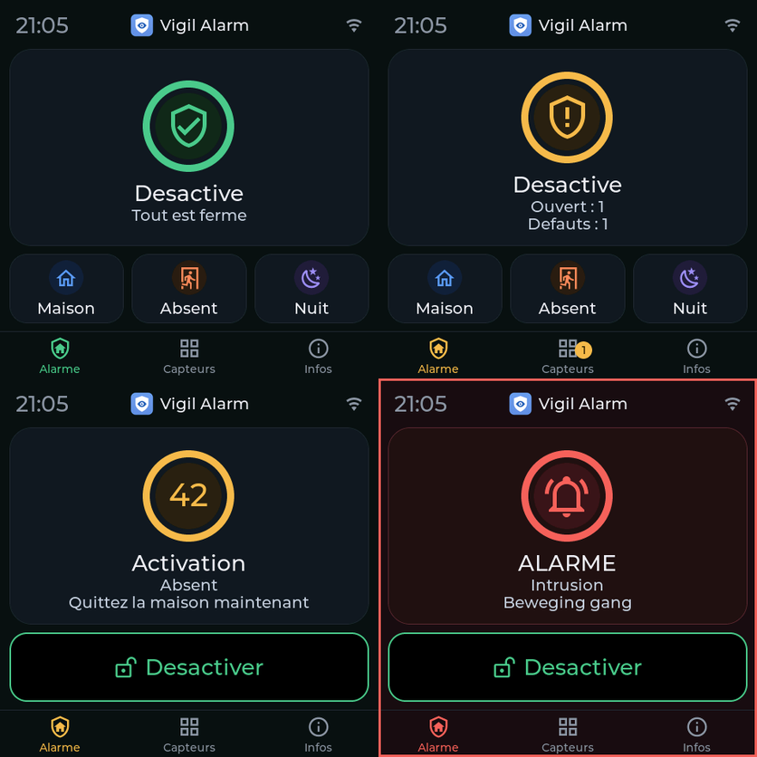
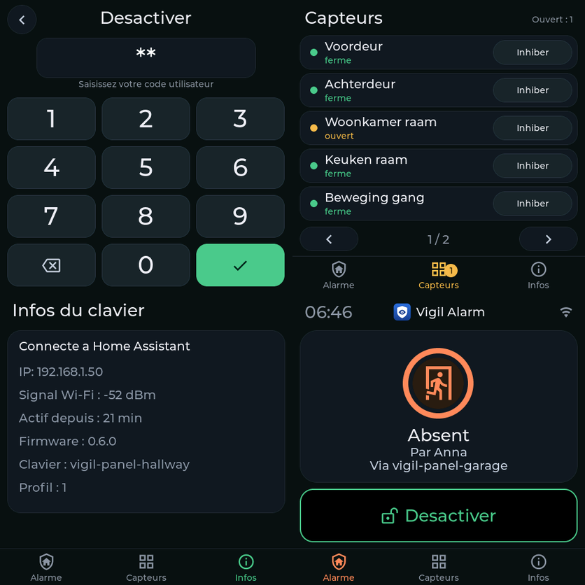
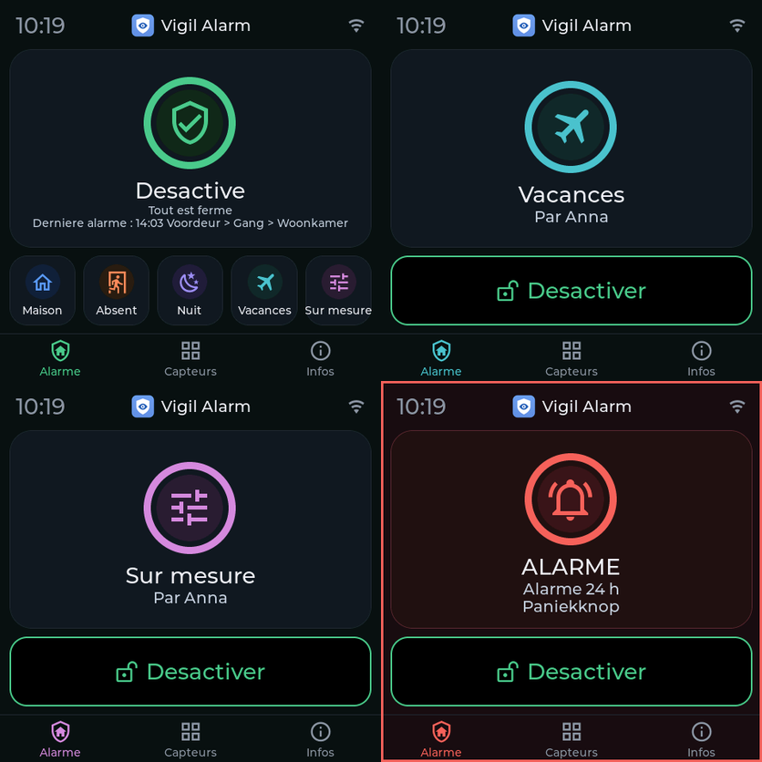

# Vigil Alarm : guide de l'utilisateur

Ce guide explique comment configurer et utiliser Vigil Alarm. Pour l'installation, voir le
[README](../README.md) (en anglais). La version d'origine est le guide anglais
[user-guide.md](user-guide.md) ; il existe aussi des versions en
[néerlandais](user-guide.nl.md), [allemand](user-guide.de.md),
[italien](user-guide.it.md) et [espagnol](user-guide.es.md).

> Vigil Alarm n'est pas un système d'alarme certifié. Testez-le régulièrement et ne vous y fiez pas
> comme unique protection.

> Les textes français ont été traduits par Claude (une IA) et n'ont pas été relus par un locuteur natif.
> Merci de signaler une formulation maladroite ou erronée sous forme d'issue.

## Sommaire

1. [Comment tout s'articule](#comment-tout-sarticule)
2. [La configuration, pas à pas](#la-configuration-pas-à-pas)
3. [Utiliser l'alarme au quotidien](#utiliser-lalarme-au-quotidien)
4. [Ce qui se passe pendant une alarme](#ce-qui-se-passe-pendant-une-alarme)
5. [Référence : le panneau, onglet par onglet](#référence--le-panneau-onglet-par-onglet)
6. [Automatisations et blueprints](#automatisations-et-blueprints)
7. [Activation automatique](#activation-automatique)
8. [Autosurveillance](#autosurveillance)
9. [Redémarrages et mises à jour](#redémarrages-et-mises-à-jour)
10. [Dépannage](#dépannage)
11. [Limites à connaître](#limites-à-connaître)

## Comment tout s'articule

| Élément | Ce que c'est |
|---|---|
| **Alarme** | Une entité `alarm_control_panel`. États : *disarmed* (désactivée), *arming* (temporisation de sortie), *armed home / away / night / vacation / custom* (activée), *pending* (temporisation d'entrée) et *triggered* (déclenchée). |
| **Modes** | *Maison* (vous êtes là, l'extérieur est surveillé), *Absent* (personne à la maison, tout est surveillé) et *Nuit* (vous dormez, l'extérieur est surveillé). Deux autres modes peuvent être activés sous *Partitions* (dans le formulaire de la partition) : *Vacances* (absence prolongée) et *Personnalisé* (votre propre choix ; Home Assistant l'appelle *custom bypass*). Chaque mode a sa propre temporisation de sortie, et des groupes de capteurs peuvent y être actifs comme dans les autres modes. Vigil ne décide pas de ce qu'ils signifient : vous choisissez quels groupes de capteurs y surveillent. |
| **Capteur** | Un détecteur, relié à un `binary_sensor` (actif = ouvert ou alarme). Chaque capteur a une **classe**. |
| **Groupe de capteurs** | Décide **dans quels modes** les capteurs d'intrusion qu'il contient surveillent. |
| **Règle de confirmation** | Facultative. Une alarme ne suit que si plusieurs capteurs différents se déclenchent dans une fenêtre de temps. |
| **Utilisateur** | Une personne avec un code, éventuellement limitée à certains modes. |
| **Notification** | Un service `notify` qui reçoit des messages, éventuellement différés (escalade). |
| **Sirène** | Facultative. Quelque chose qui fait du bruit pendant une alarme. |

### Classes de capteurs

| Classe | Comportement |
|---|---|
| **Intrusion** | Surveille dans les modes de ses groupes de capteurs. Type *instantané* (alarme aussitôt), *temporisé* (temporisation d'entrée d'abord, pour la porte d'entrée) ou *suiveur* (ne déclenche que si un capteur temporisé a été ouvert avant, par exemple un détecteur de mouvement du couloir derrière la porte d'entrée). |
| **Incendie** | Surveille toujours, dans tous les modes, même alarme désactivée. Alarme aussitôt. |
| **Gaz** | Surveille toujours. Choisissez le type de gaz : monoxyde de carbone, gaz naturel, GPL ou autre. Avec le gaz naturel ou le GPL, Vigil n'allume jamais le feu flash, à cause du risque d'étincelles. |
| **Autoprotection** | Surveille toujours. Un contact d'autoprotection qui s'ouvre déclenche une alarme. |
| **Eau** | Surveille toujours. Une *alarme technique* : elle ne change jamais l'état de l'alarme, elle publie seulement des événements et un capteur « alarme active ». |
| **24 heures sonore** | Surveille toujours, dans tous les états, même alarme désactivée, comme un contact d'autoprotection : quand il s'ouvre, la sirène retentit et les canaux d'alarme reçoivent un message (cause *alarme 24 h*). Pour un bouton panique ou un coffre. Tant qu'il est ouvert, l'activation est refusée. |
| **24 heures silencieuse** | Surveille toujours, sans sirène : une *alarme technique* comme l'eau, avec un message aux canaux *Technique* et une ligne dans le journal. Pour un bouton panique silencieux, ou pour un nombre : choisissez un capteur avec un nombre (température, tension, puissance, courant) et réglez une limite basse et/ou haute et une durée. Une valeur hors des limites plus longtemps que cette durée est un capteur ouvert ; de retour dans les limites, c'est fermé tout de suite. Exemples : congélateur au-dessus de -15 pendant 30 minutes, réfrigérateur au-dessus de 8, un terrarium ou aquarium hors de sa plage, une pièce où la climatisation s'est arrêtée, tension du secteur sous 180 pendant une minute. Une valeur qui n'est pas un nombre (`unavailable`) suit le choix fait pour les capteurs indisponibles. |

### Groupes de capteurs : quels capteurs surveillent dans quel mode

Un groupe de capteurs est une liste de modes. Un capteur d'intrusion appartient à un ou plusieurs groupes et surveille
dans chaque mode où l'un de ses groupes est actif. Deux groupes sont créés pour vous :

| Groupe | Actif en | Pour |
|---|---|---|
| **Périmètre** | Maison, Absent, Nuit | portes et fenêtres |
| **Intérieur** | Absent | détecteurs de mouvement |

Ainsi, en *Maison*, seules les portes et les fenêtres comptent, et vous pouvez circuler librement. En *Absent*, les
détecteurs de mouvement comptent aussi. Vous pouvez ajouter des groupes, par exemple *Cave* pour *Nuit* seulement.

C'est aussi pourquoi Vigil n'utilise pas les zones (areas) de Home Assistant pour cela : une zone dit **où** se trouve un
capteur, un groupe de capteurs dit **comment vous voulez l'utiliser**. Un contact de porte et un détecteur de mouvement dans la
même pièce vont dans des groupes différents.

L'onglet **Aperçu** montre « Ce que chaque mode surveille », pour que vous puissiez vérifier le résultat.

## La configuration, pas à pas

Ouvrez **Vigil Alarm** dans la barre latérale (seuls les administrateurs la voient). Chaque enregistrement recharge Vigil Alarm ;
l'état de l'alarme est conservé.

1. **Vérifiez la partition** (onglet *Partitions*, la première ligne est votre maison) : modes, temporisations de sortie, temporisation
   d'entrée par défaut et durée d'alarme. Sous *Paramètres*, vous vérifiez si un code est nécessaire pour activer.
2. **Ajoutez vos capteurs.** Le moyen rapide est *Capteurs → Trouver des capteurs* : Vigil liste les capteurs de porte, de fenêtre, de mouvement, de fumée, de chaleur, de gaz, d'eau, de sécurité et d'autoprotection que Home Assistant connaît déjà, avec le capteur de batterie et d'autoprotection du même appareil. Au départ rien n'est coché et les capteurs déjà ajoutés ne sont pas affichés. Cochez ceux que vous voulez, changez un nom si vous le souhaitez, cochez *Entrée* pour les portes que vous franchissez (elles reçoivent une temporisation d'entrée) et ajoutez-les d'un coup. Dans la colonne *Groupes de capteurs* vous cochez d'autres groupes par capteur, ou vous utilisez *Définir le groupe pour les cochés…* pour plusieurs à la fois. Un capteur que vous ne voulez plus voir (par exemple une pièce Hue qui apparaît comme second capteur de mouvement) se masque avec *Ignorer* ; *Afficher N ignoré(s)* le rétablit. Rien n'est enregistré avant que vous n'appuyiez sur le bouton en bas. Sans groupes de capteurs, appuyez d'abord sur *Créer les groupes par défaut* (Périmètre pour les portes et fenêtres, Intérieur pour le mouvement). Pour en ajouter un à la main, utilisez *Capteurs → Ajouter un capteur* :
   - Donnez-lui un nom (« Porte d'entrée »). Le nom détermine les noms d'entités (`sensor.porte_d_entree_status`).
   - Choisissez le `binary_sensor`. Pour un contact de porte ou un détecteur de mouvement, le panneau propose lui-même le bon
     groupe de capteurs.
   - Choisissez la classe et, pour l'intrusion, le type et les groupes de capteurs.
   - L'appareil a-t-il aussi un contact d'autoprotection (la plupart des contacts de porte Zigbee en ont un) ? Indiquez-le sous *Entité d'autoprotection*. Vigil ajoute de lui-même un capteur d'autoprotection nommé « Porte d'entrée (autoprotection) » : toujours en surveillance, avec son propre indicateur *Inhibé*. Il suit le capteur quand vous le renommez, le modifiez ou le supprimez, et n'a pas de ligne propre dans le tableau.
   - *Si ouvert à la fin de la temporisation de sortie* décide de ce qui arrive à une porte encore ouverte au moment de l'activation : **neutraliser avec un avis** (par défaut ; elle est de nouveau surveillée dès qu'elle se ferme), **attendre la fermeture**, **refuser l'activation** ou **démarrer la temporisation d'entrée**.
   - *Quand le capteur devient injoignable* : **bloquer l'activation** (par défaut pour l'intrusion et
     l'autoprotection), **notifier seulement** (par défaut pour l'incendie, le gaz et l'eau), **déclencher l'alarme** ou **activer
     quand même (neutraliser)**. L'incendie et le gaz ne peuvent jamais être neutralisés.
   - Ajoutez éventuellement un capteur de batterie ; Vigil vous avertit alors quand elle faiblit.
3. **Ajoutez un utilisateur** (onglet *Utilisateurs*) : un nom et un code. Sans aucun utilisateur, aucun code n'est nécessaire.
   Un utilisateur peut être limité à certains modes. Neutraliser un capteur est un droit que vous donnez à un utilisateur (*Peut neutraliser les capteurs*) : sans lui, un utilisateur ne peut ni neutraliser ni rétablir un capteur, même avec le bon code. Qui peut neutraliser un capteur peut aussi le rétablir. Un capteur d'autoprotection demande le droit supplémentaire *Peut neutraliser l'autoprotection*, pour neutraliser comme pour rétablir. Les utilisateurs enregistrés avant l'existence de ce droit le gardent jusqu'à ce que vous le décochiez.
4. **Ajoutez une notification** (onglet *Notifications*) : choisissez un ou plusieurs services `notify` (cochez-en plusieurs quand plusieurs personnes doivent recevoir le même message ; les groupes notify ne sont pas proposés, ils ne peuvent pas envoyer avec une priorité élevée) et les types de
   messages qu'elle doit recevoir. Une alerte critique sur un téléphone ne fonctionne qu'avec un service `mobile_app_…`. Avec un *délai*, le canal n'envoie les messages d'alarme que si l'alarme est
   encore active après ce délai : c'est un canal d'escalade pour une deuxième personne ou un deuxième appareil.
5. **Facultatif : une règle de confirmation** (onglet *Règles de confirmation*) : choisissez les capteurs d'intrusion instantanés,
   combien doivent se déclencher et dans quelle fenêtre de temps.
6. **Facultatif : une sirène** (onglet *Sirènes*). Voir ci-dessous.
0. **Nouveau : l'assistant de configuration.** Quand la configuration est insuffisante, l'onglet *Aperçu* commence par la carte *Configurer Vigil*, et la carte *Prêt à l'emploi ?* a un bouton *Assistant de configuration*. L'assistant passe pas à pas par les modes, les capteurs, l'utilisateur (aussi créé à partir d'une personne Home Assistant), le canal de notification (un téléphone avec l'application en un clic), la sirène et le clavier, et se termine par *Prêt à l'emploi ?*. Chaque étape peut être ignorée, *Continuer plus tard* ferme l'assistant et la carte *Reprendre l'assistant* vous ramène là où vous en étiez. L'assistant utilise les mêmes formulaires que les onglets et n'enregistre rien avant votre confirmation.
7. **Regardez *Prêt à l'emploi ?*** en haut de l'onglet *Aperçu*. Il nomme ce qui manque encore (un utilisateur avec un code, un canal de notification, un mode que rien ne surveille, des capteurs sans capteur de batterie) et a un bouton vers le bon endroit. Si vous n'avez pas encore de canal de notification et que Home Assistant connaît votre téléphone, un bouton l'ajoute et envoie un message de test.
8. **Testez tout** avec les boutons *Test* et en activant l'alarme puis en ouvrant une porte. Utilisez le
   [guide de test](installation-and-testing.md) (en anglais) pour un plan de test complet avec des capteurs virtuels.

### Sirènes

Une sirène a une entité marche/arrêt (`siren`, `switch` ou `light`) et des extras facultatifs : un feu flash,
une entité de choix de tonalité et une entité de volume. Par cause (intrusion, incendie, gaz, autoprotection), vous pouvez
donner une tonalité et un volume. Ils sont réglés juste avant que la sirène ne retentisse et rétablis ensuite. La
sirène s'arrête quand l'alarme est désactivée et après une durée maximale. Une sirène qui s'arrête d'elle-même
peut être rallumée toutes les N secondes.

Beaucoup de sirènes ne peuvent pas indiquer si elles sont réellement allumées. Alors `siren_started` a
`verified: false`, et une commande qui échoue donne `siren_failed` et une notification.

**Préréglage pour le détecteur de fumée frient SMSZB-120 (Zigbee2MQTT) :** choisissez sous *Sirène* l'interrupteur *Alarm*, puis le préréglage. Vigil renseigne la durée (240 secondes, après quoi l'appareil s'arrête de lui-même) et trouve le capteur de batterie. L'appareil n'a ni tonalité, ni volume, ni feu clignotant à régler. Son interrupteur ne dit pas s'il est vraiment allumé : un test indique donc *commande envoyée, la sirène ne confirme pas* ; ajoutez le capteur de fumée à part comme capteur de type *Incendie*.

**Préréglage pour la Sonoff SNZB-09P (Zigbee2MQTT) :** choisissez sous
*Sirène* l'interrupteur marche/arrêt de la sirène, puis le préréglage. Vigil remplit les tonalités (classique pour l'intrusion, avertissement pour l'incendie,
urgence pour le gaz, rapide pour l'autoprotection), le volume, la durée, et cherche les entités de tonalité, de volume, de feu flash,
de batterie et de mode d'alimentation du même appareil. Si quelque chose n'est pas trouvé, vous le choisissez
vous-même. Avec ZHA ou une autre intégration, choisissez l'entité marche/arrêt et remplissez le reste à
la main.

## Utiliser l'alarme au quotidien

### Activer et désactiver

Utilisez la carte du panneau d'alarme (ou la carte tuile, ou l'application Companion), les actions *arm* dans une
automatisation, ou le [tableau de bord](../examples/dashboard.yaml). Saisissez votre code si nécessaire.

- **Activer** lance la temporisation de sortie (état *arming*), puis l'alarme est *armed*. Sortez.
- **Désactiver** demande toujours un code quand il y a des utilisateurs. Pendant la temporisation d'entrée (*pending*), vous avez
  la durée de la temporisation d'entrée pour le saisir.
- Un utilisateur peut être limité à certains modes ; activer un autre mode est refusé.

### Quand l'activation est refusée

Vigil vous dit pourquoi : *une condition d'alarme est ouverte* (un capteur d'incendie ou d'autoprotection est actif), *un capteur est
injoignable* (un capteur d'intrusion est injoignable et réglé sur bloquer) ou *un capteur est ouvert* (un
capteur réglé sur refuser). L'attribut `refuse_reason` et la notification disent quels capteurs. Réparez
le capteur, ou neutralisez-le.

**Pourquoi ne puis-je pas activer ?** L'onglet *Aperçu* du panneau Vigil a une carte de ce nom tant que quelque chose
empêche l'activation : par capteur ce qui ne va pas et dans quels modes, avec les boutons *Afficher* et *Neutraliser* (un capteur d'incendie ou de
gaz ne peut pas être neutralisé : supprimez d'abord la cause). Sur le clavier tactile et dans la carte Vigil, une activation refusée
dit ce qui l'empêche (*Activation impossible : l'autoprotection de la porte d'entrée est ouverte*) et, si le clavier peut neutraliser, affiche un seul
bouton, **Neutraliser et activer**, qui demande un code, puis neutralise ce qui bloque et active. Il demande les mêmes
droits que la neutralisation manuelle (le droit de neutraliser et, pour un capteur d'autoprotection, le droit de neutraliser l'autoprotection), et il n'est jamais possible pour un capteur d'incendie ou de gaz. Dans vos propres automatisations, la même chose est
l'action `vigil_alarm.arm` avec `bypass_open: true`.

### Neutraliser un capteur

La neutralisation laisse un capteur de côté jusqu'à la désactivation de l'alarme (ou jusqu'à ce que vous l'annuliez).

**Neutralisation permanente.** Cochez *Garder la neutralisation après la désactivation (permanente)* sur un capteur (indisponible pour les capteurs d'incendie et de gaz) et une neutralisation manuelle de ce capteur reste après la désactivation de l'alarme, même après un redémarrage de Home Assistant, jusqu'à ce que quelqu'un la rétablisse à la main. Pratique pour un capteur en panne depuis un moment. Le capteur reste dans la liste comme *neutralisé*, l'onglet *Aperçu* a une carte **Neutralisés en permanence** avec un bouton *Rétablir*, et la carte Vigil et le clavier tactile affichent *Neutralisé : fenêtre cassée* sous *Désactivée*, pour que cela ne soit pas oublié ; le journal a `sensor_bypassed` au début et `sensor_unbypassed` (raison *manuel*) à la fin. Sans la case, rien ne change : la neutralisation prend fin à la désactivation.

- Dans le panneau Vigil : le bouton **Neutraliser** du capteur (administrateurs seulement). Dans la carte Vigil et sur le clavier tactile, de même, avec un code. L'entité `binary_sensor.<capteur>_bypassed` l'indique (lecture seule ; il n'y a pas d'interrupteur).
- Par action : `vigil_alarm.bypass` et `vigil_alarm.unbypass` avec l'entité du capteur et, pour les personnes qui ne sont pas
  administrateurs, un code. Ce code n'est nécessaire que si l'activation en demande un aussi (le paramètre
  *code requis pour activer*). Les capteurs d'autoprotection ne peuvent être neutralisés que par les administrateurs et par les utilisateurs
  qui ont ce droit.
- Les capteurs d'incendie et de gaz ne peuvent jamais être neutralisés.

### Un clavier tactile



Le clavier et la carte Vigil partagent le même aspect. L'état est un **anneau avec une icône** de la couleur de l'état : vert quand l'alarme est désactivée et que tout est fermé, ambre quand quelque chose est ouvert ou pendant l'activation, orange pendant la temporisation d'entrée, bleu, corail, violet, turquoise et rose pour maison, absent, nuit, vacances et personnalisé, rouge pour une alarme (avec un cadre rouge autour de l'écran), gris sans connexion. Pendant les temporisations de sortie et d'entrée, l'anneau est le **compte à rebours** : les secondes au milieu, l'anneau se vidant jusqu'à zéro ; à zéro, l'alarme est active. Sous l'anneau, vous voyez les boutons des modes que ce clavier peut utiliser, ou un large bouton *Désactiver* quand l'alarme est active, aussi haut que les boutons de mode. En bas se trouvent les onglets *Alarme*, *Capteurs* (avec le nombre de capteurs ouverts) et *Info* ; le pavé numérique n'a pas d'onglets.



Avec *Vacances* et *Personnalisé* activés, il y a jusqu'à cinq boutons de mode sur une ligne (le texte devient plus petit), et *Désactivée* affiche la dernière alarme sous l'état :




Avec le clavier ESPHome (Guition 4848), vous activez, désactivez et neutralisez des capteurs sans téléphone. Il lit
son profil depuis Vigil : il n'affiche que les modes dans lesquels le clavier peut activer, demande un code comme Vigil le fait et utilise la langue que vous avez réglée pour lui.
L'installation et les options sont dans [esphome/README.md](../esphome/README.md). Le nom de l'appareil est l'identifiant du clavier et la `source` de chaque appel, ce qui apparaît dans l'historique comme *Anna (vigil-panel-garage)*. Un mauvais
code donne l'événement `code_rejected`, jamais avec le code lui-même. Le verrouillage se fait par paliers et vous réglez les valeurs sous *Paramètres*, *Verrouillage*. Par défaut : après 3 mauvais codes, ce clavier est verrouillé 5 minutes, puis après 2 mauvais codes de plus 15 minutes, puis après 2 de plus 60 minutes, et après 1 mauvais code de plus pour de bon (événements `code_locked` et `code_locked_permanent`, aussi envoyés à vos canaux de notification de défauts). Un verrouillage permanent ne disparaît qu'avec *Lever le verrouillage* au clavier, puis tout recommence au premier palier. Un bon code remet aussi le compteur et le palier à zéro. Le verrouillage reste en place quand Home Assistant redémarre ; le minuteur partagé pour tout ce qui n'est pas un clavier enregistré (*other*) ne verrouille jamais définitivement, car personne ne pourrait le lever, mais répète la dernière attente ; un administrateur dans l'interface peut toujours utiliser l'alarme. Chaque clavier enregistré (voir ci-dessous) a son propre minuteur ; tout le reste (un téléphone, une automatisation, tout autre nom) en partage un.

#### Claviers, tablettes et téléphones

L'onglet *Claviers* est le registre de tout ce qui peut utiliser l'alarme en dehors de l'interface de Home Assistant : les claviers ESPHome (reconnus à leur identifiant de clavier) et les tablettes ou téléphones (reconnus à leur compte Home Assistant). Tous se configurent de la même façon. Dès qu'un compte est enregistré, les autres comptes ordinaires sont refusés avant que leur code soit examiné (événement `user_refused`) ; les administrateurs, les automatisations et les claviers ESPHome ne sont pas touchés. Les détails, et le conseil de donner à un administrateur un second compte ordinaire pour l'usage quotidien, sont dans le [guide de la tablette](tablet.md).

#### Enregistrer un clavier (onglet *Claviers*)

Un clavier ou une tablette que vous enregistrez dans l'onglet *Claviers* est traité comme un terminal passif : Vigil décide de ce qu'il peut faire. Vous lui donnez un nom et un **identifiant de clavier**, qui est le nom de l'appareil ESPHome et aussi la `source` que portent ses appels. Par clavier, vous réglez :

Quand vous ajoutez un clavier, vous choisissez d'abord le **type d'appareil**. *Clavier ESPHome* demande le nom de l'appareil ESPHome (l'identifiant du clavier). *Tablette ou téléphone avec Home Assistant* demande seulement le compte Home Assistant ; Vigil fabrique lui-même l'identifiant du clavier à partir du nom. Tout le reste (modes, désactivation, neutralisation, langue, liste des capteurs, code installateur) est identique pour les deux. La langue commence par celle de la personne qui ajoute le clavier, l'anglais si ce n'est ni le néerlandais ni l'anglais.

- les modes dans lesquels il peut activer, et s'il peut désactiver, neutraliser des capteurs, et couper le son ou acquitter ;
- la langue (par défaut : celle de Home Assistant) ;
- s'il peut afficher la liste des capteurs : *toujours*, *seulement après déverrouillage* (par défaut) ou *jamais*, et combien de temps il reste déverrouillé (par défaut 60 secondes) ;
- un **code installateur** facultatif pour ce clavier, conservé sous forme de hash, avec son propre minuteur de mauvais codes. Le clavier l'envoie avec `vigil_alarm.unlock_panel` ; Vigil le vérifie et déverrouille le clavier pour la durée réglée. Il ouvre les pages d'information et (comme le code de tout utilisateur Vigil) la liste des capteurs, et ne désactive jamais l'alarme : désactiver demande toujours un code utilisateur valide ;
- ce que le micrologiciel **signale** de lui-même (son matériel, la version du micrologiciel et la version du profil) est affiché sur la carte du clavier, et *Prêt à l'emploi ?* donne un conseil quand le micrologiciel ne comprend pas le profil ;
- **surveiller s'il est joignable** (*Surveiller si ce clavier est joignable*) : activé par défaut pour un clavier ESPHome, désactivé par défaut pour une tablette ou un téléphone, car un téléphone éteint n'est pas une panne. Désactivé, vous n'avez ni Réparation ni message quand le clavier disparaît, et la liste dit *Non surveillé*. Les entrées créées avant ce paramètre restent activées ;
- **bloqué** : Vigil refuse chaque appel portant cet identifiant de clavier et le consigne.

Ce qui est imposé côté serveur : un appel d'un clavier enregistré que son profil n'autorise pas est refusé et consigné (événement `panel_refused`, avec la raison). Neutraliser un capteur depuis un clavier enregistré demande toujours un code utilisateur. Un clavier bloqué est refusé avant que le moindre code soit examiné. Les appels dont la source n'est pas enregistrée ne sont limités par rien de tout cela. **La clé du clavier.** La `source` d'un appel est du texte simple et ne prouve donc rien en soi : toute personne pouvant appeler une action Home Assistant pourrait y écrire le nom d'un clavier. Donnez à un clavier ESPHome une **clé** (le bouton clé sous *Claviers*) : Vigil l'affiche une fois et n'en garde qu'une empreinte, vous la mettez dans le `secrets.yaml` du clavier et le clavier l'envoie à chaque appel. Ensuite, un appel au nom de ce clavier sans la bonne clé est refusé et consigné (`panel_refused`, raison `key`), quel qu'en soit l'auteur. Cela protège contre quelqu'un avec un compte Home Assistant ordinaire ou un script qui ne connaît pas la clé ; cela ne protège pas contre quelqu'un qui peut lire votre configuration ESPHome ou qui a les droits d'administrateur. Les appels qui ne nomment aucun clavier, les autres claviers et les tablettes (reconnues à leur utilisateur Home Assistant) ne sont pas touchés. Un clavier sans clé fonctionne comme avant, et *Prêt à l'emploi ?* conseille d'en créer une. Une nouvelle clé remplace l'ancienne immédiatement : réinstallez le clavier avec elle. Utilisez aussi le chiffrement de l'API ESPHome, pour que la clé ne circule pas en clair.

Chaque clavier enregistré reçoit une entité `sensor.<panel_id>_profile` (les tirets de l'identifiant deviennent des tirets bas, donc `vigil-panel-garage` donne `sensor.vigil_panel_garage_profile`) avec ce qu'il peut faire et afficher. Les noms des capteurs n'y figurent que tant que le clavier est déverrouillé (ou que la liste est sur *toujours*), et les attributs qui les contiennent sont tenus hors de l'historique. Elle ne contient jamais de code, de hash, de clé ni de mot de passe. **Soyez honnête sur ce que cela protège :** `source` est du texte brut, Vigil ne peut donc pas prouver qu'un appel vient réellement de ce clavier. Le profil protège contre les erreurs et contre un clavier qui ne devrait pas avoir certains boutons, pas contre quelqu'un qui peut déjà appeler des services. La vraie protection, ce sont le code, le verrouillage, la connexion chiffrée du clavier et les règles d'accès de Home Assistant lui-même.

Deux boutons par clavier, **Déverrouiller** et **Lever le verrouillage**, n'existent que dans le panneau Vigil (administrateurs seulement) et non comme actions Home Assistant : une action peut être appelée par n'importe quel utilisateur, automatisation ou clavier, de sorte qu'un clavier volé pourrait se déverrouiller lui-même. *Déverrouiller* affiche la liste des capteurs pour la durée réglée ; *Lever le verrouillage* lève le verrouillage enregistré après de mauvais codes (il survit à un redémarrage, c'est donc ainsi que vous le levez). Les deux sont consignés avec l'administrateur qui l'a fait (`panel_unlocked`, `panel_lock_cleared`).

**Hors de portée.** Si Vigil ne peut pas joindre l'appareil ESPHome d'un clavier pendant 10 minutes, vous recevez une Réparation *Clavier injoignable* et un message sur vos canaux de défauts (événements `panel_offline` et `panel_online`). Un clavier hors de portée ne change jamais l'état de l'alarme. Un clavier bloqué, et un clavier pour lequel *surveiller* est désactivé, ne donnent pas de Réparation. Après un redémarrage de Home Assistant, les dix minutes recommencent.

Une tablette peut aussi être enregistrée, liée à un utilisateur Home Assistant, et affiche la carte Vigil (`type: custom:vigil-card`) ; voir le [guide de la tablette](tablet.md).

Le micrologiciel ESPHome lit lui-même ce profil. Un clavier qui n'est pas dans le registre affiche *Non lié* avec l'identifiant de clavier qu'il attend ; un clavier bloqué affiche *Bloqué*. La liste des capteurs et la page d'info du clavier (adresse IP, signal, micrologiciel, durée de fonctionnement et si une clé du clavier est définie) s'ouvrent avec un code : la liste des capteurs avec le code de n'importe quel utilisateur Vigil (ou le code installateur), la page d'info avec le seul code installateur du clavier ; tant qu'il n'est pas déverrouillé, le clavier n'affiche que le nombre de capteurs ouverts. Les restrictions sont aussi imposées par Vigil pour chaque appel portant la `source` du clavier, quoi que fasse le micrologiciel.

### Couper le son et acquitter

- `vigil_alarm.silence` arrête les sirènes pendant que l'alarme reste active.
- `vigil_alarm.acknowledge` annule les messages d'escalade en attente : vous l'avez vu.

Les deux demandent un code utilisateur, ou un administrateur dans l'interface.

## Ce qui se passe pendant une alarme

Un exemple avec l'alarme activée en *Absent* et la porte d'entrée (un capteur temporisé) qui s'ouvre :

| Moment | Ce qui se passe |
|---|---|
| La porte s'ouvre | État *pending*. Événement `pending_started`. Notification « Temporisation d'entrée démarrée ». |
| Pendant la temporisation d'entrée | Désactivez avec un code : pas d'alarme. |
| La temporisation d'entrée se termine | État *triggered*, cause *intrusion*. Événement `triggered`. Les notifications partent, les sirènes retentissent, « Alarme d'intrusion » s'active. |
| Après le délai d'un canal d'escalade | Si l'alarme est toujours active et non acquittée, ce canal envoie son message. |
| Désactivation, ou fin de la durée d'alarme | Les sirènes s'arrêtent, `trigger_ended`, l'état revient à *disarmed* ou *armed*. |

Un capteur instantané saute la temporisation d'entrée. L'incendie, le gaz et l'autoprotection déclenchent aussitôt, dans tous les états. Une
cause plus grave remplace une cause moins grave (`trigger_cause_changed`) : l'ordre est incendie,
puis gaz, autoprotection, défaut de capteur et intrusion.

Avec une **règle de confirmation**, un seul déclenchement de l'un de ses capteurs ne provoque pas d'alarme. Il
publie `sensor_unconfirmed` (et une notification si vous avez choisi d'être prévenu). Quand le nombre requis
de capteurs différents se déclenche dans la fenêtre, l'alarme est déclenchée avec `confirmed_by`
dans l'événement.

## Référence : le panneau, onglet par onglet

Les actions dans les listes sont des boutons à icône (modifier, copier, supprimer, tester) ; survolez pour voir le nom. Les règles et les utilisateurs n'ont pas de bouton de copie. Certains champs ont un ⓘ : cliquez dessus pour une explication plus complète.

Chaque onglet a sa propre adresse (par exemple `/vigil_alarm/sensor`) : les boutons *précédent* et *suivant* du navigateur permettent de passer d'un onglet consulté à l'autre, et vous pouvez mettre un onglet en favori.

| Onglet | Ce que vous y faites |
|---|---|
| **Aperçu** | la carte *Alarme* avec le logo Vigil et, avec plus d'une partition, une tuile colorée par partition (vert désactivée, bleu activée, ambre compte à rebours, rouge alarme), la carte *S'entraîner et tester* (*Démarrer le mode d'entraînement* et *Démarrer le test de marche*, voir *Mode d'entraînement et test de marche* ci-dessous), la carte *Configurer Vigil* (l'assistant, tant qu'il manque quelque chose), la carte *Nouveaux capteurs trouvés* (capteurs apparus dans Home Assistant depuis le dernier passage de Vigil ; *Examiner et ajouter* ouvre la liste avec seulement les nouveaux, *Pas maintenant* ne les annonce plus ; rien n'est jamais ajouté de soi-même, et l'onglet *Capteurs* affiche un badge), *Prêt à l'emploi ?* (ce qui manque encore), la carte *Autotest* (dernier contrôle, dernier test de sirène, prochain test, *Tester la sirène maintenant*), la carte *Heartbeat* (dernier succès, *Tester maintenant*), une carte *Tableau de bord* avec un bouton qui copie un tableau de bord avec vos propres identifiants d'entités, l'état de l'alarme, les points d'attention (batteries faibles, appareils injoignables), ce que chaque mode surveille et l'état en direct de chaque capteur. |
| **Partitions** | Une ligne par partition, la première (votre maison) comprise : nom, modes, temporisations de sortie, temporisation d'entrée par défaut, durée d'alarme et appareil de carillon, et en dessous *Ce que chaque mode surveille*, une carte par partition et une pour les capteurs toujours actifs. Avec plus d'une partition, les onglets suivants (*Groupes de capteurs*, *Capteurs*, *Règles de confirmation*) ont un tableau par partition. Une partition qui a encore des capteurs ou des groupes de capteurs ne peut pas être supprimée. |
| **Capteurs** | *Trouver des capteurs* propose des capteurs depuis Home Assistant ; ajouter, modifier, copier et supprimer des capteurs. Sous chaque nom, une phrase dit comment le capteur réagit et quand il surveille. Le tableau affiche le niveau de batterie dans sa propre colonne. Une entité ne peut appartenir qu'à un seul capteur. Le champ *Entité d'autoprotection* relie le signal d'autoprotection du même appareil : Vigil crée un capteur d'autoprotection séparé qui peut être neutralisé seul. Vous pouvez aussi créer un capteur d'autoprotection autonome. |
| **Groupes de capteurs** | Quels capteurs surveillent dans quels modes. Un groupe peut *se proposer lui-même* pour les nouveaux contacts de porte ou détecteurs de mouvement. Un groupe encore utilisé ne peut pas être supprimé. |
| **Règles de confirmation** | Plusieurs capteurs doivent se déclencher dans une fenêtre de temps. Un capteur qui est dans une règle ne peut pas être supprimé. |
| **Utilisateurs** | (Ne peut pas être copié.) Nom, code, modes autorisés, droit de neutraliser, droit de neutraliser l'autoprotection. Les codes sont stockés hachés et jamais affichés. Laissez le code vide en modifiant pour le conserver. |
| **Notifications** | Service `notify`, types de messages (alarme, temporisation d'entrée, activation et désactivation, défauts et avis, alarmes techniques), délai, haute priorité. *Test* envoie un message de test. |
| **Sirènes** | Voir ci-dessus. *Test* fait retentir la sirène pendant 3 secondes (refusé pendant une vraie alarme). |
| **Journal** | Tout ce que Vigil publie comme événement, le plus récent d'abord (les 200 plus récents sont affichés). La colonne *Utilisateur* dit qui l'a fait et *Via* où (clavier ou appareil) ; activée sur un clavier sans code se lit *inconnu (pas de code)*. *Télécharger* donne tout le journal en JSON Lines ou CSV (RFC 4180), avec des heures en UTC (RFC 3339) et les champs `time`, `event`, `partition`, `source`, `user`, `item`, `result` et `detail`. Il conserve 90 jours par défaut (*Paramètres*), ne contient aucun code et survit aux redémarrages. |
| **Sauvegarde** | Les 10 dernières versions de votre configuration (une est conservée à chaque modification, avec ce qui a changé), *Restaurer* pour chacune (il montre d'abord ce qui changerait, et la restauration elle-même peut être annulée de la même façon), et *Exporter la configuration* et *Importer la configuration…* sous forme de fichier. Voir *Sauvegardes, export et import* ci-dessous. |
| **Paramètres** | Ce qui s'applique à tout le système : combien de temps attendre les capteurs lents après un redémarrage de Home Assistant (secondes, par défaut 120), l'écran des claviers (secondes avant que l'écran s'éteigne, par défaut 30, s'il peut aussi s'éteindre pendant une alarme, par défaut non, et le temps avant le retour à la partition par défaut, par défaut 30 secondes, 0 = jamais), limite de batterie, code requis pour activer, longueur minimale du code (4 à 12 caractères, par défaut 4 ; s'applique aux codes nouveaux et modifiés, les codes existants continuent de fonctionner), jours de conservation du journal (par défaut 90), et l'autotest : intervalle de rappel (par défaut 30 jours, 0 = désactivé), secondes pendant lesquelles la sirène retentit (1 à 5, par défaut 2), retentissement automatique et les heures où il peut le faire, et l'adresse du heartbeat et son intervalle en minutes (par défaut 5). |
| **À propos** | Un badge « nouveau » après une mise à jour, la version, trois liens : le guide de l'utilisateur sur le site de documentation (dans la langue du panneau), le projet GitHub et *Signaler un problème*, les notes de version (les plus récentes d'abord) et un bouton qui copie les détails pour un rapport de bogue. |

Vigil parle **anglais, néerlandais, allemand, français, italien et espagnol** ; toute autre langue affiche l'anglais. La
langue des **textes de notification** suit la langue du système Home Assistant (Paramètres → Système → Général).
Le panneau d'administration et la carte Vigil suivent la langue de votre propre profil. Un clavier tactile ou une tablette a la langue que vous
choisissez pour lui sous *Claviers* (un nouveau clavier commence avec la langue de votre compte). Les traductions en allemand,
français, italien et espagnol ont été écrites par Claude (une IA) et ne sont pas relues par un locuteur natif : merci de signaler
un texte maladroit ou erroné comme issue. Un clavier tactile (ESPHome) a besoin du micrologiciel 0.5.6 pour parler les nouvelles langues ;
un micrologiciel plus ancien affiche l'anglais pour elles.

## Mode d'entraînement et test de marche

Le **mode d'entraînement** vous permet de faire fonctionner l'alarme pour de vrai sans effrayer les voisins. Dans l'Aperçu : *Démarrer le mode d'entraînement* (seulement quand l'alarme est désactivée). L'alarme fonctionne alors comme d'habitude : elle décompte, la temporisation d'entrée s'écoule, elle se déclenche et les claviers (aussi la carte Vigil et l'écran tactile) l'affichent. Mais **aucune sirène ne retentit** et **aucun message ne part**, pas même un message de défaut. Tout figure dans le journal avec `practice` dans les détails. Le clavier affiche une pastille *Mode d'entraînement* en haut, la carte Vigil une ligne, et l'entité d'alarme a l'attribut `practice`. Le mode d'entraînement se termine **à la première désactivation** (un tour), après 30 minutes, ou avec *Arrêter le mode d'entraînement*, de sorte qu'un mode d'entraînement oublié ne puisse jamais garder silencieuse une vraie alarme. Après un redémarrage de Home Assistant, il est désactivé. **Si le mode d'entraînement expire alors que l'alarme est activée,** l'alarme reste activée et fonctionne pour de vrai à partir de là : une effraction fait retentir la sirène et envoie des messages. Si l'alarme est en train de sonner à ce moment, la sirène et les messages démarrent alors.

Le **test de marche** vérifie que chaque capteur réagit. Alarme désactivée : *Démarrer le test de marche* (dans l'Aperçu ou sous *Capteurs*), longez les portes, les fenêtres et les détecteurs de mouvement et regardez-les se cocher en direct. Seuls les **capteurs d'intrusion** y participent : ils ne font rien quand l'alarme est désactivée. Les capteurs d'incendie, de gaz, d'eau et d'autoprotection sont toujours actifs et déclencheraient une vraie alarme ; testez-les avec leur propre bouton de test. Un capteur qui ne réagit pas n'arrête pas le test : à la fin, une liste dit ce qui a été manqué (*n'a pas réagi* ou *est injoignable*). Le test se termine quand tous les capteurs ont été vus, avec *Arrêter le test*, après 15 minutes, ou dès que vous activez l'alarme. Le journal a `walktest_started` et `walktest_finished`.

## Mémoire d'alarme, fausses alarmes, code de contrainte et carillon

**Mémoire d'alarme.** Du moment où une temporisation d'entrée démarre jusqu'à la désactivation de l'alarme, Vigil note **chaque capteur qui s'ouvre**, avec l'heure et la pièce (la zone que vous avez donnée au capteur dans Home Assistant). Cela inclut les capteurs qui ne comptent pas dans le mode activé (un détecteur de mouvement qui ne surveille qu'en *Absent*, alors que vous êtes activé en *Maison*) et les capteurs neutralisés : pour le chemin d'un intrus dans la maison, ils disent tous quelque chose. Un capteur qui clignote est une étape avec un compteur. L'onglet *Aperçu* a la carte **Dernière alarme** : quand, la cause, le premier capteur, si elle a été désactivée (et par qui) ou annulée, et les étapes dans l'ordre, avec pour chaque étape si elle a compté pour l'alarme. Un capteur qui a compté figure dans le journal comme `sensor_faulted` ; un qui n'a pas compté a sa propre ligne `alarm_sensor_seen`. La carte Vigil affiche *Dernière alarme : 14:03 Porte d'entrée → Couloir → Salon* tant que l'alarme est désactivée (après le code, quand la liste des capteurs est masquée). L'entité d'alarme a l'attribut `last_alarm` avec la même chose en abrégé (les 8 dernières étapes).

La mémoire reste après un redémarrage, jusqu'à ce que quelqu'un l'efface ou que l'alarme suivante la remplace. **L'effacer ne demande pas de code** : *Effacer la mémoire d'alarme* sur la carte dans le panneau Vigil (onglet Aperçu), le service `vigil_alarm.clear_alarm_memory`, ou une automatisation. Elle ne peut pas être effacée pendant qu'une alarme est en cours. Une temporisation d'entrée qui se termine à temps par une désactivation n'est pas une alarme et ne laisse rien. Le clavier tactile ne l'affiche pas encore (il faudrait un nouveau micrologiciel).

**Fausses alarmes : la fenêtre d'annulation.** Quiconque saisit un code valide dans les **60 secondes après le déclenchement de la sirène** (un paramètre sous *Paramètres → Modes et temporisations* ; 0 le désactive) a causé une fausse alarme : la sirène s'arrête comme à toute désactivation, la mémoire d'alarme dit *annulée*, et un message *Alarme annulée : fausse alarme par Anna* part vers les canaux d'alarme qui ont déjà eu connaissance de l'alarme. Événement `alarm_cancelled`. Cela ne vaut que pour les alarmes d'intrusion ; l'incendie, le gaz et l'autoprotection ne sont jamais des fausses alarmes.

**Code de contrainte.** Modifiez un utilisateur et remplissez *Code de contrainte (facultatif)* : un second code pour le cas où quelqu'un vous force à désactiver l'alarme. Il doit différer de tout autre code, et Vigil ne l'accepte que s'il existe au moins un canal de notification ayant le type de message **Contrainte**. Le saisir fonctionne exactement comme le code normal : l'alarme est désactivée, la sirène reste silencieuse, **rien ne s'affiche** sur le clavier, la carte ou l'entité d'événement. Pendant ce temps, les canaux avec *Contrainte* reçoivent *ALARME SILENCIEUSE : Anna a utilisé le code de contrainte à …* (avec haute priorité si le canal en a une). La ligne `duress_used` n'est que dans le journal. Il fonctionne aussi pour activer et pour les autres actions, et il ne compte jamais comme une alarme annulée. Choisissez un code que vous pouvez saisir sans réfléchir, et ne l'écrivez pas là où un intrus chercherait.

**Carillon.** Cochez *Carillon* sur un capteur : quand il s'ouvre **alors que l'alarme est désactivée**, un court son est joué. Sous *Partitions* (dans le formulaire de la partition), vous choisissez ce qui fait le son (une sirène, un interrupteur, une lumière, un bouton ou un script), et sous *Paramètres → Carillon* pour combien de temps. Il n'y a pas d'alarme, pas de message et rien dans le journal ; quand l'alarme est activée, rien ne se passe. L'événement `chime` est sur l'entité d'événement, de sorte qu'une automatisation peut faire plus (par exemple un message sur une enceinte) même si vous ne choisissez aucune entité. Un contact qui clignote sonne une fois toutes les 3 secondes.

## Partitions : la maison et le garage

Par défaut, Vigil a une seule alarme. Sous **Partitions**, vous pouvez en ajouter d'autres, pour un garage, un atelier ou une maison d'amis. Chaque partition a son propre état (activée ou non), ses propres modes et temporisations, et sa propre entité d'alarme.

- **La première partition** est l'alarme que vous aviez déjà. C'est la première ligne sous *Partitions*, où vous la renommez et modifiez ses modes et temporisations ; *Paramètres* ne contient que ce qui s'applique à tout le système. Les autres partitions ont leurs propres *Modes et temporisations* dans leur formulaire (une partition peut avoir moins de modes que la maison ; un capteur ne surveille alors que dans les modes que la partition a).
- **Un capteur appartient à une partition** (champ *Partition*). Les capteurs d'incendie, de gaz, d'eau et 24 h n'ont pas de partition : ils surveillent dans toutes. Le contact d'autoprotection d'un capteur (l'entrée d'autoprotection que vous renseignez avec le capteur) surveille dans la partition de ce capteur, de sorte qu'un clavier du garage n'affiche et ne neutralise que l'autoprotection du garage. Un capteur d'autoprotection que vous ajoutez vous-même (classe *autoprotection*) a aussi un choix *Partition*, avec *Toutes les partitions* par défaut. Leur alarme est une alarme pour toute la maison ; la désactiver dans n'importe quelle partition qui est en alarme y met fin partout.
- **L'entité *Toutes*** apparaît quand il y a plus d'une partition. Son état est l'état le plus élevé d'une partition ; quand elles diffèrent, l'attribut `status` dit `mixed`, et la carte dit *Mixte*. Activer *Toutes* active chaque partition ou aucune : si l'une est refusée (une porte ouverte, un mode qu'elle n'a pas), rien n'est activé.
- **Qui peut quoi :** un utilisateur, un clavier, une sirène et un canal de notification ont toujours un choix *Partitions* (dans le formulaire juste au-dessus des modes). Il est obligatoire : cochez les partitions, ou *Toutes les partitions*. Les modes que vous pouvez cocher en dessous sont ceux des partitions choisies. Un code ne fonctionne que pour les partitions de son utilisateur. Les alarmes de sécurité (incendie, gaz, eau, autoprotection, 24 h) retentissent sur chaque sirène, quelles que soient ses partitions. Les notifications reçoivent le nom de la partition quand il y en a plus d'une.
- **Partition par défaut d'un clavier :** un clavier a une *Partition par défaut* obligatoire (l'une de ses partitions, ou *Toutes*). C'est ce que le clavier utilise après le démarrage et après le délai *Retour à la partition par défaut* (*Paramètres*, *Écran du clavier*, par défaut 30 secondes, 0 = jamais).
- **Services :** `vigil_alarm.arm` et `vigil_alarm.disarm` acceptent `partition` (l'identifiant, ou `all`). Sans lui, ils agissent sur la première partition.
- Une partition qui a encore des capteurs ou des groupes de capteurs ne peut pas être supprimée ; déplacez-les d'abord.
- **Les groupes de capteurs appartiennent à une partition.** Avec plus d'une partition, l'onglet *Groupes de capteurs* a un tableau par partition. Un groupe ne propose que les modes de sa partition, et un capteur ne peut utiliser que les groupes de sa propre partition. Une nouvelle partition commence sans groupes : utilisez *Créer les groupes par défaut* dans son tableau. Les règles de confirmation sont aussi listées par partition (tous les capteurs d'une règle doivent être dans une partition).
- **Le journal** a une colonne *Partition* ; un événement d'incendie, de gaz, d'eau ou 24 h n'en a pas (il vaut pour toute la maison).
- **Les claviers tactiles et la carte de la tablette** affichent toujours quelle partition (ou *Toutes*) ils utilisent, même quand il n'y en a qu'une, avec *Vigil Alarm* et le logo. Un clavier qui peut utiliser plusieurs partitions a une rangée de boutons pour changer (et un bouton en haut de la page *Capteurs* qui choisit de quelle partition les capteurs sont listés) ; *Toutes* active ou désactive chaque partition. Après le délai de retour sans toucher, il revient à sa partition par défaut, mais pas tant que la liste des capteurs est ouverte. Le service `vigil_alarm.select_partition` fait le même changement depuis une automatisation.
- **Capteurs toujours actifs à part.** Les capteurs d'incendie, de gaz, d'eau, de sabotage et de 24 heures n'appartiennent à aucune partition ; la liste des capteurs d'une partition (sur la carte Vigil et sur le clavier tactile) ne les montre donc pas. Ils forment un choix à part à côté des partitions, *Toujours actif* : sur la carte un bouton de plus dans la rangée de la page *Capteurs*, sur le clavier tactile une étape de plus du bouton de partition en haut de cette page. Avec plus de quatre partitions, le clavier tactile en montre quatre à la fois, avec une flèche de chaque côté (la flèche de droite reste tout à droite ; *Tout* vient après la dernière partition, sur la dernière page, ou sur une page à part si celle-ci est pleine) ; une partition choisie ailleurs fait apparaître sa propre page.

## Automatisations et blueprints

Tout ce qui dépasse les notifications et les sirènes, c'est à vous de l'automatiser. Vigil publie l'entité d'événement
`event.<name>_alarm_events` ; le [README](../README.md#for-automations) liste tous les événements
et leurs données.

Les [blueprints](../README.md#blueprints) fournis couvrent les cas courants :

- **Faire clignoter les lumières pendant une alarme** enregistre l'état de vos lumières, les fait clignoter tant que l'alarme
  est déclenchée et les rétablit ensuite, aussi quand l'alarme est désactivée. Choisissez quelles
  causes font clignoter (le gaz est désactivé par défaut) et, avec plus d'une partition, pour quelles partitions (*Only for these partitions*). La valeur par défaut de 2 secondes allumé et 2 secondes éteint reste
  bien en dessous de la fréquence qui compte pour les personnes photosensibles. Pour Hue, utilisez une pièce ou une zone
  (groupe) plutôt que des lampes seules ; les groupes sont désactivés par défaut dans Home Assistant, activez-les
  donc d'abord.
- **Annoncer les événements d'alarme par la voix** prononce un message quand l'alarme s'active, se désactive, démarre
  la temporisation d'entrée ou se déclenche. Laissez un message vide pour rester silencieux pour cet événement. Avec plus d'une partition, le message commence par le nom de la partition (désactivable avec *Name the partition* ; `partition_name` est aussi disponible dans votre texte).
- **Exécuter vos propres actions sur les événements d'alarme** est le bloc de construction général : choisissez des événements et ajoutez
  n'importe quelles actions, avec `event_type` et `data` disponibles. Ce blueprint et celui de la voix ont *Only for these partitions* (plusieurs possibles ; vide = toutes) ; `data.partition_name` indique la partition concernée.
- **Rappeler en arrivant dans une maison activée** envoie un message quand quelqu'un rentre alors que l'
  alarme est activée. Il ne désactive pas.

### Activation automatique

**Activer quand tout le monde est parti** et **Activer à une heure fixe** activent l'alarme pour vous. Ils ne
désactivent jamais : désactiver demande toujours une personne avec un code.

L'activation demande un code, sauf si *Code requis pour activer* est désactivé dans le panneau. Vous avez deux
choix :

1. Désactivez *Code requis pour activer*. Alors toute personne qui peut atteindre l'entité d'alarme peut l'activer
   (désactiver demande toujours un code). C'est l'option la plus simple et elle ne porte aucun secret.
2. Gardez l'exigence de code et mettez un code dans le blueprint. Ce code est stocké **en clair**
   dans l'automatisation. Créez pour cela un utilisateur Vigil distinct, limité au seul mode que l'
   automatisation utilise, et n'utilisez jamais votre propre code.

Si l'activation est refusée (par exemple parce qu'une porte est ouverte), vous pouvez recevoir un message qui dit
pourquoi. Si vous laissez le champ de message vide, rien n'est envoyé.

### Vos automatisations tournent-elles encore ?

Un blueprint ou une automatisation qui réagit à l'alarme peut échouer sans que personne ne le remarque : elle est désactivée, a une erreur, ou une lampe qui n'existe pas. Vigil y veille.

- **Les blueprints Vigil** (faire clignoter les lampes, parole, actions personnelles) indiquent à Vigil avec l'action `vigil_alarm.handler_report` quand une exécution commence et quand elle est terminée. Une exécution qui se termine **sans** être terminée (une erreur l'a arrêtée, ou elle a été désactivée) donne l'événement `handler_stalled`, un message à vos canaux de panne, une ligne dans *Prêt à l'emploi ?* et une **réparation** dans Home Assistant. Si Home Assistant a encore la trace, la réparation dit quelle étape a échoué. Un gestionnaire qui tourne simplement encore, par exemple une répétition qui attend que vous changiez quelque chose, n'est jamais une panne, quelle que soit sa durée : Vigil regarde l'automatisation elle-même (son nombre d'exécutions en cours), pas l'horloge.
- **Le contrôle silencieux :** chaque jour, avec l'autotest, Vigil demande à chaque automatisation qui réagit à l'alarme de signaler qu'elle tourne (l'événement `handler_test` avec `dry_run`). Les blueprints signalent alors seulement et ne font rien d'autre : aucune lampe ne clignote et rien ne sonne. Une automatisation qui ne répond pas en une minute donne `handler_stalled` (*non démarrée*). Le même contrôle trouve une automatisation d'un blueprint Vigil qui est désactivée, cassée ou disparue.
- **Le test hebdomadaire avec les vraies actions** (*Paramètres*, *Autotest*, désactivé par défaut) : une fois par semaine, aux heures réglées et seulement alarme désactivée, les automatisations font leur vrai travail en **mode d'entraînement** : les lampes clignotent trois fois, mais pas de sirène et Vigil n'envoie aucun message. Chaque blueprint a le choix *Agir aussi en mode d'entraînement* : activé pour les lampes, désactivé pour la parole et pour vos propres actions (elles signalent seulement qu'elles ont tourné). Le même test se lance depuis la carte *Autotest* (*Tester les automatisations (en silence)* et *Tester avec les vraies actions*) ou avec l'action `vigil_alarm.test_handlers`.
- **Dans vos propres actions**, la variable `practice` vaut `true` tant que le mode d'entraînement est actif, pour qu'une sirène et une lampe flash combinées puissent laisser la sirène de côté : utilisez un `choose` avec la condition `{{ not practice }}` autour de la sirène. Avec le blueprint *Exécuter vos propres actions* vous pouvez aussi choisir l'événement `handler_test`, pour que vos actions participent au test hebdomadaire.
- **Vos propres automatisations** peuvent aussi participer : appelez `vigil_alarm.handler_report` au début et à la fin, avec le même `run_id` :

```yaml
variables:
  run_id: "{{ this.entity_id }}-{{ now().timestamp() }}"
actions:
  - action: vigil_alarm.handler_report
    data:
      run_id: "{{ run_id }}"
      state: started
      automation: "{{ this.entity_id }}"
      handler: My own automation
  # ... your actions ...
  - action: vigil_alarm.handler_report
    data:
      run_id: "{{ run_id }}"
      state: done
```

  Donnez `waits_for_user: true` si l'exécution peut durer autant qu'il faut, ou `max_duration` (secondes) si une exécution plus longue mérite un avis (une seule fois, pas de réparation).

Vigil ne voit pas une action qui avait le droit d'échouer avec `continue_on_error` : Home Assistant ne l'enregistre pas dans la trace. Et un gestionnaire qui va jusqu'au bout prouve qu'il a tourné, pas que la lampe s'est allumée ni que le téléphone a reçu le message.

## Autosurveillance

Les vrais défauts (un capteur injoignable, une batterie faible, une sirène indisponible ou sur batterie) apparaissent aussi sous *Paramètres → Système → Réparations* et disparaissent d'eux-mêmes une fois corrigés. Les réglages manquants ne sont pas des réparations ; *Prêt à l'emploi ?* les montre.

- **Batterie :** donnez à un capteur ou à une sirène un capteur de batterie. Vigil signale `battery_low` quand le
  niveau tombe à la limite (par défaut 20 %, un paramètre) et `battery_ok` quand il remonte.
- **Capteurs :** un capteur injoignable est traité selon son réglage *quand injoignable*, et signalé
  avec `supervision_lost` et `supervision_restored`.
- **Sirènes :** Vigil signale quand une sirène devient indisponible et, avec une entité de mode d'alimentation,
  quand elle fonctionne sur sa batterie (la valeur qui signifie « sur batterie » est un paramètre, par défaut
  `battery` ; vérifiez ce que votre appareil rapporte). Indiquez le contact d'autoprotection d'une sirène dans le formulaire de la sirène (*Entité d'autoprotection*) : Vigil ajoute un capteur d'autoprotection, toujours en surveillance dans toutes les partitions.
- Les problèmes qui existent au démarrage sont listés dans l'attribut `problems` de l'alarme sans événement ; des événements suivent lors des changements. L'aperçu les montre sous *Attention*.

### Autotest

Personne ne teste une sirène chaque semaine, alors Vigil se charge de s'en souvenir. Il fonctionne seul et n'attend rien de vous jusqu'au moment d'un vrai test.

- **Contrôle silencieux, quotidien.** Vigil vérifie que les services de notification que vous avez configurés existent toujours et que les sirènes sont joignables. Il ne fait aucun bruit. Seul un canal de notification qui a disparu (par exemple après un changement de téléphone) produit un message et une Réparation ; une sirène injoignable est déjà signalée comme défaut par la supervision ci-dessus.
- **Test de sirène, mensuel.** Par défaut tous les 30 jours (un paramètre ; 0 le désactive), Vigil envoie un rappel aux canaux qui reçoivent *défauts et avis*. Sur un téléphone avec l'application Home Assistant, le message a un bouton **Tester la sirène** ; un appui fait retentir la sirène 2 secondes. Vous pouvez aussi utiliser *Tester la sirène maintenant* dans l'onglet Aperçu ou appeler `vigil_alarm.test_siren`.
- **Si vous ne réagissez pas,** un second rappel suit après 3 jours. Après 7 jours de plus, une Réparation dit que le test est en retard. Faire un test, par l'un des trois moyens, l'efface.
- **Laisser Vigil faire retentir la sirène lui-même** est désactivé par défaut. Si vous l'activez, Vigil fait retentir la sirène quand le test est dû, mais seulement entre les heures que vous fixez (par défaut de 9 h à 20 h), pour ne réveiller personne.
- Le test est refusé pendant une vraie alarme, et ce n'est pas une alarme : rien n'est envoyé aux canaux d'alarme.
- La carte *Autotest* de l'onglet Aperçu affiche le dernier contrôle silencieux, le dernier test de sirène et quand le prochain est dû. Les événements d'autotest (`selftest_checked`, `selftest_reminder`, `selftest_siren_tested`) sont écrits dans le journal mais ne comptent pas comme dernier événement de l'alarme.

### Heartbeat

Une sirène et une notification ne servent que si Home Assistant lui-même fonctionne. Le heartbeat couvre l'autre cas : si Home Assistant, l'ordinateur sur lequel il tourne ou votre connexion internet s'arrête, rien dans la maison ne peut vous prévenir. Alors Vigil appelle une adresse web à intervalle fixe, et un service de surveillance **extérieur** à votre maison donne l'alerte quand les appels cessent.

- Vigil n'est lié à aucun service. Sous *Paramètres*, vous saisissez une **adresse de heartbeat** et les **minutes entre les heartbeats** (par défaut 5). Tout service qui attend un appel régulier et signale quand il manque fonctionne. Laissez l'adresse vide pour le désactiver.
- L'appel est fait en permanence, aussi quand l'alarme est désactivée, car la question à laquelle il répond est « Vigil fonctionne-t-il encore ? ».
- L'appel ne transporte rien sur votre alarme : ni état, ni noms, ni codes. C'est une simple requête GET.
- L'adresse est un secret, car les services y mettent généralement la clé. Vigil la tient hors du journal, des Réparations et des diagnostics téléchargés, et le panneau ne la montre qu'à un administrateur dans l'onglet Paramètres.
- La carte *Heartbeat* de l'onglet Aperçu affiche l'intervalle, le dernier succès et le dernier échec, et a un bouton *Tester maintenant*. Après trois échecs de suite, une Réparation apparaît, qui disparaît quand le heartbeat refonctionne.

**Exemple pas à pas avec Healthchecks.io** (une offre gratuite existe, ou vous pouvez l'héberger vous-même) :

1. Créez un check. Réglez sa *période* un peu au-dessus de votre intervalle, par exemple 5 minutes, et un *délai de grâce* de 5 à 10 minutes, pour qu'un seul appel manqué ne déclenche pas de message.
2. Sous *Integrations*, reliez l'endroit où le message doit aller (e-mail, ou une application sur votre téléphone).
3. Copiez l'*URL de ping* du check. C'est une adresse `https://` qui se termine par un long identifiant.
4. Collez-la dans Vigil Alarm sous *Paramètres → Adresse du heartbeat* et enregistrez.
5. Cliquez sur *Tester maintenant* dans l'Aperçu. Le check passe au vert en quelques secondes.
6. Pour prouver que cela fonctionne, arrêtez Home Assistant plus longtemps que la période plus le délai de grâce. Vous devriez recevoir un message du service.

D'autres services fonctionnent de la même façon : il vous faut une adresse qui attend un appel, une période et un moyen d'être prévenu quand il manque.

## Redémarrages et mises à jour

### Sauvegardes, export et import

Chaque fois que votre configuration change (une modification dans le panneau, un import, une restauration), Vigil conserve la
configuration telle qu'elle était juste avant, avec un résumé de ce qui a changé (*Capteurs : 3 ajoutés,
Utilisateurs : 1 modifié*). Les 10 dernières versions sont conservées (le nombre est un paramètre, de 1 à 50, sous *Paramètres* → *Sauvegarde* ; le baisser supprime aussitôt les versions les plus anciennes) ; l'onglet **Sauvegarde** les liste. *Restaurer* montre ce qui
changerait et remet cette version en place. Restaurer est aussi une modification, vous pouvez donc l'annuler avec la
version qu'elle crée. Après un enregistrement dans le panneau, le message *Enregistré* a un lien *Annuler* qui restaure la
version d'juste avant. L'icône en forme d'œil (*Voir*) sur une version ouvre une fenêtre avec la modification elle-même (quels éléments ont été ajoutés, modifiés ou supprimés, et quels paramètres). L'icône en forme de flèche (*Restaurer*) remet la version en place. La colonne *Version de Vigil* dit quelle version de Vigil a créé chaque version. Une **mise à jour de Vigil** qui modifie votre configuration stockée (une migration) conserve aussi la configuration d'avant, sous *Mise à jour de Vigil*. Une version créée par une *version de stockage* plus ancienne peut être consultée mais pas restaurée (cela demanderait une migration, et la liste le dit) ; les versions créées après la mise à jour le peuvent. Seule la configuration est conservée, pas l'état de l'alarme (activée, neutralisée).

*Exporter la configuration* télécharge toute la configuration sous forme de fichier ; *Importer la configuration…* lit un tel
fichier, montre ce qui changerait et remplace la configuration quand vous confirmez (la configuration actuelle
est d'abord conservée comme version). Le fichier ne contient aucun code, mais il contient les codes hachés, l'adresse du heartbeat
et les noms de vos services de notification, conservez-le donc en lieu sûr. Un fichier n'est accepté que du
même format de stockage (le fichier dit lequel) ; importez-le dans la même version de Vigil que celle dont il vient.
Les capteurs, utilisateurs et claviers gardent leur identifiant dans le fichier, donc importer dans l'installation d'où il vient conserve
les entités ; dans une autre installation, les entités sont créées de nouveau.

- L'état de l'alarme et les minuteurs en cours sont enregistrés. Après un redémarrage, l'alarme est dans le même état ;
  une temporisation d'entrée qui a expiré pendant le redémarrage devient une alarme, avec l'heure correcte.
- Pendant les 10 premières secondes après le démarrage de Home Assistant, les états des capteurs ne sont pas encore fiables, de sorte que
  les capteurs qui ne sont pas encore chargés ne causent pas de faux défauts. L'activation pendant ce temps est refusée avec
  « démarrage en cours ».
- La mise à jour de Vigil Alarm via HACS demande un redémarrage de Home Assistant. Votre configuration est
  migrée automatiquement.

## Dépannage

Voir aussi **[Mon alarme ne fait pas ce que j'attends](troubleshooting.md)** (en anglais).

| Problème | Que faire |
|---|---|
| **Pas de « Vigil » dans la barre latérale** | Seuls les administrateurs le voient. Rechargez le navigateur en forçant, redémarrez Home Assistant et cherchez dans le journal des lignes avec `vigil`. |
| **Le panneau reste vide ou dit qu'il n'a pas pu être chargé** | L'intégration ne tourne pas : regardez sous Paramètres → Appareils et services s'il y a une erreur. Rechargez le navigateur. |
| **L'activation est refusée** | Lisez la raison dans la notification ou l'attribut `refuse_reason`, et vérifiez les capteurs nommés. |
| **Un capteur est signalé injoignable** | Vérifiez l'appareil. Pour un court moment, vous pouvez régler *quand injoignable* sur *activer quand même (neutraliser)*. |
| **Aucune notification n'arrive** | Utilisez *Test* sur la notification. Vérifiez que le service `notify` existe et que le type de message est coché. |
| **La sirène ne retentit pas** | Utilisez *Test* sur la sirène. Vérifiez l'entité marche/arrêt et les causes de *Retentir pour* de la sirène. Certaines sirènes s'arrêtent d'elles-mêmes après leur propre durée ; voir *répéter toutes les*. |
| **Une automatisation ne réagit pas** | Déclenchez sur l'entité d'événement (pas sur l'état de l'alarme) et vérifiez `event_type` dans la trace de l'automatisation. |
| **Un blueprint ne peut pas activer** | L'activation demande un code. Voir [Activation automatique](#activation-automatique). |

Pour un rapport de bogue, indiquez ce que vous avez fait, ce que vous attendiez, ce qui s'est passé et les lignes du journal
avec `vigil` (Paramètres → Système → Journaux). Pour plus de détails, ajoutez à `configuration.yaml` :

```yaml
logger:
  logs:
    custom_components.vigil_alarm: debug
```

## Limites à connaître

- Vigil Alarm n'est **pas certifié** pour une norme d'alarme, de détection d'incendie ou d'assurance.
- Il fonctionne dans Home Assistant. Si Home Assistant est arrêté ou redémarre, il n'y a pas d'alarme.
- Tout est configuré par les administrateurs de Home Assistant, dans le panneau. Il n'y a pas d'autre
  moyen de modifier capteurs et utilisateurs ; c'est voulu.
- Les **badges (tags)** peuvent être enregistrés sur un utilisateur mais n'ont **aucune fonction**. Utilisez l'alarme
  avec un code.
- Votre propre code ne protège que l'entité d'alarme. Toute personne administratrice de Home Assistant
  peut modifier la configuration.
- Testez régulièrement, y compris une vraie alarme et votre chemin de notification, et remplacez les batteries
  quand Vigil vous le dit.
