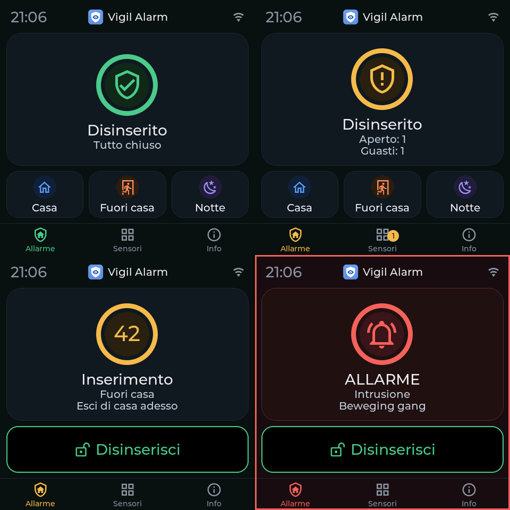
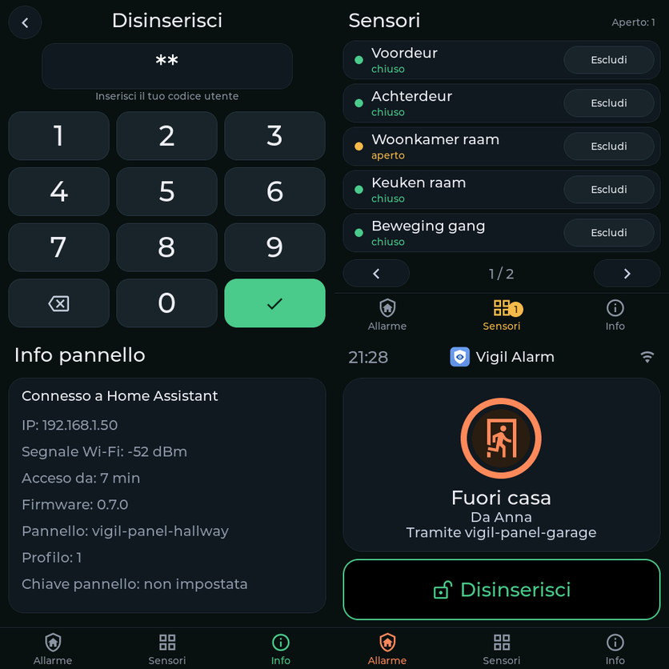
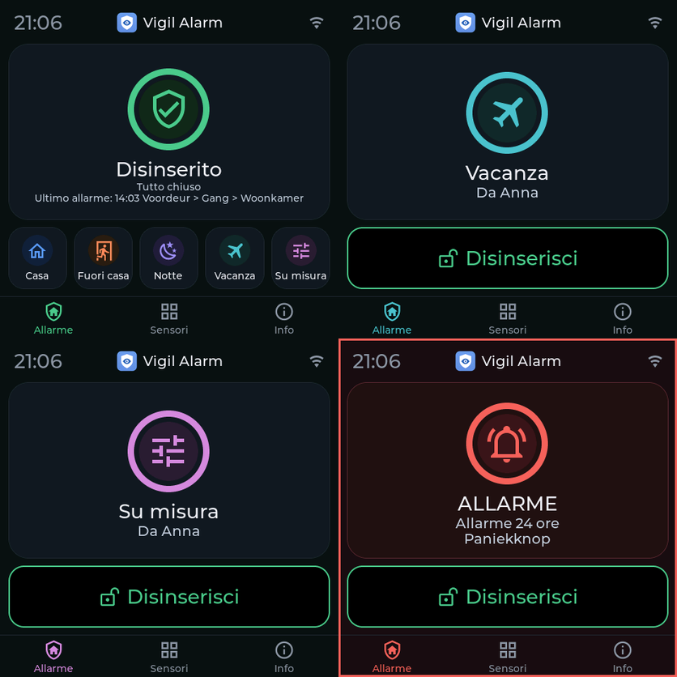

# Vigil Alarm: guida per l'utente

Questa guida spiega come configurare e usare Vigil Alarm. Per l'installazione vedi il
[README](../README.md) (in inglese). La versione originale è la guida inglese
[user-guide.md](user-guide.md); esistono anche le versioni in
[olandese](user-guide.nl.md), [tedesco](user-guide.de.md),
[francese](user-guide.fr.md) e [spagnolo](user-guide.es.md).

> Vigil Alarm non è un sistema di allarme certificato. Provalo regolarmente e non fare affidamento
> su di esso come unica protezione.

> I testi italiani sono stati tradotti da Claude (un'IA) e non sono stati rivisti da un madrelingua.
> Segnala una formulazione goffa o sbagliata aprendo una issue.

## Indice

1. [Come si incastra tutto](#come-si-incastra-tutto)
2. [La configurazione, passo per passo](#la-configurazione-passo-per-passo)
3. [Usare l'allarme ogni giorno](#usare-lallarme-ogni-giorno)
4. [Cosa succede durante un allarme](#cosa-succede-durante-un-allarme)
5. [Riferimento: il pannello, scheda per scheda](#riferimento-il-pannello-scheda-per-scheda)
6. [Automazioni e blueprint](#automazioni-e-blueprint)
7. [Inserimento automatico](#inserimento-automatico)
8. [Autosorveglianza](#autosorveglianza)
9. [Riavvii e aggiornamenti](#riavvii-e-aggiornamenti)
10. [Risoluzione dei problemi](#risoluzione-dei-problemi)
11. [Limiti da conoscere](#limiti-da-conoscere)

## Come si incastra tutto

| Elemento | Cos'è |
|---|---|
| **Allarme** | Un'entità `alarm_control_panel`. Stati: *disarmed* (disattivato), *arming* (ritardo d'uscita), *armed home / away / night / vacation / custom* (inserito), *pending* (ritardo d'ingresso) e *triggered* (scattato). |
| **Modalità** | *Casa* (ci sei tu, l'esterno è sorvegliato), *Fuori casa* (nessuno in casa, tutto è sorvegliato) e *Notte* (dormi, l'esterno è sorvegliato). Altre due modalità si possono attivare in *Partizioni* (nel modulo della partizione): *Vacanza* (assenza prolungata) e *Personalizzato* (una scelta tua; Home Assistant lo chiama *custom bypass*). Ogni modalità ha il proprio ritardo d'uscita e gruppi di sensori possono esservi attivi come nelle altre modalità. Vigil non decide cosa significhino: sei tu a scegliere quali gruppi di sensori vi sorvegliano. |
| **Sensore** | Un rilevatore, collegato a un `binary_sensor` (attivo = aperto o allarme). Ogni sensore ha una **classe**. |
| **Gruppo di sensori** | Decide **in quali modalità** sorvegliano i sensori di intrusione che contiene. |
| **Regola di conferma** | Facoltativa. Un allarme segue solo se più sensori diversi scattano entro una finestra di tempo. |
| **Utente** | Una persona con un codice, eventualmente limitata ad alcune modalità. |
| **Notifica** | Un servizio `notify` che riceve messaggi, eventualmente ritardati (escalation). |
| **Sirena** | Facoltativa. Qualcosa che fa rumore durante un allarme. |

### Classi di sensori

| Classe | Comportamento |
|---|---|
| **Intrusione** | Sorveglia nelle modalità dei suoi gruppi di sensori. Tipo *istantaneo* (allarme subito), *ritardato* (prima il ritardo d'ingresso, per la porta d'ingresso) o *seguace* (scatta solo se prima è stato aperto un sensore ritardato, per esempio un rilevatore di movimento del corridoio dietro la porta d'ingresso). |
| **Incendio** | Sorveglia sempre, in tutte le modalità, anche con l'allarme disattivato. Allarme subito. |
| **Gas** | Sorveglia sempre. Scegli il tipo di gas: monossido di carbonio, gas naturale, GPL o altro. Con gas naturale o GPL, Vigil non accende mai il lampeggiante, per il rischio di scintille. |
| **Antimanomissione** | Sorveglia sempre. Un contatto antimanomissione che si apre fa scattare un allarme. |
| **Acqua** | Sorveglia sempre. Un *allarme tecnico*: non cambia mai lo stato dell'allarme, pubblica solo eventi e un sensore «allarme attivo». |
| **24 ore con suono** | Sorveglia sempre, in ogni stato, anche con l'allarme disattivato, come un contatto antimanomissione: quando si apre, la sirena suona e i canali di allarme ricevono un messaggio (causa *allarme 24 h*). Per un pulsante antipanico o una cassaforte. Finché è aperto, l'inserimento viene rifiutato. |
| **24 ore silenzioso** | Sorveglia sempre, senza sirena: un *allarme tecnico* come l'acqua, con un messaggio ai canali *Tecnico* e una riga nel registro. Per un pulsante antipanico silenzioso, o per un numero: scegli un sensore con un numero (temperatura, tensione, potenza, corrente) e imposta un limite inferiore e/o superiore e un tempo. Un valore fuori dai limiti per più di quel tempo è un sensore aperto; di nuovo entro i limiti è chiuso subito. Esempi: congelatore sopra -15 per 30 minuti, frigorifero sopra 8, un terrario o acquario fuori dal suo intervallo, un locale dove l'aria condizionata si è fermata, tensione di rete sotto 180 per un minuto. Un valore che non è un numero (`unavailable`) segue la scelta fatta per i sensori non disponibili. |

### Gruppi di sensori: quali sensori sorvegliano in quale modalità

Un gruppo di sensori è un elenco di modalità. Un sensore di intrusione appartiene a uno o più gruppi e sorveglia
in ogni modalità in cui uno dei suoi gruppi è attivo. Due gruppi vengono creati per te:

| Gruppo | Attivo in | Per |
|---|---|---|
| **Perimetro** | Casa, Fuori casa, Notte | porte e finestre |
| **Interno** | Fuori casa | rilevatori di movimento |

Così, in *Casa*, contano solo porte e finestre e puoi muoverti liberamente. In *Fuori casa* contano anche i
rilevatori di movimento. Puoi aggiungere gruppi, per esempio *Cantina* solo per *Notte*.

È anche il motivo per cui Vigil non usa le aree (area) di Home Assistant per questo: un'area dice **dove** si trova un
sensore, un gruppo di sensori dice **come lo vuoi usare**. Un contatto porta e un rilevatore di movimento nella
stessa stanza vanno in gruppi diversi.

La scheda **Panoramica** mostra «Cosa sorveglia ogni modalità», così puoi controllare il risultato.

## La configurazione, passo per passo

Apri **Vigil Alarm** nella barra laterale (la vedono solo gli amministratori). Ogni salvataggio ricarica Vigil Alarm;
lo stato dell'allarme viene mantenuto.

1. **Controlla la partizione** (scheda *Partizioni*, la prima riga è la tua casa): modalità, ritardi d'uscita, ritardo
   d'ingresso predefinito e durata dell'allarme. In *Impostazioni* controlli se serve un codice per inserire.
2. **Aggiungi i sensori.** Il modo rapido è *Sensori → Trova sensori*: Vigil elenca i sensori di porta, finestra, movimento, fumo, calore, gas, acqua, sicurezza e antimanomissione che Home Assistant già conosce, con il sensore di batteria e di antimanomissione dello stesso dispositivo. All'inizio non è selezionato nulla e i sensori già aggiunti non vengono mostrati. Spunta quelli che vuoi, cambia un nome se vuoi, spunta *Ingresso* per le porte da cui passi (ricevono un ritardo d'ingresso) e aggiungili tutti insieme. Nella colonna *Gruppi di sensori* spunti altri gruppi per sensore, oppure usi *Imposta il gruppo per i selezionati…* per più sensori insieme. Un sensore che non vuoi più vedere (per esempio una stanza Hue che compare come secondo sensore di movimento) si nasconde con *Ignora*; *Mostra N ignorati* lo riporta. Non viene salvato nulla finché non premi il pulsante in basso. Senza gruppi di sensori, premi prima *Crea i gruppi predefiniti* (Perimetro per porte e finestre, Interno per il movimento). Per aggiungerne uno a mano usa *Sensori → Aggiungi sensore*:
   - Dagli un nome («Porta d'ingresso»). Il nome determina i nomi delle entità (`sensor.porta_d_ingresso_status`).
   - Scegli il `binary_sensor`. Per un contatto porta o un rilevatore di movimento, il pannello propone da solo il gruppo
     di sensori giusto.
   - Scegli la classe e, per l'intrusione, il tipo e i gruppi di sensori.
   - Il dispositivo ha anche un contatto antimanomissione (la maggior parte dei contatti porta Zigbee lo ha)? Indicalo in *Entità antimanomissione*. Vigil aggiunge da sé un sensore antimanomissione chiamato «Porta d'ingresso (antimanomissione)»: sempre in sorveglianza, con il proprio indicatore *Escluso*. Segue il sensore quando lo rinomini, lo modifichi o lo elimini, e non ha una riga propria nella tabella.
   - *Se aperto alla fine del ritardo d'uscita* decide cosa succede a una porta ancora aperta al momento dell'inserimento: **escludere con un avviso** (predefinito; torna sorvegliata appena si chiude), **attendere la chiusura**, **rifiutare l'inserimento** o **avviare il ritardo d'ingresso**.
   - *Quando il sensore diventa irraggiungibile*: **bloccare l'inserimento** (predefinito per intrusione e
     antimanomissione), **solo notificare** (predefinito per incendio, gas e acqua), **far scattare l'allarme** o **inserire
     comunque (escludere)**. Incendio e gas non possono mai essere esclusi.
   - Se vuoi, aggiungi un sensore di batteria; Vigil ti avvisa quando è quasi scarica. Un sensore senza batteria (una telecamera PoE) riceve la spunta *Alimentato dalla rete (senza batteria)*, così la Panoramica non la richiede.
3. **Aggiungi un utente** (scheda *Utenti*): un nome e un codice. Senza utenti non serve alcun codice.
   Un utente può essere limitato ad alcune modalità. Escludere un sensore è un diritto che dai a un utente (*Può escludere i sensori*): senza di esso un utente non può né escludere né ripristinare un sensore, anche con il codice giusto. Chi può escludere un sensore può anche ripristinarlo. Un sensore antimanomissione richiede il diritto in più *Può escludere l'antimanomissione*, sia per escludere sia per ripristinare. Gli utenti salvati prima dell'esistenza di questo diritto lo mantengono finché non lo togli.
4. **Aggiungi una notifica** (scheda *Notifiche*): scegli uno o più servizi `notify` (selezionane più di uno quando più persone devono ricevere lo stesso messaggio; i gruppi notify non sono offerti, non possono inviare con priorità alta) e i tipi di
   messaggi che deve ricevere. Un avviso critico su un telefono funziona solo con un servizio `mobile_app_…`. Con un *ritardo*, il canale invia i messaggi di allarme solo se l'allarme è
   ancora attivo dopo quel ritardo: è un canale di escalation per una seconda persona o un secondo dispositivo.
5. **Facoltativo: una regola di conferma** (scheda *Regole di conferma*): scegli i sensori di intrusione istantanei,
   quanti devono scattare e in quale finestra di tempo.
6. **Facoltativo: una sirena** (scheda *Sirene*). Vedi sotto.
0. **Novità: la procedura guidata di configurazione.** Quando la configurazione è insufficiente, la scheda *Panoramica* comincia con la scheda *Configura Vigil*, e la scheda *Pronto all'uso?* ha un pulsante *Procedura guidata di configurazione*. La procedura passa passo per passo per modalità, sensori, utente (creato anche da una persona di Home Assistant), canale di notifica (un telefono con l'app in un clic), sirena e tastiera, e termina con *Pronto all'uso?*. Ogni passo si può saltare, *Continua più tardi* chiude la procedura e la scheda *Riprendi la procedura* ti riporta dov'eri. La procedura usa gli stessi moduli delle schede e non salva nulla prima della tua conferma.
7. **Guarda *Pronto all'uso?*** in cima alla scheda *Panoramica*. Nomina ciò che ancora manca (un utente con un codice, un canale di notifica, una modalità che nulla sorveglia, sensori senza sensore di batteria) e ha un pulsante verso il punto giusto. Se non hai ancora un canale di notifica e Home Assistant conosce il tuo telefono, un pulsante lo aggiunge e invia un messaggio di prova.
8. **Prova tutto** con i pulsanti *Test* e inserendo l'allarme e aprendo una porta. Usa la
   [guida ai test](installation-and-testing.md) (in inglese) per un piano di prova completo con sensori virtuali.

### Sirene

Una sirena ha un'entità on/off (`siren`, `switch` o `light`) ed extra facoltativi: un lampeggiante,
un'entità per la scelta del tono e un'entità per il volume. Per causa (intrusione, incendio, gas, antimanomissione) puoi
assegnare un tono e un volume. Vengono impostati subito prima che la sirena suoni e ripristinati dopo. La
sirena si ferma quando l'allarme viene disattivato e dopo una durata massima. Una sirena che si ferma da sola
può essere riaccesa ogni N secondi.

Molte sirene non sanno dire se sono davvero accese. In quel caso `siren_started` ha
`verified: false`, e un comando che fallisce produce `siren_failed` e una notifica.

**Preset per il rilevatore di fumo frient SMSZB-120 (Zigbee2MQTT):** scegli sotto *Sirena* l'interruttore *Alarm* e poi il preset. Vigil inserisce la durata (240 secondi, dopo i quali il dispositivo si ferma da solo) e trova il sensore della batteria. Il dispositivo non ha tono, volume o luce lampeggiante da impostare. Il suo interruttore non riferisce se è davvero acceso, quindi un test dice *comando inviato, la sirena non conferma*; aggiungi il sensore di fumo a parte come sensore di tipo *Incendio*.

**Preset per la Sonoff SNZB-09P (Zigbee2MQTT):** sotto
*Sirena* scegli l'interruttore on/off della sirena, poi il preset. Vigil compila i toni (classico per l'intrusione, avvertimento per l'incendio,
emergenza per il gas, rapido per l'antimanomissione), il volume, la durata, e cerca le entità di tono, volume, lampeggiante,
batteria e modalità di alimentazione dello stesso dispositivo. Se qualcosa non viene trovato, lo scegli
tu. Con ZHA o un'altra integrazione scegli l'entità on/off e compila il resto a
mano.

## Usare l'allarme ogni giorno

### Inserire e disattivare

Usa la scheda del pannello di allarme (o la scheda tile, o l'app Companion), le azioni *arm* in
un'automazione, oppure la [dashboard](../examples/dashboard.yaml). Digita il codice se richiesto.

- **Inserire** avvia il ritardo d'uscita (stato *arming*), poi l'allarme è *armed*. Esci.
- **Disattivare** richiede sempre un codice quando ci sono utenti. Durante il ritardo d'ingresso (*pending*) hai
  la durata del ritardo d'ingresso per digitarlo.
- Un utente può essere limitato ad alcune modalità; inserirne un'altra viene rifiutato.

### Quando l'inserimento viene rifiutato

Vigil ti dice perché: *una condizione di allarme è aperta* (un sensore di incendio o antimanomissione è attivo), *un sensore è
irraggiungibile* (un sensore di intrusione è irraggiungibile ed è impostato su bloccare) o *un sensore è aperto* (un
sensore impostato su rifiutare). L'attributo `refuse_reason` e la notifica dicono quali sensori. Ripara
il sensore, oppure escludilo.

**Perché non posso inserire?** La scheda *Panoramica* del pannello Vigil ha una scheda con questo nome finché qualcosa
impedisce l'inserimento: per ogni sensore cosa non va e in quali modalità, con i pulsanti *Mostra* ed *Escludi* (un sensore di incendio o
gas non si può escludere: elimina prima la causa). Sulla tastiera touch e nella scheda Vigil, un inserimento rifiutato
dice cosa lo impedisce (*Impossibile inserire: l'antimanomissione della porta d'ingresso è aperta*) e, se la tastiera può escludere, mostra un solo
pulsante, **Escludi e inserisci**, che chiede un codice, poi esclude ciò che blocca e inserisce. Richiede gli stessi
diritti dell'esclusione manuale (il diritto di escludere e, per un sensore antimanomissione, il diritto di escludere l'antimanomissione), e non è mai possibile per un sensore di incendio o gas. Nelle tue automazioni, la stessa cosa è
l'azione `vigil_alarm.arm` con `bypass_open: true`.

### Escludere un sensore

L'esclusione mette da parte un sensore fino alla disattivazione dell'allarme (o finché non la annulli).

**Esclusione permanente.** Spunta *Mantieni l'esclusione dopo la disattivazione (permanente)* su un sensore (non disponibile per sensori di incendio e gas) e un'esclusione manuale di quel sensore resta dopo la disattivazione dell'allarme, anche dopo un riavvio di Home Assistant, finché qualcuno non la ripristina a mano. Utile per un sensore guasto da tempo. Il sensore resta nell'elenco come *escluso*, la scheda *Panoramica* ha una scheda **Esclusi in modo permanente** con un pulsante *Ripristina*, e la scheda Vigil e la tastiera touch mostrano *Escluso: finestra rotta* sotto *Disattivato*, così non viene dimenticato; il registro ha `sensor_bypassed` all'inizio e `sensor_unbypassed` (motivo *manuale*) alla fine. Senza la spunta non cambia nulla: l'esclusione termina alla disattivazione.

- Nel pannello Vigil: il pulsante **Escludi** del sensore (solo amministratori). Nella scheda Vigil e sul pannello touch lo stesso, con un codice. L'entità `binary_sensor.<sensore>_bypassed` lo mostra (sola lettura; non c'è un interruttore).
- Tramite azione: `vigil_alarm.bypass` e `vigil_alarm.unbypass` con l'entità del sensore e, per chi non è
  amministratore, un codice. Questo codice serve solo se anche l'inserimento ne richiede uno (l'impostazione
  *codice richiesto per inserire*). I sensori antimanomissione possono essere esclusi solo dagli amministratori e dagli utenti
  che hanno quel diritto.
- I sensori di incendio e gas non possono mai essere esclusi.

### Una tastiera touch



La tastiera e la scheda Vigil condividono lo stesso aspetto. Lo stato è un **anello con un'icona** del colore dello stato: verde quando l'allarme è disattivato e tutto è chiuso, ambra quando qualcosa è aperto o durante l'inserimento, arancione durante il ritardo d'ingresso, blu, corallo, viola, turchese e rosa per casa, fuori casa, notte, vacanza e personalizzato, rosso per un allarme (con una cornice rossa attorno allo schermo), grigio senza connessione. Durante i ritardi d'uscita e d'ingresso l'anello è il **conto alla rovescia**: i secondi al centro, l'anello che si svuota fino a zero; a zero l'allarme è attivo. Sotto l'anello vedi i pulsanti delle modalità che questa tastiera può usare, oppure un pulsante largo *Disattiva* quando l'allarme è attivo, alto quanto i pulsanti delle modalità. In basso ci sono le schede *Allarme*, *Sensori* (con il numero di sensori aperti) e *Info*; il tastierino numerico non ha schede.



Con *Vacanza* e *Personalizzato* attivati ci sono fino a cinque pulsanti di modalità in una riga (il testo diventa più piccolo), e *Disattivato* mostra l'ultimo allarme sotto lo stato:




Con la tastiera ESPHome (Guition 4848) inserisci, disattivi ed escludi sensori senza telefono. Legge
il suo profilo da Vigil: mostra solo le modalità in cui la tastiera può inserire, chiede un codice come fa Vigil e usa la lingua che hai impostato per lei.
L'installazione e le opzioni sono in [esphome/README.md](../esphome/README.md). Il nome del dispositivo è l'identificativo della tastiera e la `source` di ogni chiamata, che compare nella cronologia come *Anna (vigil-panel-garage)*. Un codice
errato produce l'evento `code_rejected`, mai con il codice stesso. Il blocco avviene a gradini e i valori si regolano in *Impostazioni*, *Blocco*. Predefinito: dopo 3 codici errati questa tastiera è bloccata per 5 minuti, poi dopo altri 2 codici errati per 15 minuti, poi dopo altri 2 per 60 minuti, e dopo ancora 1 codice errato in modo definitivo (eventi `code_locked` e `code_locked_permanent`, inviati anche ai tuoi canali di notifica dei guasti). Un blocco permanente scompare solo con *Revoca il blocco* nel pannello, poi si ricomincia dal primo gradino. Anche un codice corretto azzera il contatore e il gradino. Il blocco resta quando Home Assistant si riavvia; il timer condiviso per tutto ciò che non è una tastiera registrata (*other*) non blocca mai in modo definitivo, perché nessuno potrebbe revocarlo, ma ripete l'ultima attesa; un amministratore nell'interfaccia può sempre usare l'allarme. Ogni tastiera registrata (vedi sotto) ha il proprio timer; tutto il resto (un telefono, un'automazione, qualsiasi altro nome) ne condivide uno.

#### Tastiere, tablet e telefoni

La scheda *Pannelli* è il registro di tutto ciò che può usare l'allarme al di fuori dell'interfaccia di Home Assistant: le tastiere ESPHome (riconosciute dal loro identificativo di tastiera) e i tablet o telefoni (riconosciuti dal loro account Home Assistant). Tutti si configurano allo stesso modo. Appena è registrato un account, gli altri account ordinari vengono rifiutati prima che il loro codice venga esaminato (evento `user_refused`); gli amministratori, le automazioni e le tastiere ESPHome non sono toccati. I dettagli, e il consiglio di dare a un amministratore un secondo account ordinario per l'uso quotidiano, sono nella [guida al tablet](tablet.md).

#### Registrare una tastiera (scheda *Pannelli*)

Una tastiera o un tablet che registri nella scheda *Pannelli* è trattato come un terminale passivo: Vigil decide cosa può fare. Gli dai un nome e un **identificativo della tastiera**, che è il nome del dispositivo ESPHome e anche la `source` che portano le sue chiamate. Per ogni tastiera imposti:

Quando aggiungi una tastiera, scegli prima il **tipo di dispositivo**. *Tastiera ESPHome* chiede il nome del dispositivo ESPHome (l'identificativo della tastiera). *Tablet o telefono con Home Assistant* chiede solo l'account Home Assistant; Vigil ricava da sé l'identificativo della tastiera dal nome. Tutto il resto (modalità, disattivazione, esclusione, lingua, elenco dei sensori, codice installatore) è uguale per entrambi. La lingua parte da quella di chi aggiunge la tastiera, l'inglese se non è né olandese né inglese.

- le modalità in cui può inserire, e se può disattivare, escludere sensori e silenziare o confermare;
- la lingua (predefinita: quella di Home Assistant);
- se può mostrare l'elenco dei sensori: *sempre*, *solo dopo lo sblocco* (predefinito) o *mai*, e per quanto tempo resta sbloccata (predefinito 60 secondi);
- un **codice installatore** facoltativo per questa tastiera, conservato come hash, con il proprio timer per i codici errati. La tastiera lo invia con `vigil_alarm.unlock_panel`; Vigil lo verifica e sblocca la tastiera per la durata impostata. Apre le pagine informative e (come il codice di qualsiasi utente Vigil) l'elenco dei sensori, e non disattiva mai l'allarme: disattivare richiede sempre un codice utente valido;
- ciò che il firmware **segnala** di sé (il suo hardware, la versione del firmware e la versione del profilo) viene mostrato sulla scheda della tastiera, e *Pronto all'uso?* dà un consiglio quando il firmware non capisce il profilo;
- **controllare se è raggiungibile** (*Controlla se questa tastiera è raggiungibile*): attivo per impostazione predefinita per una tastiera ESPHome, disattivo per un tablet o un telefono, perché un telefono spento non è un guasto. Disattivato, non hai né Riparazione né messaggio quando la tastiera sparisce, e l'elenco dice *Non sorvegliato*. Le voci create prima di questa impostazione restano attive;
- **bloccata**: Vigil rifiuta ogni chiamata con questo identificativo di tastiera e la registra.

Ciò che viene imposto lato server: una chiamata di una tastiera registrata che il suo profilo non consente viene rifiutata e registrata (evento `panel_refused`, con il motivo). Escludere un sensore da una tastiera registrata richiede sempre un codice utente. Una tastiera bloccata viene rifiutata prima che venga esaminato qualsiasi codice. Le chiamate con una source non registrata non sono limitate da nulla di tutto ciò. **La chiave della tastiera.** La `source` di una chiamata è testo semplice e da sola non prova nulla: chiunque possa chiamare un'azione di Home Assistant potrebbe scriverci il nome di una tastiera. Dai a una tastiera ESPHome una **chiave** (il pulsante chiave in *Pannelli*): Vigil la mostra una volta e ne conserva solo un'impronta, tu la metti nel `secrets.yaml` della tastiera e la tastiera la invia a ogni chiamata. Da quel momento una chiamata a nome di quella tastiera senza la chiave giusta viene rifiutata e registrata (`panel_refused`, motivo `key`), da chiunque venga. Questo protegge da chi ha un normale account Home Assistant o da uno script che non conosce la chiave; non protegge da chi può leggere la tua configurazione ESPHome o ha diritti di amministratore. Le chiamate che non nominano alcuna tastiera, le altre tastiere e i tablet (riconosciuti dal loro utente Home Assistant) non sono toccati. Una tastiera senza chiave funziona come prima, e *Pronto all'uso?* consiglia di crearne una. Una nuova chiave sostituisce subito la vecchia: reinstalla la tastiera con essa. Usa anche la cifratura dell'API ESPHome, così la chiave non viaggia in chiaro.

Ogni tastiera registrata ottiene un'entità `sensor.<panel_id>_profile` (i trattini dell'identificativo diventano trattini bassi, quindi `vigil-panel-garage` dà `sensor.vigil_panel_garage_profile`) con ciò che può fare e mostrare. I nomi dei sensori vi compaiono solo finché la tastiera è sbloccata (o l'elenco è su *sempre*), e gli attributi che li contengono sono tenuti fuori dalla cronologia. Non contiene mai codici, hash, chiavi o password. **Sii onesto su ciò che protegge:** `source` è testo semplice, quindi Vigil non può provare che una chiamata provenga davvero da quella tastiera. Il profilo protegge dagli errori e da una tastiera che non dovrebbe avere certi pulsanti, non da chi può già chiamare servizi. La vera protezione sono il codice, il blocco, la connessione cifrata della tastiera e le regole di accesso di Home Assistant stesso.

Due pulsanti per tastiera, **Sblocca** e **Revoca il blocco**, esistono solo nel pannello Vigil (solo amministratori) e non come azioni di Home Assistant: un'azione può essere chiamata da qualsiasi utente, automazione o tastiera, quindi una tastiera rubata potrebbe sbloccarsi da sola. *Sblocca* mostra l'elenco dei sensori per la durata impostata; *Revoca il blocco* toglie il blocco registrato dopo codici errati (sopravvive a un riavvio, quindi è così che lo togli). Entrambi sono registrati con l'amministratore che li ha eseguiti (`panel_unlocked`, `panel_lock_cleared`).

**Fuori portata.** Se Vigil non riesce a raggiungere il dispositivo ESPHome di una tastiera per 10 minuti, ricevi una Riparazione *Tastiera irraggiungibile* e un messaggio sui tuoi canali dei guasti (eventi `panel_offline` e `panel_online`). Una tastiera fuori portata non cambia mai lo stato dell'allarme. Una tastiera bloccata, e una per cui *controllare* è disattivato, non producono Riparazioni. Dopo un riavvio di Home Assistant i dieci minuti ricominciano.

Si può registrare anche un tablet, collegato a un utente di Home Assistant, che mostra la scheda Vigil (`type: custom:vigil-card`); vedi la [guida al tablet](tablet.md).

Il firmware ESPHome legge da solo questo profilo. Una tastiera che non è nel registro mostra *Non collegata* con l'identificativo di tastiera che si aspetta; una tastiera bloccata mostra *Bloccata*. L'elenco dei sensori e la pagina info della tastiera (indirizzo IP, segnale, firmware, tempo di attività e se è impostata una chiave del pannello) si aprono con un codice: l'elenco dei sensori con il codice di qualsiasi utente Vigil (o il codice installatore), la pagina info con il solo codice installatore della tastiera; finché non è sbloccata, la tastiera mostra solo il numero di sensori aperti. Le restrizioni sono imposte anche da Vigil per ogni chiamata con la `source` della tastiera, qualunque cosa faccia il firmware.

### Silenziare e confermare

- `vigil_alarm.silence` ferma le sirene mentre l'allarme resta attivo.
- `vigil_alarm.acknowledge` annulla i messaggi di escalation in attesa: l'hai visto.

Entrambi richiedono un codice utente, oppure un amministratore nell'interfaccia.

## Cosa succede durante un allarme

Un esempio con l'allarme inserito in *Fuori casa* e la porta d'ingresso (un sensore ritardato) che si apre:

| Momento | Cosa succede |
|---|---|
| La porta si apre | Stato *pending*. Evento `pending_started`. Notifica «Ritardo d'ingresso avviato». |
| Durante il ritardo d'ingresso | Disattiva con un codice: nessun allarme. |
| Il ritardo d'ingresso termina | Stato *triggered*, causa *intrusione*. Evento `triggered`. Partono le notifiche, suonano le sirene, si attiva «Allarme intrusione». |
| Dopo il ritardo di un canale di escalation | Se l'allarme è ancora attivo e non confermato, quel canale invia il suo messaggio. |
| Disattivazione, o fine della durata dell'allarme | Le sirene si fermano, `trigger_ended`, lo stato torna a *disarmed* o *armed*. |

Un sensore istantaneo salta il ritardo d'ingresso. Incendio, gas e antimanomissione fanno scattare subito, in ogni stato. Una
causa più grave sostituisce una meno grave (`trigger_cause_changed`): l'ordine è incendio,
poi gas, antimanomissione, guasto del sensore e intrusione.

Con una **regola di conferma**, un solo scatto di uno dei suoi sensori non provoca un allarme. Pubblica
`sensor_unconfirmed` (e una notifica se hai scelto di essere avvisato). Quando il numero richiesto
di sensori diversi scatta entro la finestra, l'allarme scatta con `confirmed_by`
nell'evento.

## Riferimento: il pannello, scheda per scheda

Le azioni negli elenchi sono pulsanti con icona (modifica, copia, elimina, prova); passa il mouse per vedere il nome. Le regole e gli utenti non hanno il pulsante di copia. Alcuni campi hanno un ⓘ: cliccalo per una spiegazione più completa.

Ogni scheda ha un indirizzo proprio (per esempio `/vigil_alarm/sensor`), quindi i pulsanti *indietro* e *avanti* del browser passano tra le schede viste, e puoi salvare una scheda tra i preferiti.

Gli elenchi nelle schede e gli elenchi di scelta nei moduli sono ordinati per nome (i numeri per valore: «Porta 2» prima di «Porta 10»). Solo le partizioni mantengono il loro ordine, perché la prima è l'allarme stesso.

| Scheda | Cosa ci fai |
|---|---|
| **Panoramica** | la scheda *Allarme* con il logo Vigil e, con più di una partizione, una tessera colorata per partizione (verde disattivato, blu inserito, ambra conto alla rovescia, rosso allarme), la scheda *Esercitarsi e provare* (*Avvia la modalità di esercitazione* e *Avvia il giro di prova*, vedi *Modalità di esercitazione e giro di prova* sotto), la scheda *Configura Vigil* (la procedura guidata, finché manca qualcosa), la scheda *Nuovi sensori trovati* (sensori comparsi in Home Assistant dall'ultimo controllo di Vigil; *Esamina e aggiungi* apre l'elenco con soli i nuovi, *Non ora* non li annuncia più; nulla viene mai aggiunto da solo, e la scheda *Sensori* mostra un badge), *Pronto all'uso?* (cosa manca ancora), la scheda *Autotest* (ultimo controllo, ultimo test della sirena, prossimo test, *Prova la sirena ora*), la scheda *Heartbeat* (ultimo successo, *Prova ora*), una scheda *Dashboard* con un pulsante che copia una dashboard con i tuoi identificativi di entità, lo stato dell'allarme, i punti di attenzione (batterie scariche, dispositivi irraggiungibili), cosa sorveglia ogni modalità e lo stato in tempo reale di ogni sensore. |
| **Partizioni** | Una riga per partizione, compresa la prima (la tua casa): nome, modalità, ritardi d'uscita, ritardo d'ingresso predefinito, durata dell'allarme e dispositivo del campanello, e sotto *Cosa sorveglia ogni modalità*, una scheda per partizione e una per i sensori sempre attivi. Con più di una partizione, le schede successive (*Gruppi di sensori*, *Sensori*, *Regole di conferma*) hanno una tabella per partizione. Una partizione che ha ancora sensori o gruppi di sensori non può essere eliminata. |
| **Sensori** | *Trova sensori* propone sensori da Home Assistant (ordinati per nome, senza quelli che hai già, all'inizio nulla è selezionato; per sensore spunti i gruppi di sensori o scegli *Ignora*); aggiungere, modificare, copiare ed eliminare sensori. Sotto ogni nome una frase dice come reagisce il sensore e quando sorveglia. La tabella mostra il livello della batteria in una colonna propria. Un'entità può appartenere a un solo sensore. Il campo *Entità antimanomissione* collega il segnale antimanomissione dello stesso dispositivo: Vigil crea un sensore antimanomissione separato che può essere escluso da solo. Puoi anche creare un sensore antimanomissione autonomo. |
| **Gruppi di sensori** | Quali sensori sorvegliano in quali modalità. Un gruppo può *proporsi da solo* per i nuovi contatti porta o rilevatori di movimento. Un gruppo ancora in uso non può essere eliminato. |
| **Regole di conferma** | Più sensori devono scattare entro una finestra di tempo. Un sensore che è in una regola non può essere eliminato. |
| **Utenti** | (Non si può copiare.) Nome, codice, modalità consentite, diritto di escludere, diritto di escludere l'antimanomissione. I codici sono memorizzati come hash e mai mostrati. Lascia vuoto il codice quando modifichi per mantenerlo. |
| **Notifiche** | Servizio `notify`, tipi di messaggio (allarme, ritardo d'ingresso, inserimento e disattivazione, guasti e avvisi, allarmi tecnici), ritardo, alta priorità. *Test* invia un messaggio di prova. |
| **Sirene** | Vedi sopra. *Test* fa suonare la sirena per 3 secondi (rifiutato durante un vero allarme). |
| **Registro** | Tutto ciò che Vigil pubblica come evento, il più recente per primo (vengono mostrati i 200 più recenti). La colonna *Utente* dice chi l'ha fatto e *Tramite* dove (tastiera o dispositivo); inserito su una tastiera senza codice si legge *sconosciuto (nessun codice)*. *Scarica* dà l'intero registro in JSON Lines o CSV (RFC 4180), con orari in UTC (RFC 3339) e i campi `time`, `event`, `partition`, `source`, `user`, `item`, `result` e `detail`. Conserva 90 giorni per impostazione predefinita (*Impostazioni*), non contiene codici e sopravvive ai riavvii. |
| **Backup** | Le ultime 10 versioni della tua configurazione (una viene conservata a ogni modifica, con ciò che è cambiato), *Ripristina* per ciascuna (mostra prima cosa cambierebbe, e il ripristino stesso può essere annullato allo stesso modo), ed *Esporta la configurazione* e *Importa la configurazione…* come file. Vedi *Backup, esportazione e importazione* sotto. |
| **Impostazioni** | Ciò che vale per l'intero sistema: quanto attendere i sensori lenti dopo un riavvio di Home Assistant (secondi, predefinito 120), lo schermo delle tastiere (secondi prima che lo schermo si spenga, predefinito 30, se può spegnersi anche durante un allarme, predefinito no, e il tempo prima del ritorno alla partizione predefinita, predefinito 30 secondi, 0 = mai), soglia della batteria, codice richiesto per inserire, lunghezza minima del codice (da 4 a 12 caratteri, predefinito 4; vale per i codici nuovi e modificati, i codici esistenti continuano a funzionare), giorni di conservazione del registro (predefinito 90), e l'autotest: intervallo del promemoria (predefinito 30 giorni, 0 = disattivato), secondi in cui la sirena suona (da 1 a 5, predefinito 2), suono automatico e le ore in cui può farlo, e l'indirizzo dell'heartbeat e il suo intervallo in minuti (predefinito 5). |
| **Info** | Un badge «novità» dopo un aggiornamento, la versione, tre collegamenti: la guida per l'utente sul sito della documentazione (nella lingua del pannello), il progetto GitHub e *Segnala un problema*, le note di rilascio (le più recenti per prime) e un pulsante che copia i dettagli per una segnalazione di bug. |

Vigil parla **inglese, olandese, tedesco, francese, italiano e spagnolo**; ogni altra lingua mostra l'inglese. La
lingua dei **testi di notifica** segue la lingua del sistema Home Assistant (Impostazioni → Sistema → Generale).
Il pannello di amministrazione e la scheda Vigil seguono la lingua del tuo profilo. Una tastiera touch o un tablet ha la lingua che
scegli per esso in *Pannelli* (una nuova tastiera parte con la lingua del tuo account). Le traduzioni in tedesco,
francese, italiano e spagnolo sono state scritte da Claude (un'IA) e non sono riviste da un madrelingua: segnala
un testo goffo o sbagliato come issue. Una tastiera touch (ESPHome) ha bisogno del firmware 0.5.6 per parlare le nuove lingue;
un firmware più vecchio mostra l'inglese per esse.

## Modalità di esercitazione e giro di prova

La **modalità di esercitazione** ti permette di far funzionare l'allarme davvero senza spaventare i vicini. Nella Panoramica: *Avvia la modalità di esercitazione* (solo quando l'allarme è disattivato). L'allarme funziona allora come al solito: conta alla rovescia, il ritardo d'ingresso scorre, scatta e le tastiere (anche la scheda Vigil e lo schermo touch) lo mostrano. Ma **nessuna sirena suona** e **nessun messaggio parte**, nemmeno un messaggio di guasto. Tutto è nel registro con `practice` nei dettagli. La tastiera mostra una pastiglia *Modalità di esercitazione* in alto, la scheda Vigil una riga, e l'entità di allarme ha l'attributo `practice`. La modalità di esercitazione termina **alla prima disattivazione** (un giro), dopo 30 minuti, o con *Termina la modalità di esercitazione*, così una modalità di esercitazione dimenticata non può mai tenere muto un vero allarme. Dopo un riavvio di Home Assistant è disattivata. **Se la modalità di esercitazione scade mentre l'allarme è inserito,** l'allarme resta inserito e da quel momento funziona davvero: un'effrazione fa suonare la sirena e invia messaggi. Se l'allarme sta suonando in quel momento, sirena e messaggi partono allora.

Il **giro di prova** controlla che ogni sensore reagisca. Con l'allarme disattivato: *Avvia il giro di prova* (nella Panoramica o in *Sensori*), passa lungo porte, finestre e rilevatori di movimento e guardali spuntarsi in tempo reale. Vi partecipano solo i **sensori di intrusione**: con l'allarme disattivato non fanno nulla. I sensori di incendio, gas, acqua e antimanomissione sono sempre attivi e farebbero scattare un vero allarme; provali con il loro pulsante di test. Un sensore che non reagisce non ferma il giro: alla fine un elenco dice cosa è stato mancato (*non ha reagito* o *è irraggiungibile*). Il giro termina quando tutti i sensori sono stati visti, con *Termina il giro*, dopo 15 minuti, o appena inserisci l'allarme. Il registro ha `walktest_started` e `walktest_finished`.

## Memoria dell'allarme, falsi allarmi, codice di coercizione e campanello

**Memoria dell'allarme.** Da quando parte un ritardo d'ingresso fino alla disattivazione dell'allarme, Vigil annota **ogni sensore che si apre**, con l'ora e la stanza (l'area che hai dato al sensore in Home Assistant). Ciò include i sensori che non contano nella modalità inserita (un rilevatore di movimento che sorveglia solo in *Fuori casa*, mentre sei inserito in *Casa*) e i sensori esclusi: per il percorso di un intruso in casa dicono tutti qualcosa. Un sensore che lampeggia è un passaggio con un contatore. La scheda *Panoramica* ha la scheda **Ultimo allarme**: quando, la causa, il primo sensore, se è stato disattivato (e da chi) o annullato, e i passaggi in ordine, con per ogni passaggio se ha contato per l'allarme. Un sensore che ha contato compare nel registro come `sensor_faulted`; uno che non ha contato ha una propria riga `alarm_sensor_seen`. La scheda Vigil mostra *Ultimo allarme: 14:03 Porta d'ingresso → Corridoio → Soggiorno* finché l'allarme è disattivato (dopo il codice, quando l'elenco dei sensori è nascosto). L'entità di allarme ha l'attributo `last_alarm` con la stessa cosa in breve (gli ultimi 8 passaggi).

La memoria resta dopo un riavvio, finché qualcuno non la cancella o l'allarme successivo la sostituisce. **Cancellarla non richiede un codice**: *Cancella la memoria dell'allarme* sulla scheda nel pannello Vigil (scheda Panoramica), il servizio `vigil_alarm.clear_alarm_memory`, o un'automazione. Non può essere cancellata mentre è in corso un allarme. Un ritardo d'ingresso che termina in tempo con una disattivazione non è un allarme e non lascia nulla. La tastiera touch non la mostra ancora (servirebbe un nuovo firmware).

**Falsi allarmi: la finestra di annullamento.** Chiunque digiti un codice valido entro i **60 secondi dopo lo scatto della sirena** (un'impostazione in *Impostazioni → Modalità e ritardi*; 0 la disattiva) ha causato un falso allarme: la sirena si ferma come a ogni disattivazione, la memoria dell'allarme dice *annullato*, e un messaggio *Allarme annullato: falso allarme di Anna* parte verso i canali di allarme che già sapevano dell'allarme. Evento `alarm_cancelled`. Vale solo per gli allarmi di intrusione; incendio, gas e antimanomissione non sono mai falsi allarmi.

**Codice di coercizione.** Modifica un utente e compila *Codice di coercizione (facoltativo)*: un secondo codice per il caso in cui qualcuno ti costringa a disattivare l'allarme. Deve essere diverso da ogni altro codice, e Vigil lo accetta solo se esiste almeno un canale di notifica con il tipo di messaggio **Coercizione**. Digitarlo funziona esattamente come il codice normale: l'allarme viene disattivato, la sirena resta muta, **non si vede nulla** sulla tastiera, sulla scheda o sull'entità evento. Intanto i canali con *Coercizione* ricevono *ALLARME SILENZIOSO: Anna ha usato il codice di coercizione alle …* (con alta priorità se il canale ne ha una). La riga `duress_used` è solo nel registro. Funziona anche per inserire e per le altre azioni, e non conta mai come allarme annullato. Scegli un codice che puoi digitare senza pensare, e non scriverlo dove cercherebbe un intruso.

**Campanello.** Spunta *Campanello* su un sensore: quando si apre **mentre l'allarme è disattivato**, viene riprodotto un breve suono. In *Partizioni* (nel modulo della partizione) scegli cosa produce il suono (una sirena, un interruttore, una luce, un pulsante o uno script), e in *Impostazioni → Campanello* per quanto tempo. Non c'è allarme, né messaggio, né nulla nel registro; quando l'allarme è inserito non succede nulla. L'evento `chime` è sull'entità evento, così un'automazione può fare di più (per esempio un messaggio su un altoparlante) anche se non scegli nessuna entità. Un contatto che lampeggia suona una volta ogni 3 secondi.

## Partizioni: la casa e il garage

Per impostazione predefinita Vigil ha un solo allarme. In **Partizioni** puoi aggiungerne altri, per un garage, un laboratorio o una casa per gli ospiti. Ogni partizione ha il proprio stato (inserita o no), le proprie modalità e i propri ritardi, e la propria entità di allarme.

- **La prima partizione** è l'allarme che avevi già. È la prima riga in *Partizioni*, dove la rinomini e ne modifichi modalità e ritardi; *Impostazioni* contiene solo ciò che vale per l'intero sistema. Le altre partizioni hanno le proprie *Modalità e ritardi* nel loro modulo (una partizione può avere meno modalità della casa; un sensore sorveglia allora solo nelle modalità che la partizione ha).
- **Un sensore appartiene a una partizione** (campo *Partizione*). I sensori di incendio, gas, acqua e 24 ore non hanno partizione: sorvegliano in tutte. Il contatto antimanomissione di un sensore (l'ingresso antimanomissione che compili con il sensore) sorveglia nella partizione di quel sensore, così una tastiera del garage mostra ed esclude solo l'antimanomissione del garage. Un sensore antimanomissione che aggiungi tu (classe *antimanomissione*) ha anch'esso una scelta *Partizione*, con *Tutte le partizioni* come predefinito. Il loro allarme è un allarme per tutta la casa; disattivarlo in una qualsiasi partizione in allarme lo termina ovunque.
- **L'entità *Tutte*** compare quando c'è più di una partizione. Il suo stato è lo stato più alto di una partizione; quando differiscono, l'attributo `status` dice `mixed`, e la scheda dice *Misto*. Inserire *Tutte* inserisce ogni partizione o nessuna: se una viene rifiutata (una porta aperta, una modalità che non ha), non viene inserito nulla.
- **Chi può cosa:** un utente, una tastiera, una sirena e un canale di notifica hanno sempre una scelta *Partizioni* (nel modulo, subito sopra le modalità). È obbligatoria: spunta le partizioni, oppure *Tutte le partizioni*. Le modalità che puoi spuntare sotto sono quelle delle partizioni scelte. Un codice funziona solo per le partizioni del suo utente. Gli allarmi di sicurezza (incendio, gas, acqua, antimanomissione, 24 ore) suonano su ogni sirena, indipendentemente dalle sue partizioni. Le notifiche ricevono il nome della partizione quando ce n'è più di una.
- **Partizione predefinita di una tastiera:** una tastiera ha una *Partizione predefinita* obbligatoria (una delle sue partizioni, o *Tutte*). È ciò che la tastiera usa dopo l'avvio e dopo il ritardo *Ritorno alla partizione predefinita* (*Impostazioni*, *Schermo della tastiera*, predefinito 30 secondi, 0 = mai).
- **Servizi:** `vigil_alarm.arm` e `vigil_alarm.disarm` accettano `partition` (l'identificativo, o `all`). Senza di esso agiscono sulla prima partizione.
- Una partizione che ha ancora sensori o gruppi di sensori non può essere eliminata; spostali prima.
- **I gruppi di sensori appartengono a una partizione.** Con più di una partizione, la scheda *Gruppi di sensori* ha una tabella per partizione. Un gruppo propone solo le modalità della sua partizione, e un sensore può usare solo i gruppi della propria partizione. Una nuova partizione parte senza gruppi: usa *Crea i gruppi predefiniti* nella sua tabella. Anche le regole di conferma sono elencate per partizione (tutti i sensori di una regola devono essere in una partizione).
- **Il registro** ha una colonna *Partizione*; un evento di incendio, gas, acqua o 24 ore non ne ha (vale per tutta la casa).
- **Le tastiere touch e la scheda del tablet** mostrano sempre quale partizione (o *Tutte*) usano, anche quando ce n'è una sola, con *Vigil Alarm* e il logo. Una tastiera che può usare più partizioni ha una riga di pulsanti per cambiare (e un pulsante in alto nella pagina *Sensori* che sceglie di quale partizione sono elencati i sensori); *Tutte* inserisce o disattiva ogni partizione. Dopo il ritardo di ritorno senza tocchi torna alla sua partizione predefinita, ma non finché l'elenco dei sensori è aperto. Il servizio `vigil_alarm.select_partition` fa lo stesso cambio da un'automazione.
- **Sensori sempre attivi a parte.** I sensori antincendio, gas, acqua, manomissione e 24 ore non appartengono ad alcuna partizione, quindi l'elenco dei sensori di una partizione (sulla scheda Vigil e sulla tastiera touch) non li mostra. Sono una scelta a sé accanto alle partizioni, *Sempre attivo*: sulla scheda un pulsante in più nella riga della pagina *Sensori*, sulla tastiera touch un passo in più del pulsante della partizione in alto in quella pagina. Con più di quattro partizioni la tastiera touch ne mostra quattro alla volta con una freccia per lato (la freccia destra resta all'estrema destra; *Tutto* viene dopo l'ultima partizione, nell'ultima pagina, o in una pagina a parte se quella è piena); una partizione scelta altrove porta in vista la propria pagina.

## Automazioni e blueprint

Tutto ciò che va oltre notifiche e sirene è tu ad automatizzarlo. Vigil pubblica l'entità evento
`event.<name>_alarm_events`; il [README](../README.md#for-automations) elenca tutti gli eventi
e i loro dati.

I [blueprint](../README.md#blueprints) forniti coprono i casi comuni:

- **Far lampeggiare le luci durante un allarme** salva lo stato delle tue luci, le fa lampeggiare finché l'allarme
  è scattato e le ripristina dopo, anche quando l'allarme viene disattivato. Scegli quali
  cause fanno lampeggiare (il gas è disattivato per impostazione predefinita) e, con più di una partizione, per quali partizioni (*Only for these partitions*). Il valore predefinito di 2 secondi acceso e 2 secondi spento resta
  ben al di sotto della frequenza che conta per le persone fotosensibili. Per Hue usa una stanza o una zona
  (gruppo) invece di singole lampade; i gruppi sono disattivati per impostazione predefinita in Home Assistant, quindi attivali
  prima.
- **Annunciare gli eventi di allarme a voce** pronuncia un messaggio quando l'allarme si inserisce, si disattiva, avvia
  il ritardo d'ingresso o scatta. Lascia vuoto un messaggio per restare in silenzio per quell'evento. Con più di una partizione il messaggio inizia con il nome della partizione (si disattiva con *Name the partition*; `partition_name` è disponibile anche nel tuo testo).
- **Eseguire azioni tue sugli eventi di allarme** è il mattone generale: scegli gli eventi e aggiungi
  qualsiasi azione, con `event_type` e `data` disponibili. Questo blueprint e quello vocale hanno *Only for these partitions* (se ne possono scegliere più d'una; vuoto = tutte); `data.partition_name` dice di quale partizione si tratta.
- **Ricordare all'arrivo in una casa inserita** invia un messaggio quando qualcuno rientra mentre l'
  allarme è inserito. Non disattiva.

### Inserimento automatico

**Inserire quando tutti sono usciti** e **Inserire a un orario fisso** inseriscono l'allarme per te. Non
disattivano mai: disattivare richiede sempre una persona con un codice.

L'inserimento richiede un codice, a meno che *Codice richiesto per inserire* sia disattivato nel pannello. Hai due
scelte:

1. Disattiva *Codice richiesto per inserire*. Allora chiunque possa raggiungere l'entità di allarme può inserirla
   (disattivare richiede sempre un codice). È l'opzione più semplice e non contiene segreti.
2. Mantieni l'obbligo del codice e inserisci un codice nel blueprint. Questo codice è memorizzato **in chiaro**
   nell'automazione. Crea per questo un utente Vigil separato, limitato alla sola modalità che l'
   automazione usa, e non usare mai il tuo codice.

Se l'inserimento viene rifiutato (per esempio perché una porta è aperta), puoi ricevere un messaggio che dice
perché. Se lasci vuoto il campo del messaggio, non viene inviato nulla.

### Le tue automazioni girano ancora?

Un blueprint o un'automazione che reagisce all'allarme può fallire senza che nessuno se ne accorga: è disattivata, ha un errore, o una lampada che non esiste. Vigil lo tiene d'occhio.

- **I blueprint di Vigil** (far lampeggiare le luci, voce, azioni proprie) dicono a Vigil con l'azione `vigil_alarm.handler_report` quando un'esecuzione inizia e quando è finita. Un'esecuzione che finisce **senza** essere finita (un errore l'ha fermata, o è stata disattivata) dà l'evento `handler_stalled`, un messaggio ai tuoi canali di guasto, una riga in *Pronto all'uso?* e una **riparazione** in Home Assistant. Se Home Assistant ha ancora la traccia, la riparazione dice quale passaggio è fallito. Un gestore che semplicemente gira ancora, per esempio una ripetizione che aspetta che tu cambi qualcosa, non è mai un guasto, per quanto duri: Vigil guarda l'automazione stessa (il numero di esecuzioni in corso), non l'orologio.
- **Il controllo silenzioso:** ogni giorno, con l'autotest, Vigil chiede a ogni automazione che reagisce all'allarme di segnalare che gira (l'evento `handler_test` con `dry_run`). I blueprint allora segnalano soltanto e non fanno altro: nessuna luce lampeggia e nulla suona. Un'automazione che non risponde entro un minuto dà `handler_stalled` (*non partita*). Lo stesso controllo trova un'automazione di un blueprint di Vigil che è disattivata, rotta o sparita.
- **Il test settimanale con le azioni vere** (*Impostazioni*, *Autotest*, disattivato di default): una volta a settimana, nelle ore impostate e solo con l'allarme spento, le automazioni fanno il loro lavoro vero in **modalità prova**: le luci lampeggiano tre volte, ma niente sirena e Vigil non invia messaggi. Ogni blueprint ha la scelta *Agisci anche in modalità prova*: attiva per le luci, disattiva per la voce e per le tue azioni (segnalano soltanto che hanno girato). Lo stesso test parte dalla scheda *Autotest* (*Testare le automazioni (in silenzio)* e *Testare con le azioni vere*) o con l'azione `vigil_alarm.test_handlers`.
- **Nelle tue azioni** la variabile `practice` è `true` finché la modalità prova è attiva, così una sirena e una luce lampeggiante combinate possono lasciare fuori la sirena: usa un `choose` con la condizione `{{ not practice }}` attorno alla sirena. Con il blueprint *Esegui le tue azioni* puoi anche scegliere l'evento `handler_test`, così le tue azioni partecipano al test settimanale.
- **Le tue automazioni** possono partecipare: chiama `vigil_alarm.handler_report` all'inizio e alla fine, con lo stesso `run_id`:

```yaml
variables:
  run_id: "{{ this.entity_id }}-{{ now().timestamp() }}"
actions:
  - action: vigil_alarm.handler_report
    data:
      run_id: "{{ run_id }}"
      state: started
      automation: "{{ this.entity_id }}"
      handler: My own automation
  # ... your actions ...
  - action: vigil_alarm.handler_report
    data:
      run_id: "{{ run_id }}"
      state: done
```

  Indica `waits_for_user: true` se l'esecuzione può durare quanto serve, o `max_duration` (secondi) se un'esecuzione più lunga merita un avviso (una sola volta, nessuna riparazione).

Vigil non vede un'azione che poteva fallire di proposito con `continue_on_error`: Home Assistant non la registra nella traccia. E un gestore che arriva fino in fondo prova che ha girato, non che la lampada si sia accesa o che il telefono abbia ricevuto il messaggio.

## Autosorveglianza

I veri guasti (un sensore irraggiungibile, una batteria scarica, una sirena non disponibile o a batteria) compaiono anche in *Impostazioni → Sistema → Riparazioni* e scompaiono da soli una volta risolti. Le impostazioni mancanti non sono riparazioni; *Pronto all'uso?* le mostra.

- **Batteria:** dai a un sensore o a una sirena un sensore di batteria. Vigil segnala `battery_low` quando il
  livello scende alla soglia (predefinita 20 %, un'impostazione) e `battery_ok` quando risale.
- **Sensori:** un sensore irraggiungibile viene trattato secondo la sua impostazione *quando irraggiungibile*, e segnalato
  con `supervision_lost` e `supervision_restored`.
- **Sirene:** Vigil segnala quando una sirena diventa non disponibile e, con un'entità per la modalità di alimentazione,
  quando funziona a batteria (il valore che significa «a batteria» è un'impostazione, predefinito
  `battery`; controlla cosa riporta il tuo dispositivo). Indica il contatto antimanomissione di una sirena nel modulo della sirena (*Entità antimanomissione*): Vigil aggiunge un sensore antimanomissione, sempre in sorveglianza in ogni partizione.
- I problemi presenti all'avvio sono elencati nell'attributo `problems` dell'allarme senza evento; seguono eventi alle variazioni. La panoramica li mostra sotto *Attenzione*.

### Autotest

Nessuno prova una sirena ogni settimana, quindi Vigil si occupa di ricordarlo. Funziona da solo e non si aspetta nulla da te fino al momento di un vero test.

- **Controllo silenzioso, quotidiano.** Vigil controlla che i servizi di notifica che hai configurato esistano ancora e che le sirene siano raggiungibili. Non fa alcun rumore. Solo un canale di notifica scomparso (per esempio dopo un cambio di telefono) produce un messaggio e una Riparazione; una sirena irraggiungibile è già segnalata come guasto dalla sorveglianza qui sopra.
- **Test della sirena, mensile.** Per impostazione predefinita ogni 30 giorni (un'impostazione; 0 lo disattiva), Vigil invia un promemoria ai canali che ricevono *guasti e avvisi*. Su un telefono con l'app Home Assistant il messaggio ha un pulsante **Prova la sirena**; un tocco fa suonare la sirena per 2 secondi. Puoi anche usare *Prova la sirena ora* nella scheda Panoramica o chiamare `vigil_alarm.test_siren`.
- **Se non reagisci,** segue un secondo promemoria dopo 3 giorni. Dopo altri 7 giorni, una Riparazione dice che il test è in ritardo. Fare un test, in uno dei tre modi, la cancella.
- **Lasciare che Vigil faccia suonare la sirena da sé** è disattivato per impostazione predefinita. Se lo attivi, Vigil fa suonare la sirena quando il test è dovuto, ma solo tra gli orari che imposti (predefinito dalle 9 alle 20), per non svegliare nessuno.
- Il test viene rifiutato durante un vero allarme, e non è un allarme: nulla viene inviato ai canali di allarme.
- La scheda *Autotest* della scheda Panoramica mostra l'ultimo controllo silenzioso, l'ultimo test della sirena e quando è dovuto il prossimo. Gli eventi di autotest (`selftest_checked`, `selftest_reminder`, `selftest_siren_tested`) sono scritti nel registro ma non contano come ultimo evento dell'allarme.

### Heartbeat

Una sirena e una notifica servono solo se Home Assistant stesso funziona. L'heartbeat copre l'altro caso: se Home Assistant, il computer su cui gira o la tua connessione internet si ferma, nulla in casa può avvisarti. Allora Vigil chiama un indirizzo web a intervalli fissi, e un servizio di sorveglianza **esterno** alla tua casa dà l'allarme quando le chiamate cessano.

- Vigil non è legato ad alcun servizio. In *Impostazioni* inserisci un **indirizzo heartbeat** e i **minuti tra gli heartbeat** (predefinito 5). Qualsiasi servizio che attende una chiamata regolare e segnala quando manca va bene. Lascia vuoto l'indirizzo per disattivarlo.
- La chiamata viene fatta sempre, anche quando l'allarme è disattivato, perché la domanda a cui risponde è «Vigil funziona ancora?».
- La chiamata non trasporta nulla sul tuo allarme: né stato, né nomi, né codici. È una semplice richiesta GET.
- L'indirizzo è un segreto, perché i servizi di solito vi mettono la chiave. Vigil lo tiene fuori dal registro, dalle Riparazioni e dalla diagnostica scaricata, e il pannello lo mostra solo a un amministratore nella scheda Impostazioni.
- La scheda *Heartbeat* della scheda Panoramica mostra l'intervallo, l'ultimo successo e l'ultimo fallimento, e ha un pulsante *Prova ora*. Dopo tre fallimenti di fila compare una Riparazione, che scompare quando l'heartbeat torna a funzionare.

**Esempio passo per passo con Healthchecks.io** (esiste un piano gratuito, oppure puoi ospitarlo da te):

1. Crea un check. Imposta il suo *periodo* poco sopra il tuo intervallo, per esempio 5 minuti, e un *periodo di tolleranza* da 5 a 10 minuti, così una sola chiamata mancata non fa partire un messaggio.
2. In *Integrations* collega il posto dove deve andare il messaggio (e-mail, o un'app sul telefono).
3. Copia l'*URL di ping* del check. È un indirizzo `https://` che termina con un lungo identificativo.
4. Incollalo in Vigil Alarm in *Impostazioni → Indirizzo heartbeat* e salva.
5. Clicca *Prova ora* nella Panoramica. Il check diventa verde in pochi secondi.
6. Per provare che funziona, ferma Home Assistant per più del periodo più il periodo di tolleranza. Dovresti ricevere un messaggio dal servizio.

Altri servizi funzionano allo stesso modo: ti serve un indirizzo che attende una chiamata, un periodo e un modo per essere avvisato quando manca.

## Riavvii e aggiornamenti

### Backup, esportazione e importazione

Ogni volta che la tua configurazione cambia (una modifica nel pannello, un'importazione, un ripristino), Vigil conserva la
configurazione com'era subito prima, con un riepilogo di ciò che è cambiato (*Sensori: 3 aggiunti,
Utenti: 1 modificato*). Le ultime 10 versioni vengono conservate (il numero è un'impostazione, da 1 a 50, in *Impostazioni* → *Backup*; abbassarlo elimina subito le versioni più vecchie); la scheda **Backup** le elenca. *Ripristina* mostra cosa
cambierebbe e rimette al suo posto quella versione. Anche ripristinare è una modifica, quindi puoi annullarlo con la
versione che crea. Dopo un salvataggio nel pannello, il messaggio *Salvato* ha un collegamento *Annulla* che ripristina la
versione di subito prima. L'icona a forma di occhio (*Vedi*) su una versione apre una finestra con la modifica stessa (quali elementi sono stati aggiunti, modificati o eliminati, e quali impostazioni). L'icona a freccia (*Ripristina*) rimette al suo posto la versione. La colonna *Versione di Vigil* dice quale versione di Vigil ha creato ogni versione. Un **aggiornamento di Vigil** che modifica la tua configurazione memorizzata (una migrazione) conserva anche la configurazione di prima, sotto *Aggiornamento di Vigil*. Una versione creata da una *versione di archiviazione* più vecchia può essere consultata ma non ripristinata (servirebbe una migrazione, e l'elenco lo dice); quelle create dopo l'aggiornamento sì. Viene conservata solo la configurazione, non lo stato dell'allarme (inserito, escluso).

*Esporta la configurazione* scarica l'intera configurazione come file; *Importa la configurazione…* legge un file simile,
mostra cosa cambierebbe e sostituisce la configurazione quando confermi (la configurazione attuale
viene prima conservata come versione). Il file non contiene codici, ma contiene i codici in forma di hash, l'indirizzo dell'heartbeat
e i nomi dei tuoi servizi di notifica, quindi conservalo in un posto sicuro. Un file viene accettato solo dallo
stesso formato di archiviazione (il file dice quale); importalo nella stessa versione di Vigil da cui proviene.
Sensori, utenti e tastiere mantengono il loro identificativo nel file, quindi importare nell'installazione da cui proviene conserva
le entità; in un'altra installazione le entità vengono create di nuovo.

- Lo stato dell'allarme e i timer in corso vengono salvati. Dopo un riavvio l'allarme è nello stesso stato;
  un ritardo d'ingresso scaduto durante il riavvio diventa un allarme, con l'ora corretta.
- Nei primi 10 secondi dopo l'avvio di Home Assistant gli stati dei sensori non sono ancora affidabili, quindi
  i sensori non ancora caricati non causano falsi guasti. L'inserimento in questo periodo viene rifiutato con
  «avvio in corso».
- L'aggiornamento di Vigil Alarm tramite HACS richiede un riavvio di Home Assistant. La tua configurazione viene
  migrata automaticamente.

## Risoluzione dei problemi

Vedi anche **[Il mio allarme non fa ciò che mi aspetto](troubleshooting.md)** (in inglese).

| Problema | Cosa fare |
|---|---|
| **Nessun «Vigil» nella barra laterale** | Lo vedono solo gli amministratori. Ricarica il browser forzando, riavvia Home Assistant e cerca nel registro le righe con `vigil`. |
| **Il pannello resta vuoto o dice che non è stato possibile caricarlo** | L'integrazione non è in esecuzione: guarda in Impostazioni → Dispositivi e servizi se c'è un errore. Ricarica il browser. |
| **L'inserimento viene rifiutato** | Leggi il motivo nella notifica o nell'attributo `refuse_reason` e controlla i sensori indicati. |
| **Un sensore è segnalato come irraggiungibile** | Controlla il dispositivo. Per un breve periodo puoi impostare *quando irraggiungibile* su *inserire comunque (escludere)*. |
| **Non arriva nessuna notifica** | Usa *Test* sulla notifica. Controlla che il servizio `notify` esista e che il tipo di messaggio sia spuntato. |
| **La sirena non suona** | Usa *Test* sulla sirena. Controlla l'entità on/off e le cause di *Suona per* della sirena. Alcune sirene si fermano da sole dopo la loro durata; vedi *ripeti ogni*. |
| **Un'automazione non reagisce** | Attiva sull'entità evento (non sullo stato dell'allarme) e controlla `event_type` nella traccia dell'automazione. |
| **Un blueprint non riesce a inserire** | L'inserimento richiede un codice. Vedi [Inserimento automatico](#inserimento-automatico). |

Per una segnalazione di bug indica cosa hai fatto, cosa ti aspettavi, cosa è successo e le righe del registro
con `vigil` (Impostazioni → Sistema → Registri). Per più dettagli aggiungi a `configuration.yaml`:

```yaml
logger:
  logs:
    custom_components.vigil_alarm: debug
```

## Limiti da conoscere

- Vigil Alarm **non è certificato** per nessuno standard di allarme, di rilevazione incendi o assicurativo.
- Funziona dentro Home Assistant. Se Home Assistant è fermo o si riavvia, non c'è allarme.
- Tutto viene configurato dagli amministratori di Home Assistant, nel pannello. Non esiste un altro
  modo per modificare sensori e utenti; è voluto.
- I **badge (tag)** possono essere registrati su un utente ma non hanno **alcuna funzione**. Usa l'allarme
  con un codice.
- Il tuo codice protegge solo l'entità di allarme. Chiunque sia amministratore di Home Assistant
  può modificare la configurazione.
- Prova regolarmente, compreso un vero allarme e il tuo percorso di notifica, e sostituisci le batterie
  quando Vigil te lo dice.
