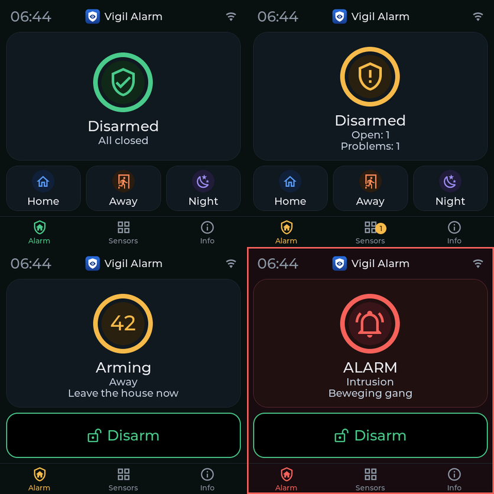
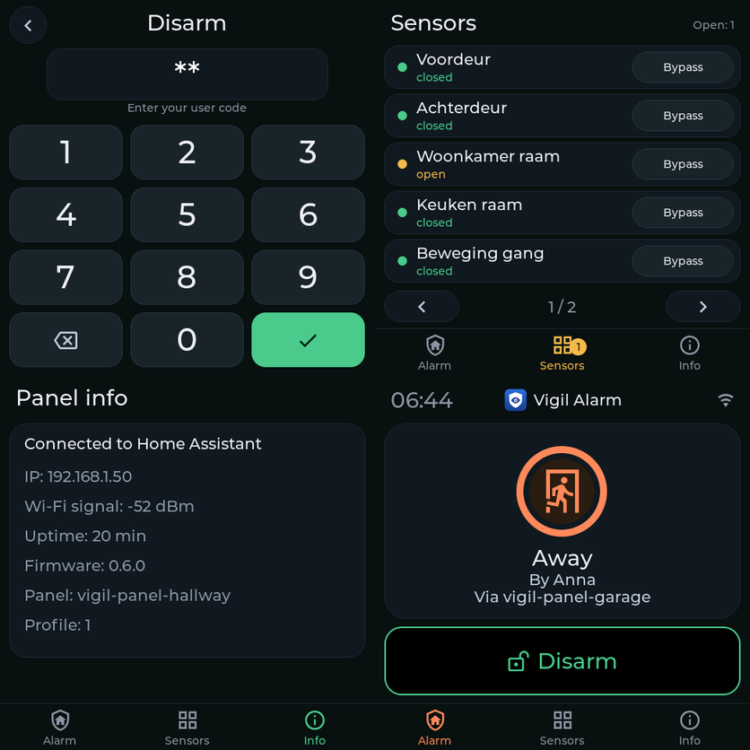
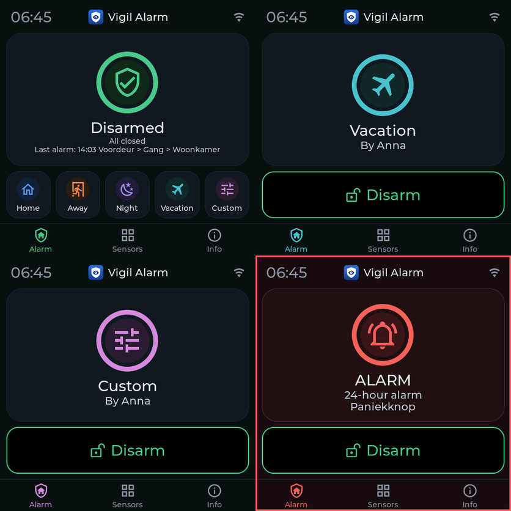

# Vigil Alarm: user guide

This guide explains how to set up and use Vigil Alarm. For installation see the
[README](../README.md). A Dutch version is in
[user-guide.nl.md](user-guide.nl.md); German, French, Italian and Spanish versions are [user-guide.de.md](user-guide.de.md), [user-guide.fr.md](user-guide.fr.md), [user-guide.it.md](user-guide.it.md) and [user-guide.es.md](user-guide.es.md).

> Vigil Alarm is not a certified alarm system. Test it regularly and do not rely on it as your
> only protection.

## Contents

1. [How it fits together](#how-it-fits-together)
2. [Setting it up, step by step](#setting-it-up-step-by-step)
3. [Using the alarm every day](#using-the-alarm-every-day)
4. [What happens during an alarm](#what-happens-during-an-alarm)
5. [Reference: the panel, tab by tab](#reference-the-panel-tab-by-tab)
6. [Automations and blueprints](#automations-and-blueprints)
7. [Automatic arming](#automatic-arming)
8. [Self-monitoring](#self-monitoring)
9. [Restarts and updates](#restarts-and-updates)
10. [Troubleshooting](#troubleshooting)
11. [Limits to know about](#limits-to-know-about)

## How it fits together

| Part | What it is |
|---|---|
| **Alarm** | One `alarm_control_panel` entity. States: *disarmed*, *arming* (exit delay), *armed home / away / night / vacation / custom*, *pending* (entry delay) and *triggered*. |
| **Modes** | *Home* (you are in, the outside is guarded), *Away* (nobody home, everything is guarded) and *Night* (you sleep, the outside is guarded). Two more modes can be switched on under *Partitions* (in the form of the partition): *Vacation* (away for a longer time) and *Custom* (your own choice; Home Assistant calls it *custom bypass*). Each mode has its own exit delay, and sensor groups can be active in them like in the other modes. Vigil does not decide what they mean: you choose which sensor groups watch in them. |
| **Sensor** | One detector, linked to a `binary_sensor` (on = open or alarm). Every sensor has a **class**. |
| **Sensor group** | Decides **in which modes** the intrusion sensors in it are watching. |
| **Confirmation rule** | Optional. An alarm only follows when several different sensors trigger within a time window. |
| **User** | A person with a code, optionally limited to certain modes. |
| **Notification** | One `notify` service that receives messages, optionally delayed (escalation). |
| **Siren** | Optional. Something that makes noise during an alarm. |

### Sensor classes

| Class | Behaviour |
|---|---|
| **Intrusion** | Watches in the modes of its sensor groups. Type *instant* (alarm at once), *delayed* (entry delay first, for the front door) or *follower* (only alarms when a delayed sensor was opened first, for example a hallway PIR behind the front door). |
| **Fire** | Always watches, in every mode, also when the alarm is off. Alarm at once. |
| **Gas** | Always watches. Choose the kind of gas: carbon monoxide, natural gas, LPG or other. With natural gas or LPG Vigil never switches the flash light, because of the risk of sparks. |
| **Tamper** | Always watches. A tamper contact that opens raises an alarm. |
| **Water** | Always watches. A *technical alarm*: it never changes the alarm state, it only publishes events and an "alarm active" sensor. |
| **24 hours audible** | Always watches, in every state, also with the alarm off, like a tamper contact: when it opens the siren sounds and the alarm channels get a message (cause *24-hour alarm*). For a panic button or a safe. While it is open, arming is refused. |
| **24 hours silent** | Always watches, no siren: a *technical alarm* like water, with a message to the *Technical* channels and a line in the log. For a silent panic button or a freezer that gets too warm. |

### Sensor groups: which sensors watch in which mode

A sensor group is a list of modes. An intrusion sensor is in one or more groups and watches in
every mode in which one of its groups is active. Two groups are created for you:

| Group | Active in | For |
|---|---|---|
| **Perimeter** | Home, Away, Night | doors and windows |
| **Interior** | Away | motion sensors |

So in *Home* only the doors and windows count, and you can walk around freely. In *Away* the
motion sensors count as well. You can add groups, for example *Basement* for *Night* only.

This is also why Vigil does not use Home Assistant areas for this: an area says **where** a
sensor sits, a sensor group says **how you want to use it**. A door contact and a PIR in the
same room belong in different groups.

The **Overview** tab shows "What each mode watches", so you can check the result.

## Setting it up, step by step

Open **Vigil Alarm** in the sidebar (only administrators see it). Saving anything reloads Vigil Alarm;
the alarm state is kept.

1. **Check the partition** (tab *Partitions*, the first row is your house): modes, exit delays, default entry
   delay and alarm duration. Under *Settings* you check whether a code is needed to arm.
2. **Add your sensors.** The quick way is *Sensors → Find sensors*: Vigil lists the door, window, motion, smoke, heat, gas, water, safety and tamper sensors that Home Assistant already knows, with the battery and tamper sensor of the same device. Tick the ones you want, change a name if you like, tick *Entrance* for doors you walk through (they get an entry delay) and add them in one go. Nothing is saved until you press the button at the bottom. Without sensor groups, press *Create default groups* first (Perimeter for doors and windows, Interior for motion). To add one by hand use *Sensors → Add sensor*:
   - Name it ("Front door"). The name decides the entity names (`sensor.front_door_status`).
   - Pick the `binary_sensor`. For a door contact or motion sensor the panel suggests the right
     sensor group by itself.
   - Choose the class and, for intrusion, the type and the sensor groups.
   - Has the device a tamper contact as well (most Zigbee door contacts do)? Fill it in under *Tamper entity*. Vigil adds a tamper sensor named "Front door (tamper)" by itself: always watching, with its own bypass switch. It follows the sensor when you rename, change or delete it, and has no row of its own in the table.
   - *If open when exit delay ends* decides what happens to a door that is still open when the
     alarm arms: **bypass with a notice** (default; it is guarded again once it closes), **wait
     until closed**, **refuse to arm**, or **start entry delay**.
   - *When the sensor becomes unreachable*: **block arming** (default for intrusion and
     tamper), **notify only** (default for fire, gas and water), **raise alarm** or **arm
     anyway (bypass)**. Fire and gas can never be bypassed.
   - Optionally add a battery sensor; Vigil then warns when it runs low.
3. **Add a user** (tab *Users*): a name and a code. Without any user, no code is needed at all.
   A user can be limited to certain modes. Bypassing a sensor is a right you give to a user (*May bypass sensors*): without it a user can neither bypass nor restore a sensor, even with a right code. Whoever may bypass a sensor may also restore it. A tamper sensor needs the extra right *May bypass tamper*, for bypassing and for restoring. Users saved before this right existed keep it until you untick it.
4. **Add a notification** (tab *Notifications*): pick a `notify` service or a notify entity (for example a *notify group* made under *Settings → Devices & services → Helpers → Group*, shown as `notify.family`) and the kinds of
   message it should get. A notify entity gets a title and a message only: no app specific data, so no critical alert on a phone (choose a `mobile_app_…` service for that). With a *delay* the channel only sends alarm messages when the alarm is
   still active after that time: that is an escalation channel for a second person or device.
5. **Optional: a confirmation rule** (tab *Confirmation rules*): choose the instant intrusion
   sensors, how many must trigger, and in what time window.
6. **Optional: a siren** (tab *Sirens*). See below.
0. **New: the setup wizard.** When not enough is set up yet, the *Overview* tab starts with the card *Set up Vigil*, and the card *Ready for use?* has a *Setup wizard* button. The wizard goes step by step through the modes, the sensors, the user (also made from a Home Assistant person), the notification channel (a phone with the app in one click), the siren and the panel, and ends with *Ready for use?*. Every step can be skipped, *Continue later* closes the wizard and the card *Continue the wizard* brings you back where you were. The wizard uses the same forms as the tabs and saves nothing until you confirm it.
7. **Look at *Ready for use?*** at the top of the *Overview* tab. It names what is still missing (a user with a code, a notification channel, a mode that nothing watches, sensors without a battery sensor) and has a button to the right place. If you have no notification channel yet and Home Assistant knows your phone, one button adds it and sends a test message.
8. **Test everything** with the *Test* buttons and by arming and opening a door. Use the
   [test guide](installation-and-testing.md) for a full test plan with virtual sensors.

### Sirens

A siren has an on/off entity (`siren`, `switch` or `light`) and optional extras: a flash light,
a tone selection entity and a volume entity. Per cause (intrusion, fire, gas, tamper) you can
give a tone and volume. They are set just before the siren sounds and restored afterwards. The
siren stops when the alarm is switched off and after a maximum duration. A siren that stops by
itself can be switched on again every N seconds.

Many sirens cannot report whether they are really on. Then `siren_started` has
`verified: false`, and a command that fails gives `siren_failed` and a notification. The *Self-test* card on the *Overview* shows, per siren, what its last start came to: *confirmed on*, *command sent, the siren does not confirm* or *failed*, so a siren that cannot confirm is not mistaken for one that does. Vigil cannot hear a siren: test it by ear now and then.

**Preset for the Sonoff SNZB-09P (Zigbee2MQTT):** pick the siren's on/off switch under
*Siren*, then choose the preset. Vigil fills in tones (classic for intrusion, warning for fire,
emergency for gas, rapid for tamper), volume, duration, and looks for the tone, volume, flash
light, battery and power-mode entities of the same device. If something is not found you pick
it yourself. With ZHA or another integration, choose the on/off entity and fill in the rest by
hand.

## Using the alarm every day

### Arming and disarming

Use the alarm panel card (or the tile card, or the Companion app), the *arm* actions in an
automation, or the [dashboard](../examples/dashboard.yaml). Enter your code if one is needed.

- **Arming** starts the exit delay (state *arming*), then the alarm is *armed*. Walk out.
- **Disarming** always needs a code when users exist. During the entry delay (*pending*) you
  have the entry delay time to enter it.
- A user can be limited to certain modes; arming another mode is refused.

### When arming is refused

Vigil tells you why: *an alarm condition is open* (a fire or tamper sensor is on), *a sensor is
unavailable* (an intrusion sensor is unreachable and set to block), or *a sensor is open* (a
sensor set to refuse). The attribute `refuse_reason` and the notification say which sensors. Fix
the sensor, or bypass it.

**Why can't I arm?** The *Overview* tab of the Vigil panel has a card with that name while something
stops arming: per sensor what is wrong and in which modes, with *Show* and *Bypass* buttons (a fire or
gas sensor cannot be bypassed: remove the cause first). On the touch panel and in the Vigil card a refused
arm says what stops it (*Cannot arm: Front door tamper is open*) and, if the panel may bypass, shows one
button, **Bypass and arm**, which asks for a code and then bypasses what stops it and arms. It needs the
same rights as bypassing by hand (the right to bypass, and the right to bypass tamper for a tamper
sensor), and it is never possible for a fire or gas sensor. In your own automations the same is the
`vigil_alarm.arm` action with `bypass_open: true`.

### Bypassing a sensor

Bypass leaves one sensor out until the alarm is switched off (or until you un-bypass it).

**Permanent bypass.** Tick *Keep the bypass after disarming (permanent)* on a sensor (not available for fire and gas sensors) and a manual bypass of that sensor stays after the alarm is disarmed, also through a restart of Home Assistant, until someone restores it by hand. Handy for a sensor that has been broken for some time. The sensor stays in the list as *bypassed*, the *Overview* tab has a card **Permanently bypassed** with a *Restore* button, and the Vigil card and the touch panel show *Bypassed: Broken window* under *Disarmed*, so it is not forgotten; the log has `sensor_bypassed` when it starts and `sensor_unbypassed` (reason *manual*) when it ends. Without the tick nothing changes: the bypass ends at disarming.

- In the panel and dashboard: the **Bypass** switch of the sensor (administrators only).
- By action: `vigil_alarm.bypass` and `vigil_alarm.unbypass` with the sensor entity and, for people who are
  not administrators, a code. That code is only needed if arming needs one too (the setting
  *code required to arm*). Tamper sensors can only be bypassed by administrators and by users
  who have that right.
- Fire and gas sensors can never be bypassed.

### A touch panel



The panel and the Vigil card share one look. The state is a **ring with an icon** in the colour of the state: green when disarmed and everything is closed, amber when something is open or while arming, orange during the entry delay, blue, coral, violet, teal and pink for home, away, night, vacation and custom, red for an alarm (with a red frame around the screen), grey without a connection. During the exit and entry delay the ring is the **countdown**: the seconds in the middle, the ring running down to empty; when it reaches zero the alarm is on. Under the ring you see the buttons for the modes this panel may use, or one big *Disarm* button when the alarm is on. At the bottom are the tabs *Alarm*, *Sensors* (with the number of open sensors) and *Info*; the keypad has no tabs.



With *Vacation* and *Custom* switched on there are up to five mode buttons in one row (the text gets smaller), and Disarmed shows the last alarm under the state:




With the ESPHome panel (Guition 4848) you arm, disarm and bypass sensors without a phone. It reads
its profile from Vigil: it shows only the modes the panel may arm in, asks for a code the way Vigil does and uses the language you set for it.
Installation and options are in [esphome/README.md](../esphome/README.md). The device name is the panel id and the `source` of every call, which shows in the history as *Anna (vigil-panel-garage)*. A wrong
code gives the event `code_rejected`, never with the code itself. The lock goes in steps and you set the numbers under *Settings*, *Locking*. By default: after 3 wrong codes that panel is locked for 5 minutes, then after 2 more wrong codes for 15 minutes, then after 2 more for 60 minutes, and after 1 more wrong code for good (events `code_locked` and `code_locked_permanent`, also sent to your fault notification channels). A permanent lock only goes away with *Clear lock* at the panel, and then everything starts from the first step again. A right code also sets the count and the step back to zero. The lock stays in place when Home Assistant restarts; the shared timer for everything that is not a registered panel (*other*) never locks for good, because nobody could lift it, but repeats the last wait; an administrator in the UI can still operate the alarm. Every registered panel (see below) has its own timer; everything else (a phone, an automation, any other name) shares one.

#### Panels, tablets and phones

The tab *Panels* is the register of everything that may operate the alarm besides the Home Assistant UI: ESPHome panels (recognised by their panel id) and tablets or phones (recognised by their Home Assistant account). All are set up the same way. As soon as one account is registered, other ordinary accounts are refused before their code is looked at (event `user_refused`); administrators, automations and ESPHome panels are not touched. Details, and the advice to give an administrator a second, ordinary account for daily use, are in the [tablet guide](tablet.md).

#### Registering a panel (tab *Panels*)

A panel or tablet that you register in the *Panels* tab is treated as a dumb terminal: Vigil decides what it may do. You give it a name and a **panel id**, which is the name of the ESPHome device and also the `source` its calls carry. Per panel you set:

When you add a panel you first choose the **kind of device**. *ESPHome panel* asks for the name of the ESPHome device (the panel id). *Tablet or phone running Home Assistant* asks only for the Home Assistant account; Vigil makes the panel id from the name itself. Everything else (modes, disarm, bypass, language, sensor list, installer code) is the same for both. The language starts as that of the person who adds the panel, English if that is not Dutch or English.

- the modes it may arm in, and whether it may disarm, bypass sensors, and silence or acknowledge;
- the language (default: that of Home Assistant);
- whether it may show the list of sensors: *always*, *only after unlocking* (default) or *never*, and how long it stays unlocked (default 60 seconds);
- an optional **installer code** for this panel, kept as a hash, with its own wrong-code timer. The panel sends it with `vigil_alarm.unlock_panel`; Vigil checks it and unlocks the panel for the set time. It opens the information pages and (like the code of any Vigil user) the sensor list, and never disarms the alarm: disarming always needs a valid user code;
- what the firmware **reports** about itself (its hardware, firmware version and profile version) is shown on the panel card, and *Ready for use?* gives advice when the firmware does not understand the profile;
- **watch whether it is reachable** (*Watch whether this panel is reachable*): on by default for an ESPHome panel, off by default for a tablet or phone, because a phone that is switched off is no fault. With it off you get no Repair and no message when the panel drops out, and the list says *Not monitored*. Entries made before this setting existed stay on;
- **blocked**: Vigil refuses every call with that panel id and logs it.

What is enforced, on the server side: a call from a registered panel that its profile does not allow is refused and logged (event `panel_refused`, with the reason). Bypassing a sensor from a registered panel always needs a user code. A blocked panel is refused before any code is looked at. Calls whose source is not registered are not restricted by any of this. **The panel key.** The `source` of a call is plain text, so on its own it proves nothing: anyone who can call a Home Assistant action could write the name of a panel in it. Give an ESPHome panel a **key** (the key button in *Panels*): Vigil shows it once and keeps only a digest, you put it in the panel's `secrets.yaml` and the panel sends it with every call. From then on a call in the name of that panel without the right key is refused and logged (`panel_refused`, reason `key`), whoever makes it. This protects against someone with a normal Home Assistant account or a script that does not know the key; it does not protect against someone who can read your ESPHome configuration or has administrator rights. Calls that name no panel, other panels and tablets (which are told apart by their Home Assistant user) are not affected. A panel without a key works as before, and *Ready for use?* advises you to make one. A new key replaces the old one at once: install the panel again with it. Use the encryption of the ESPHome API as well, so the key does not travel in the clear.

Every registered panel gets an entity `sensor.<panel_id>_profile` (dashes in the panel id become underscores, so `vigil-panel-garage` gives `sensor.vigil_panel_garage_profile`) with what it may do and show. The names of the sensors are only in it while the panel is unlocked (or when the list is set to *always*), and the attributes that hold them are kept out of the history. It never holds a code, hash, key or password. **Be honest about what this protects:** `source` is plain text, so Vigil cannot prove that a call really comes from that panel. The profile protects against mistakes and against a panel that should not have certain buttons, not against someone who can already call services. The real protection is the code, the lockout, the encrypted connection of the panel and the access rules of Home Assistant itself.

Two buttons per panel, **Unlock** and **Clear lock**, exist only in the Vigil panel (administrators only) and not as Home Assistant actions: an action can be called by any user, automation or panel, so a stolen panel could unlock itself. *Unlock* shows the sensor list for the set time; *Clear lock* lifts the stored lock after wrong codes (it survives a restart, so this is how you lift it). Both are logged with the administrator who did it (`panel_unlocked`, `panel_lock_cleared`).

**Out of reach.** If Vigil cannot reach the ESPHome device of a panel for 10 minutes, you get a Repair *Panel not reachable* and a message on your fault channels (events `panel_offline` and `panel_online`). A panel that is out of reach never changes the alarm state. A blocked panel, and a panel for which *watch* is switched off, give no Repair. After a restart of Home Assistant the ten minutes start again.

A tablet can be registered too, bound to a Home Assistant user, and shows the Vigil card (`type: custom:vigil-card`); see the [tablet guide](tablet.md).

The ESPHome firmware reads this profile itself. A panel that is not in the register shows *Not linked* with the panel id it expects; a blocked panel shows *Blocked*. The list of sensors and the panel's info page (IP address, signal, firmware, uptime) open with a code: the sensor list with the code of any Vigil user (or the installer code), the info page with the installer code of the panel only; until it is unlocked the panel shows only how many sensors are open. The restrictions are also enforced by Vigil for every call that carries the panel's `source`, whatever the firmware does.

### Silence and acknowledge

- `vigil_alarm.silence` stops the sirens while the alarm stays active.
- `vigil_alarm.acknowledge` cancels the pending escalation messages: you have seen it.

Both need a user code, or an administrator in the interface.

## What happens during an alarm

An example with the alarm armed in *Away* and the front door (a delayed sensor) opening:

| Moment | What happens |
|---|---|
| Door opens | State *pending*. Event `pending_started`. Notification "Entry delay started". |
| Within the entry delay | Disarm with a code: no alarm. |
| Entry delay ends | State *triggered*, cause *intrusion*. Event `triggered`. Notifications go out, sirens sound, "Intrusion alarm" turns on. |
| After the delay of an escalation channel | If the alarm is still active and not acknowledged, that channel sends its message. |
| Disarm, or the alarm duration ends | Sirens stop, `trigger_ended`, state back to *disarmed* or *armed*. |

An instant sensor skips the entry delay. Fire, gas and tamper alarm at once, in every state. A
more serious cause replaces a less serious one (`trigger_cause_changed`): the order is fire,
then gas, tamper, sensor fault and intrusion.

With a **confirmation rule**, a single trigger of one of its sensors raises no alarm. It
publishes `sensor_unconfirmed` (and a notification if you chose to be told). When the required
number of different sensors trigger within the window, the alarm is raised with `confirmed_by`
in the event.

## Reference: the panel, tab by tab

Actions in the lists are icon buttons (edit, copy, delete, test); hover for the name. Rules and users have no copy button. Some fields have an ⓘ: click it for a fuller explanation.

| Tab | What you do there |
|---|---|
| **Overview** | the card *Alarm* with the Vigil logo and, with more than one partition, a coloured tile per partition (green off, blue armed, amber counting down, red alarm), the card *Practice and test* (*Start practice mode* and *Start walk test*, see *Practice mode and walk test* below), the card *Set up Vigil* (the wizard, while something is still missing), the card *New sensors found* (sensors that appeared in Home Assistant since Vigil last looked; *Review and add* opens the list with only the new ones, *Not now* does not announce them again; nothing is ever added by itself, and the *Sensors* tab shows a badge), *Ready for use?* (what is still missing), the *Self-test* card (last check, last siren test, next test, *Test siren now*), the *Heartbeat* card (last success, *Test now*), a *Dashboard* card with a button that copies a dashboard with your own entity ids, alarm state, attention points (low batteries, unreachable devices), what each mode watches, and the live status of every sensor. |
| **Partitions** | One row per partition, the first (your house) included: name, modes, exit delays, default entry delay, alarm duration and chime device, and below it *What each mode watches*, one card per partition and one for the sensors that are always on. With more than one partition the next tabs (*Sensor groups*, *Sensors*, *Confirmation rules*) have a table per partition. A partition that still has sensors or sensor groups cannot be deleted. |
| **Sensors** | *Find sensors* proposes sensors from Home Assistant; add, edit, copy and delete sensors. Under each name a sentence says how the sensor reacts and when it is watching. The table shows battery level in its own column. One entity can belong to only one sensor. The *Tamper entity* field links the tamper signal of the same device: Vigil creates a separate tamper sensor that can be bypassed on its own. You can also create a standalone tamper sensor. |
| **Sensor groups** | Which sensors watch in which modes. A group can *suggest itself* for new door contacts or motion sensors. A group that is still in use cannot be deleted. |
| **Confirmation rules** | Several sensors must trigger within a time window. A sensor that is in a rule cannot be deleted. |
| **Users** | (Cannot be copied.) Name, code, allowed modes, right to bypass, right to bypass tamper. Codes are stored hashed and never shown. Leave the code empty when editing to keep it. |
| **Notifications** | `notify` service, kinds of message (alarm, entry delay, arming and disarming, faults and notices, technical alarms), delay, high priority. *Test* sends a test message. |
| **Sirens** | See above. *Test* sounds the siren for 3 seconds (refused during a real alarm). |
| **Log** | Everything Vigil publishes as an event, newest first (the newest 200 are shown). The *User* column says who did it and *Via* where (panel or device); armed on a panel without a code reads *unknown (no code)*. *Download* gives the whole log as JSON Lines or CSV (RFC 4180), with times in UTC (RFC 3339) and the fields `time`, `event`, `partition`, `source`, `user`, `item`, `result` and `detail`. It keeps 90 days by default (*Settings*), holds no codes and survives restarts. |
| **Backup** | The last 10 versions of your configuration (one is kept at every change, with what changed), *Restore* for each (it shows what would change first, and the restore itself can be undone the same way), and *Export configuration* and *Import configuration…* as a file. See *Backups, export and import* below. |
| **Settings** | What applies to the whole system: how long to wait for slow sensors after a restart of Home Assistant (seconds, default 120), the screen of the panels (seconds until the screen goes dark, default 30, and whether it may also go dark during an alarm, default no), battery limit, code required to arm, minimum code length (4 to 12 characters, default 4; applies to new and changed codes, existing codes keep working), days to keep the log (default 90), and the self-test: reminder interval (default 30 days, 0 = off), seconds the siren sounds (1 to 5, default 2), sounding by itself, and the hours it may do so, and the heartbeat address and its interval in minutes (default 5). |
| **About** | A "new" badge after an update, version, links to the user guide and GitHub, release notes (newest first) and a button that copies the details for a bug report. |

Vigil speaks **English, Dutch, German, French, Italian and Spanish**; every other language shows English. The
language of the **notification texts** follows the Home Assistant system language (Settings → System → General).
The admin panel and the Vigil card follow your own profile language. A touch panel or tablet has the language you
choose for it under *Panels* (a new panel starts with the language of your account). The translations of German,
French, Italian and Spanish were written by Claude (an AI) and are not checked by a native speaker: please report
a clumsy or wrong text as an issue. A touch panel (ESPHome) needs the 0.5.6 firmware to speak the new languages;
older firmware shows English for them.

## Practice mode and walk test

**Practice mode** lets you run the alarm for real without startling the neighbours. On the Overview: *Start practice mode* (only while the alarm is off). The alarm then works as always: it counts down, the entry delay runs, it triggers and the panels (also the Vigil card and the touch screen) show it. But **no siren sounds** and **no message goes out**, not even a fault message. Everything is in the log with `practice` in the details. The panel shows a *Practice mode* chip at the top, the Vigil card a line, and the alarm entity has the attribute `practice`. Practice mode ends **at the first disarm** (one round), after 30 minutes, or with *Stop practice mode*, so a forgotten practice mode can never keep a real alarm silent. After a restart of Home Assistant it is off. **If practice mode runs out while the alarm is armed,** the alarm stays armed and works for real from then on: a break-in sounds the siren and sends messages. If the alarm is going off at that moment, the siren and messages start then.

**Walk test** checks that every sensor reacts. With the alarm off: *Start walk test* (on the Overview or under *Sensors*), walk along the doors, windows and motion sensors and watch them being ticked off live. Only **intrusion sensors** take part: they do nothing while the alarm is off. Fire, gas, water and tamper sensors are always on and would start a real alarm; test those with their own test button. A sensor that does not react does not stop the test: at the end a list says what was missed (*did not react* or *is unavailable*). The test ends when all sensors have been seen, with *Stop the test*, after 15 minutes, or as soon as you arm the alarm. The log has `walktest_started` and `walktest_finished`.

## Alarm memory, false alarms, duress code and chime

**Alarm memory.** From the moment an entry delay starts until the alarm is disarmed, Vigil writes down **every sensor that opens**, with the time and the room (the area you gave the sensor in Home Assistant). That includes sensors that do not count in the armed mode (a motion sensor that only watches in *Away*, while you are armed at *Home*) and sensors that are bypassed: for the path of an intruder through the house they all tell something. A sensor that flickers is one step with a count. The *Overview* tab has the card **Last alarm**: when, the cause, the first sensor, whether it was disarmed (and by whom) or cancelled, and the steps in order, with for each step whether it counted for the alarm. A sensor that counted is in the log as `sensor_faulted`; one that did not count has its own line `alarm_sensor_seen`. The Vigil card shows *Last alarm: 14:03 Front door → Hall → Living room* while the alarm is off (after the code, when the sensor list is hidden). The alarm entity has the attribute `last_alarm` with the same in short (the last 8 steps).

The memory stays after a restart, until someone clears it or the next alarm replaces it. **Clearing needs no code**: *Clear alarm memory* on the card in the Vigil panel (Overview tab), the service `vigil_alarm.clear_alarm_memory`, or an automation. It cannot be cleared while an alarm is going on. An entry delay that ends in a disarm in time is not an alarm and leaves nothing behind. The touch panel does not show it yet (that needs new firmware).

**False alarms: the cancel window.** Whoever enters a valid code within **60 seconds after the siren went off** (a setting under *Settings → Modes and delays*; 0 switches it off) has caused a false alarm: the siren stops as with any disarm, the alarm memory says *cancelled*, and a message *Alarm cancelled: false alarm by Anna* goes to the alarm channels that already heard about the alarm. Event `alarm_cancelled`. It only applies to intrusion alarms; fire, gas and tamper are never called false alarms.

**Duress code.** Edit a user and fill in *Duress code (optional)*: a second code for when someone forces you to switch the alarm off. It must differ from every other code, and Vigil only accepts it when there is at least one notification channel that has the kind of message **Duress**. Entering it works exactly like the normal code: the alarm is disarmed, the siren stays quiet, **nothing shows** on the panel, the card or the event entity. Meanwhile the channels with *Duress* get *SILENT ALARM: Anna used the duress code at …* (with high priority if the channel has that). The line `duress_used` is in the log only. It works for arming and the other actions too, and it never counts as a cancelled alarm. Choose a code you can enter without thinking, and do not write it down where an intruder will look.

**Chime.** Tick *Chime* on a sensor: when it opens **while the alarm is off**, a short sound plays. Under *Partitions* (in the form of the partition) you choose what makes the sound (a siren, switch, light, button or script), and under *Settings → Chime* for how long. There is no alarm, no message and nothing in the log; when the alarm is on, nothing happens. The event `chime` is on the event entity, so an automation can do more (for example a message on a speaker) even when you choose no entity. A contact that flickers rings once per 3 seconds.

## Partitions: the house and the garage

By default Vigil has one alarm. Under **Partitions** you can add more, for a garage, a workshop or a guest house. Each partition has its own state (armed or not), its own modes and delays, and its own alarm entity.

- **The first partition** is the alarm you already had. It is the first row under *Partitions*, where you rename it and change its modes and delays; *Settings* holds only what applies to the whole system. Further partitions have their own *Modes and delays* in their form (a partition may have fewer modes than the house; a sensor then only watches in the modes the partition has).
- **A sensor belongs to one partition** (field *Partition*). Fire, gas, water and 24-hour sensors have no partition: they watch in all of them. The tamper contact of a sensor (the tamper input you fill in with the sensor) watches in the partition of that sensor, so a garage panel only shows and bypasses the tamper of the garage. A tamper sensor you add yourself (class *tamper*) gets a *Partition* choice too, with *All partitions* as the default. Their alarm is one alarm for the whole house; disarming it in any partition that is in the alarm ends it everywhere.
- **The entity *All*** appears when there is more than one partition. Its state is the highest state of any partition; when they differ the attribute `status` says `mixed`, and the card says *Mixed*. Arming *All* arms every partition or none: if one is refused (an open door, a mode it does not have), nothing is armed.
- **Who may do what:** a user, a panel, a siren and a notification channel always have a *Partitions* choice (in the form just above the modes). It is required: tick the partitions, or *All partitions*. The modes you can tick below it are those of the chosen partitions. A code only works for the partitions of its user. Safety alarms (fire, gas, water, tamper, 24-hour) sound on every siren, whatever its partitions. Notifications get the partition name added when there is more than one.
- **Default partition of a panel:** a panel has a required *Default partition* (one of its partitions, or *All*). That is what the panel operates after start and after the *Return to default partition* time (*Settings*, *Panel screen*, default 30 seconds, 0 = never).
- **Services:** `vigil_alarm.arm` and `vigil_alarm.disarm` take `partition` (the id, or `all`). Without it they act on the first partition.
- A partition that still has sensors or sensor groups cannot be deleted; move them first.
- **Sensor groups belong to one partition.** With more than one partition, the *Sensor groups* tab has a table per partition. A group offers only the modes of its partition, and a sensor can only use the groups of its own partition. A new partition starts without groups: use *Create default groups* in its table. Confirmation rules are listed per partition as well (a rule's sensors must all be in one partition).
- **The log** has a *Partition* column; a fire, gas, water, tamper or 24-hour event has none (it is for the whole house).
- **Touch panels and the tablet card** always show which partition (or *All*) they operate, also when it may be only one, together with *Vigil Alarm* and the logo. A panel that may operate several partitions has a row of buttons to switch (and a button at the top of the *Sensors* page that chooses whose sensors are listed); *All* arms or disarms every partition. After the return time without touch it jumps back to its default partition. The service `vigil_alarm.select_partition` does the same switch from an automation.

## Automations and blueprints

Everything beyond notifications and sirens is yours to automate. Vigil publishes the event
entity `event.<name>_alarm_events`; the [README](../README.md#for-automations) lists all events
and their data.

The included [blueprints](../README.md#blueprints) cover the common cases:

- **Flash lights during an alarm** saves the state of your lights, flashes them while the alarm
  is triggered and restores them afterwards, also when the alarm is switched off. Choose which
  causes flash (gas is off by default). The default of 2 seconds on and 2 seconds off stays
  well below the rate that matters for photosensitive people. For Hue, use a room or zone
  (group) instead of single lamps; groups are disabled by default in Home Assistant, so enable
  them first.
- **Announce alarm events with speech** speaks a message when the alarm arms, disarms, starts
  the entry delay or goes off. Leave a message empty to stay silent for that event.
- **Run your own actions on alarm events** is the general building block: choose events and add
  any actions, with `event_type` and `data` available.
- **Remind when arriving at an armed home** sends a message when someone comes home while the
  alarm is armed. It does not disarm.

### Automatic arming

**Arm when everyone has left** and **Arm at a set time** arm the alarm for you. They never
disarm: disarming always needs a person with a code.

Arming needs a code unless *Code required to arm* is switched off in the panel. You have two
choices:

1. Switch *Code required to arm* off. Then anyone who can reach the alarm entity can arm it
   (disarming still needs a code). This is the simplest option and carries no secret.
2. Keep the code requirement and put a code in the blueprint. That code is stored **as plain
   text** in the automation. Make a separate Vigil user for it, limited to the one mode the
   automation uses, and never use your own code.

If arming is refused (for example because a door is open), you can get a message that says
why. If you leave the message field empty, nothing is sent.

## Self-monitoring

Real faults (an unreachable sensor, a low battery, a siren that is unavailable or on battery power) also appear under *Settings → System → Repairs* and go away by themselves when fixed. Missing settings are not repairs; *Ready for use?* shows those.

- **Battery:** give a sensor or siren a battery sensor. Vigil reports `battery_low` when the
  level drops to the limit (default 20%, a setting) and `battery_ok` when it recovers.
- **Sensors:** an unreachable sensor is handled by its *when unreachable* setting, and reported
  with `supervision_lost` and `supervision_restored`.
- **Sirens:** Vigil reports when a siren becomes unavailable and, with a power-mode entity,
  when it runs on its battery (the value that means "on battery" is a setting, default
  `battery`; check what your device reports). Add the tamper contact of a siren as a tamper
  sensor.
- Problems that exist at startup are listed in the `problems` attribute of the alarm without an
  event; events follow on changes. The overview shows them under *Attention*.

### Self-test

Nobody tests a siren every week, so Vigil does the remembering. It runs by itself and needs nothing from you until it is time for a real test.

- **Quiet check, daily.** Vigil checks that the notification services you set up still exist and that the sirens can be reached. It makes no sound. Only a notification channel that has disappeared (for example after you changed phones) produces a message and a Repair; an unreachable siren is already reported as a fault by the supervision above.
- **Siren test, monthly.** By default every 30 days (a setting; 0 turns it off) Vigil sends a reminder to the channels that receive *faults and notices*. On a phone with the Home Assistant app the message has a **Test siren** button; a tap sounds the siren for 2 seconds. You can also use *Test siren now* on the Overview tab or call `vigil_alarm.test_siren`.
- **If you do not react,** a second reminder follows after 3 days. After 7 more days a Repair says the test is overdue. Doing a test, by any of the three ways, clears it.
- **Let Vigil sound the siren itself** is off by default. When you turn it on, Vigil sounds the siren when the test is due, but only between the hours you set (default 9 to 20), so nobody is woken.
- The test is refused during a real alarm, and it is not an alarm: nothing is sent to the alarm channels.
- The *Self-test* card on the Overview tab shows the last quiet check, the last siren test and when the next one is due. Self-test events (`selftest_checked`, `selftest_reminder`, `selftest_siren_tested`) are written to the log but do not count as the alarm's last event.

### Heartbeat

A siren and a notification only help when Home Assistant itself is running. The heartbeat covers the other case: if Home Assistant, the computer it runs on or your internet connection stops, nothing inside the house can tell you. So Vigil calls a web address at a fixed interval, and a monitoring service **outside** your house raises the alarm when the calls stop.

- Vigil is not tied to a service. Under *Settings* you enter a **heartbeat address** and the **minutes between heartbeats** (default 5). Any service that expects a regular call and reports when it stays away works. Leave the address empty to turn it off.
- The call is made all the time, also when the alarm is disarmed, because the question it answers is "is Vigil still running?".
- The call carries nothing about your alarm: no state, no names, no codes. It is a plain GET request.
- The address is a secret, because services usually put the key in it. Vigil keeps it out of the log, the Repairs and the downloaded diagnostics, and the panel never shows it to anyone but an administrator on the Settings tab.
- The *Heartbeat* card on the Overview tab shows the interval, the last success and the last failure, and has a *Test now* button. After three failures in a row a Repair appears, which goes away when the heartbeat works again.

**Worked example with Healthchecks.io** (a free plan exists, or you can run it yourself):

1. Create a check. Set its *period* a little above your interval, for example 5 minutes, and a *grace time* of 5 to 10 minutes, so a single missed call does not trigger a message.
2. Under *Integrations* connect where the message must go (email, or an app on your phone).
3. Copy the check's *ping URL*. It is an `https://` address that ends in a long identifier.
4. Paste it in Vigil Alarm under *Settings → Heartbeat address* and save.
5. Click *Test now* on the Overview. The check turns green within a few seconds.
6. To prove it works, stop Home Assistant for longer than the period plus the grace time. You should get a message from the service.

Other services work the same way: you need an address that expects a call, a period, and a way to be told when it is missed.

## Restarts and updates

### Backups, export and import

Whenever your configuration changes (an edit in the panel, an import, a restore) Vigil keeps the
configuration as it was just before, together with a summary of what changed (*Sensors: 3 added,
Users: 1 changed*). The last 10 versions are kept (the number is a setting, 1 to 50, under *Settings* → *Backup*; lowering it drops the oldest versions at once); the **Backup** tab lists them. *Restore* shows what
would change and puts that version back. Restoring is a change too, so you can undo it with the
version it creates. After a save in the panel the message *Saved* has an *Undo* link that restores the
version from just before. The eye icon (*View*) on a version opens a window with the change itself (which items were added, changed or removed, and which settings). The arrow icon (*Restore*) puts the version back. The *Vigil version* column says which Vigil version made each version. An **update of Vigil** that changes your stored configuration (a migration) keeps the configuration from before it too, as *Vigil update*. A version that was made by an older *storage version* can be viewed but not restored (that would need a migration, and the list says so); versions made after the update can. Only the configuration is kept, not the state of the alarm (armed, bypassed).

*Export configuration* downloads the whole configuration as a file; *Import configuration…* reads such a
file, shows what would change and replaces the configuration when you confirm (the present configuration
is kept as a version first). The file holds no codes, but it does hold the hashed codes, the heartbeat
address and the names of your notification services, so keep it safe. A file is only accepted from
the same storage format (the file says which); import it in the same version of Vigil it came from.
Sensors, users and panels keep their id in the file, so importing in the installation it came from keeps
the entities; in another installation the entities are created again.

- The alarm state and running timers are saved. After a restart the alarm is in the same state;
  an entry delay that ran out during the restart becomes an alarm, with the correct time.
- For the first 10 seconds after Home Assistant starts, sensor states are not trusted yet, so
  sensors that have not loaded do not cause false faults. Arming in that time is refused with
  "still starting up".
- Updating Vigil Alarm through HACS needs a Home Assistant restart. Your configuration is
  migrated automatically.

## Troubleshooting

See also **[My alarm does not do what I expect](troubleshooting.md)**.

| Problem | What to do |
|---|---|
| **No "Vigil" in the sidebar** | Only administrators see it. Hard-refresh the browser, restart Home Assistant, and look in the log for lines with `vigil`. |
| **The panel stays empty or says it could not be loaded** | The integration is not running: look under Settings → Devices & services for an error. Refresh the browser. |
| **Arming is refused** | Read the reason in the notification or the `refuse_reason` attribute, and check the sensors named there. |
| **A sensor is reported unreachable** | Check the device. For a short time you can set *when unreachable* to *arm anyway (bypass)*. |
| **No notification arrives** | Use *Test* on the notification. Check that the `notify` service exists and that the kind of message is ticked. |
| **The siren does not sound** | Use *Test* on the siren. Check the on/off entity and the siren's *Sound for* causes. Some sirens stop by themselves after their own duration; see *repeat every*. |
| **An automation does not react** | Trigger on the event entity (not on the alarm state) and check `event_type` in the automation trace. |
| **A blueprint cannot arm** | Arming needs a code. See [Automatic arming](#automatic-arming). |

For a bug report, include what you did, what you expected, what happened and the log lines
with `vigil` (Settings → System → Logs). For more detail add to `configuration.yaml`:

```yaml
logger:
  logs:
    custom_components.vigil_alarm: debug
```

## Limits to know about

- Vigil Alarm is **not certified** for any alarm, fire-detection or insurance standard.
- It runs inside Home Assistant. If Home Assistant is down or restarting, there is no alarm.
- Everything is configured by Home Assistant administrators, in the panel. There is no other
  way to edit sensors and users; this is on purpose.
- **Tags** can be stored on a user but have **no function**. Operate the alarm
  with a code.
- Your own code only protects the alarm entity. Anyone who is a Home Assistant administrator
  can change the configuration.
- Test regularly, including a real alarm and your notification route, and replace batteries
  when Vigil tells you to.
