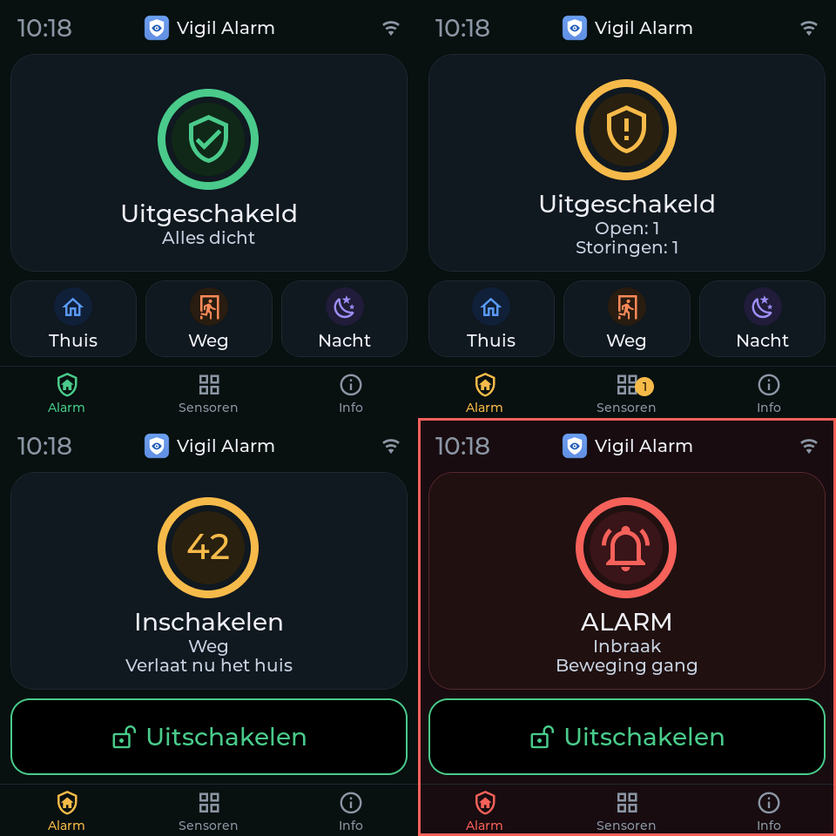
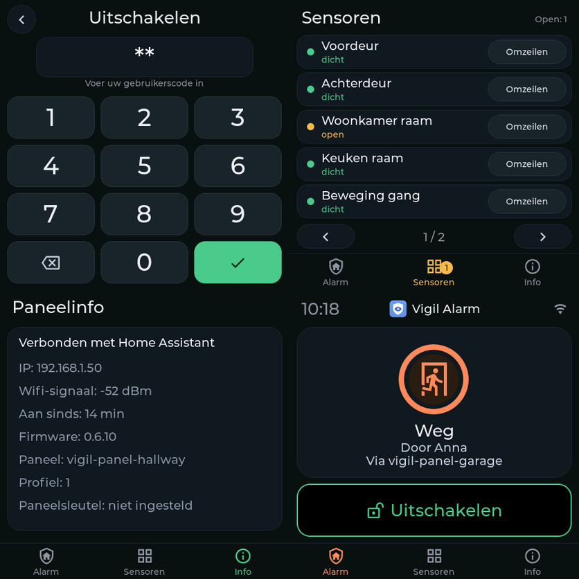
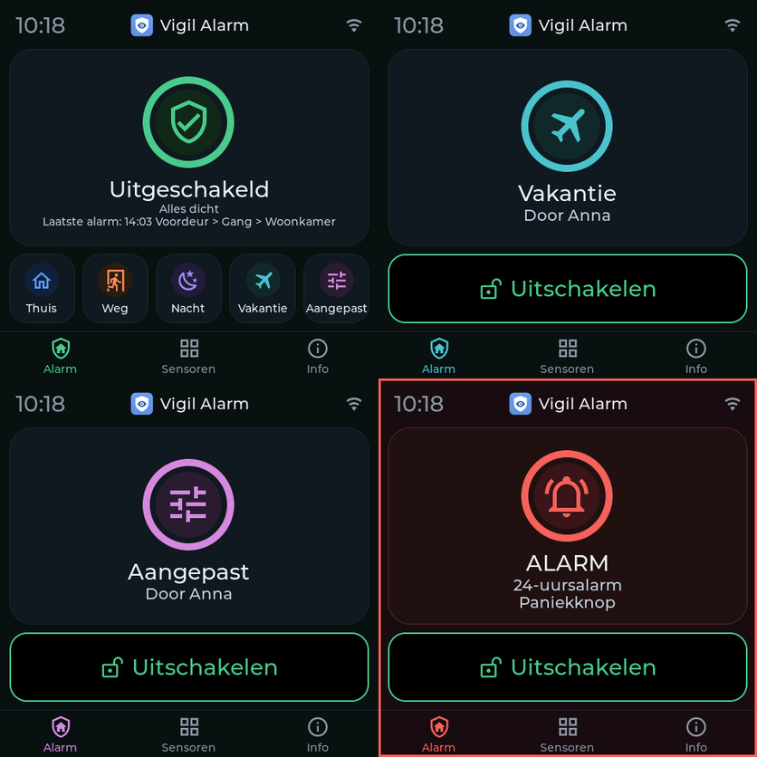

# Vigil Alarm: gebruikershandleiding

Deze handleiding legt uit hoe je Vigil Alarm instelt en gebruikt. Voor het installeren zie de
[README](../README.md) (Engels). Een Engelse versie van deze handleiding staat in
[user-guide.md](user-guide.md). Duitse, Franse, Italiaanse en Spaanse versies staan in [user-guide.de.md](user-guide.de.md), [user-guide.fr.md](user-guide.fr.md), [user-guide.it.md](user-guide.it.md) en [user-guide.es.md](user-guide.es.md).

> Vigil Alarm is geen gecertificeerd alarmsysteem. Test het regelmatig en vertrouw er niet als
> enige bescherming op.

## Inhoud

1. [Hoe het in elkaar zit](#hoe-het-in-elkaar-zit)
2. [Instellen, stap voor stap](#instellen-stap-voor-stap)
3. [Het alarm dagelijks gebruiken](#het-alarm-dagelijks-gebruiken)
4. [Wat er gebeurt bij een alarm](#wat-er-gebeurt-bij-een-alarm)
5. [Naslag: het paneel, tabblad voor tabblad](#naslag-het-paneel-tabblad-voor-tabblad)
6. [Automatiseringen en blueprints](#automatiseringen-en-blueprints)
7. [Automatisch inschakelen](#automatisch-inschakelen)
8. [Zelfbewaking](#zelfbewaking)
9. [Herstarten en bijwerken](#herstarten-en-bijwerken)
10. [Als het niet werkt](#als-het-niet-werkt)
11. [Beperkingen om te kennen](#beperkingen-om-te-kennen)

## Hoe het in elkaar zit

| Onderdeel | Wat het is |
|---|---|
| **Alarm** | Eén `alarm_control_panel`-entiteit. Standen: *uitgeschakeld*, *bezig met inschakelen* (uitlooptijd), *ingeschakeld thuis / weg / nacht*, *inlooptijd* en *alarm*. |
| **Modi** | *Thuis* (jij bent thuis, de buitenkant wordt bewaakt), *Weg* (niemand thuis, alles wordt bewaakt) en *Nacht* (je slaapt, de buitenkant wordt bewaakt). Twee modi kun je extra aanzetten onder *Partities* (in het formulier van de partitie): *Vakantie* (langere tijd weg) en *Aangepast* (eigen keuze; Home Assistant noemt het *custom bypass*). Elke modus heeft een eigen uitlooptijd en sensorgroepen kunnen er net zo in actief zijn als in de andere modi. Wat ze betekenen bepaal je zelf: je kiest welke sensorgroepen erin bewaken. |
| **Sensor** | Eén melder, gekoppeld aan een `binary_sensor` (aan = open of alarm). Elke sensor heeft een **klasse**. |
| **Sensorgroep** | Bepaalt **in welke modi** de inbraaksensoren erin bewaken. |
| **Bevestigingsregel** | Optioneel. Er volgt pas een alarm als meerdere verschillende sensoren binnen een tijdvenster aanslaan. |
| **Gebruiker** | Iemand met een code, eventueel beperkt tot bepaalde modi. |
| **Melding** | Eén `notify`-dienst die berichten krijgt, eventueel met vertraging (escalatie). |
| **Sirene** | Optioneel. Iets dat geluid maakt bij een alarm. |

### Sensorklassen

| Klasse | Gedrag |
|---|---|
| **Inbraak** | Bewaakt in de modi van zijn sensorgroepen. Type *direct* (meteen alarm), *vertraagd* (eerst inlooptijd, voor de voordeur) of *volger* (alleen alarm als eerst een vertraagde sensor openging, bijvoorbeeld een PIR in de gang achter de voordeur). |
| **Brand** | Bewaakt altijd, in elke modus, ook als het alarm uit staat. Meteen alarm. |
| **Gas** | Bewaakt altijd. Kies de soort gas: koolmonoxide, aardgas, lpg of overig. Bij aardgas en lpg schakelt Vigil nooit het flitslicht, vanwege het risico op vonken. |
| **Sabotage** | Bewaakt altijd. Een sabotagecontact dat opengaat geeft alarm. |
| **24 uur hoorbaar** | Bewaakt altijd, in elke toestand, ook als het alarm uit staat, net als een sabotagecontact: als hij opengaat loopt de sirene en krijgen de alarmkanalen een melding (oorzaak *24-uursalarm*). Voor een paniekknop of een kluis. Zolang hij open is, weigert inschakelen. |
| **24 uur stil** | Bewaakt altijd, zonder sirene: een *technisch alarm* zoals water, met een melding naar de *Technisch*-kanalen en een regel in het logboek. Voor een stille paniekknop of een diepvries die te warm wordt. |
| **Water** | Bewaakt altijd. Een *technisch alarm*: het verandert de alarmstand nooit, maar geeft alleen events en een "alarm actief"-sensor. |

### Sensorgroepen: welke sensoren bewaken in welke modus

Een sensorgroep is een lijst van modi. Een inbraaksensor zit in één of meer groepen en bewaakt in
elke modus waarin één van zijn groepen actief is. Er zijn twee groepen voor je aangemaakt:

| Groep | Actief in | Voor |
|---|---|---|
| **Buitenschil** | Thuis, Weg, Nacht | deuren en ramen |
| **Binnen** | Weg | bewegingssensoren |

In *Thuis* tellen dus alleen deuren en ramen en kun je vrij door het huis lopen. In *Weg* tellen de
bewegingssensoren ook mee. Je kunt groepen toevoegen, bijvoorbeeld *Kelder* voor alleen *Nacht*.

Daarom gebruikt Vigil hiervoor geen Home Assistant-gebieden: een gebied zegt **waar** een sensor
hangt, een sensorgroep zegt **hoe je hem wilt gebruiken**. Een deurcontact en een PIR in dezelfde
kamer horen in verschillende groepen.

Het tabblad **Overzicht** toont "Wat bewaakt elke modus", zodat je het resultaat kunt controleren.

## Instellen, stap voor stap

Open **Vigil Alarm** in de zijbalk (alleen beheerders zien het). Bij elke wijziging laadt Vigil Alarm
opnieuw; de alarmstand blijft behouden.

1. **Controleer de partitie** (tabblad *Partities*, de eerste rij is je huis): modi, uitlooptijden, standaard
   inlooptijd en alarmduur. Onder *Instellingen* controleer je of er een code nodig is om in te schakelen.
2. **Voeg je sensoren toe.** De snelle weg is *Sensoren → Sensoren zoeken*: Vigil toont de deur-, raam-, beweging-, rook-, hitte-, gas-, water-, veiligheids- en sabotagesensoren die Home Assistant al kent, met de batterij- en sabotagesensor van hetzelfde apparaat. Vink aan wat je wilt, pas zo nodig een naam aan, vink *Ingang* aan voor deuren waar je doorheen loopt (die krijgen een inlooptijd) en voeg ze in één keer toe. Er wordt niets opgeslagen voordat je op de knop onderaan drukt. Heb je nog geen sensorgroepen, klik dan eerst op *Standaardgroepen maken* (Buitenschil voor deuren en ramen, Binnen voor beweging). Zelf één toevoegen kan met *Sensoren → Sensor toevoegen*:
   - Geef een naam ("Voordeur"). De naam bepaalt de entiteitsnamen (`sensor.voordeur_status`).
   - Kies de `binary_sensor`. Bij een deurcontact of bewegingssensor stelt het paneel zelf de
     juiste sensorgroep voor.
   - Kies de klasse en, bij inbraak, het type en de sensorgroepen.
   - Heeft het apparaat ook een sabotagecontact (de meeste Zigbee-deurcontacten wel)? Vul het in bij *Sabotage-entiteit*. Vigil voegt dan zelf een sabotagesensor toe, "Voordeur (sabotage)": altijd actief, met een eigen omzeilschakelaar. Hij volgt de sensor bij hernoemen, wijzigen en verwijderen en heeft geen eigen regel in de tabel.
   - *Als open bij einde uitlooptijd* bepaalt wat er gebeurt met een deur die nog open staat als het
     alarm inschakelt: **omzeilen met melding** (standaard; hij wordt weer bewaakt zodra hij dicht
     is), **wachten tot dicht**, **inschakelen weigeren** of **inlooptijd starten**.
   - *Als de sensor onbereikbaar wordt*: **inschakelen blokkeren** (standaard bij inbraak en
     sabotage), **alleen melden** (standaard bij brand, gas en water), **alarm geven** of
     **toch inschakelen (omzeilen)**. Brand en gas kunnen nooit omzeild worden.
   - Voeg eventueel een batterijsensor toe; Vigil waarschuwt dan als hij bijna leeg is.
3. **Voeg een gebruiker toe** (tabblad *Gebruikers*): een naam en een code. Zonder gebruikers is er
   helemaal geen code nodig. Een gebruiker kan beperkt worden tot bepaalde modi. Omzeilen is een recht dat je een gebruiker geeft (*Mag sensoren omzeilen*): zonder dat recht kan een gebruiker een sensor niet omzeilen en ook niet terugzetten, ook niet met een goede code. Wie een sensor mag omzeilen, mag hem ook terugzetten. Een sabotagesensor vraagt daarnaast het recht *Mag sabotage omzeilen*, voor omzeilen en voor terugzetten. Gebruikers die al bestonden houden het recht tot je het uitvinkt.
4. **Voeg een melding toe** (tabblad *Meldingen*): kies een `notify`-dienst en de soorten berichten
   die hij krijgt. Je kunt een of meer `notify`-diensten kiezen (vink er meer aan als meerdere mensen dezelfde melding moeten krijgen; notify-groepen worden niet aangeboden, die kunnen niet met hoge prioriteit melden). Een kritieke melding op een telefoon werkt alleen met een `mobile_app_…`-dienst. Met een *vertraging* stuurt het kanaal alarmberichten pas als het alarm na die
   tijd nog actief is: dat is een escalatiekanaal voor een tweede persoon of apparaat.
5. **Optioneel: een bevestigingsregel** (tabblad *Bevestigingsregels*): kies de directe
   inbraaksensoren, hoeveel er moeten aanslaan en binnen welk tijdvenster.
6. **Optioneel: een sirene** (tabblad *Sirenes*). Zie hieronder.
0. **Nieuw: de installatiewizard.** Is er nog niet genoeg ingesteld, dan staat bovenaan het tabblad *Overzicht* de kaart *Vigil instellen*, en op de kaart *Klaar voor gebruik?* de knop *Installatiewizard*. De wizard loopt stap voor stap langs de standen, de sensoren, de gebruiker (ook te maken van een Home Assistant-persoon), het meldingskanaal (een telefoon met de app in één klik), de sirene en het paneel, en sluit af met *Klaar voor gebruik?*. Elke stap is over te slaan, *Later verder* sluit de wizard en de kaart *Ga verder met de wizard* brengt je terug waar je was. De wizard gebruikt dezelfde formulieren als de tabbladen en slaat niets op zonder dat je dat bevestigt.
7. **Kijk bij *Klaar voor gebruik?*** bovenaan het tabblad *Overzicht*. Daar staat wat er nog ontbreekt (een gebruiker met code, een meldingskanaal, een modus die niets bewaakt, sensoren zonder batterijsensor), met een knop naar de juiste plek. Heb je nog geen meldingskanaal en kent Home Assistant je telefoon, dan voegt één knop hem toe en stuurt een testmelding.
8. **Test alles** met de knoppen *Test* en door in te schakelen en een deur te openen. Het
   [testplan](installation-and-testing.nl.md) heeft een volledige test met virtuele sensoren.

### Sirenes

Een sirene heeft een aan/uit-entiteit (`siren`, `switch` of `light`) en optionele extra's: een
flitslicht, een toonkeuze-entiteit en een volume-entiteit. Per oorzaak (inbraak, brand, gas,
sabotage) kun je een toon en volume opgeven. Die worden vlak voor het geluid ingesteld en daarna
teruggezet. De sirene stopt als het alarm uitgaat en na een maximale duur. Een sirene die zelf
stopt kan elke N seconden opnieuw worden aangezet.

Veel sirenes kunnen niet melden of ze echt aan staan. Dan heeft `siren_started` de waarde
`verified: false`, en een commando dat mislukt geeft `siren_failed` en een melding. De kaart *Zelftest* op het *Overzicht* toont per sirene waar de laatste start op uitkwam: *bevestigd aan*, *commando verstuurd, de sirene bevestigt niet* of *mislukt*, zodat een sirene die niet kan bevestigen niet voor een bevestigde wordt aangezien. Vigil kan een sirene niet horen: test hem af en toe op gehoor.

**Voorinstelling voor de Sonoff SNZB-09P (Zigbee2MQTT):** kies bij *Sirene* de aan/uit-schakelaar
van de sirene en kies dan de voorinstelling. Vigil vult de tonen in (klassiek bij inbraak,
waarschuwing bij brand, noodsignaal bij gas, snel bij sabotage), het volume en de duur, en zoekt de
entiteiten voor toon, volume, flitslicht, batterij en voedingsmodus van hetzelfde apparaat erbij.
Wordt iets niet gevonden, dan kies je het zelf. Met ZHA of een andere integratie kies je de
aan/uit-entiteit en vul je de rest zelf in.

## Het alarm dagelijks gebruiken

### Inschakelen en uitschakelen

Gebruik de alarmpaneelkaart (of de tegelkaart, of de Companion-app), de *arm*-acties in een
automatisering, of het [dashboard](../examples/dashboard.yaml). Voer je code in als die nodig is.

- **Inschakelen** start de uitlooptijd (stand *bezig met inschakelen*), daarna is het alarm
  *ingeschakeld*. Loop naar buiten.
- **Uitschakelen** vraagt altijd een code zodra er gebruikers zijn. Tijdens de inlooptijd
  (*pending*) heb je de inlooptijd om hem in te voeren.
- Een gebruiker kan beperkt zijn tot bepaalde modi; een andere modus inschakelen wordt geweigerd.

### Als inschakelen wordt geweigerd

Vigil zegt waarom: *een alarmmelding staat open* (een brand- of sabotagesensor is aan), *een sensor
is onbereikbaar* (een inbraaksensor is onbereikbaar en staat op blokkeren) of *een sensor staat
open* (een sensor die op weigeren staat). Het attribuut `refuse_reason` en de melding noemen welke
sensoren. Herstel de sensor of omzeil hem.

**Waarom kan ik niet inschakelen?** Het tabblad *Overzicht* van het Vigil-paneel heeft een kaart met die naam
zolang iets het inschakelen tegenhoudt: per sensor wat er aan de hand is en bij welke modi, met de knoppen
*Toon* en *Omzeilen* (een brand- of gassensor kun je niet omzeilen: haal eerst de oorzaak weg). Op het
aanraakpaneel en in de Vigil-kaart zegt een geweigerde inschakeling wat het tegenhoudt (*Inschakelen kan niet:
Sabotage voordeur staat open*) en, als het paneel mag omzeilen, verschijnt één knop, **Omzeilen en inschakelen**.
Die vraagt om een code en omzeilt dan wat het tegenhoudt en schakelt in. Daarvoor gelden dezelfde rechten als
bij handmatig omzeilen (het recht om te omzeilen, en voor een sabotagesensor het recht om sabotage te omzeilen),
en het kan nooit voor een brand- of gassensor. In je eigen automatiseringen is het dezelfde actie
`vigil_alarm.arm` met `bypass_open: true`.

### Een sensor omzeilen

Omzeilen laat één sensor buiten beschouwing tot het alarm wordt uitgeschakeld (of tot je het
omzeilen opheft).

**Permanent omzeilen.** Vink bij een sensor *Omzeiling blijft staan na uitschakelen (permanent)* aan (niet mogelijk bij brand- en gassensoren) en een handmatige omzeiling van die sensor blijft staan nadat het alarm is uitgeschakeld, ook na een herstart van Home Assistant, tot iemand hem met de hand herstelt. Handig voor een sensor die al een tijd stuk is. De sensor blijft in de lijst staan als *omzeild*, het tabblad *Overzicht* heeft een kaart **Permanent omzeild** met een knop *Herstellen*, en de Vigil-kaart en het aanraakpaneel tonen onder *Uitgeschakeld* de regel *Omzeild: Stuk raam*, zodat je hem niet vergeet; in het logboek staat `sensor_bypassed` bij het begin en `sensor_unbypassed` (reden *manual*) bij het einde. Zonder vinkje verandert er niets: de omzeiling vervalt bij het uitschakelen.

- In het paneel en op het dashboard: de schakelaar **Omzeilen** van de sensor (alleen beheerders).
- Met een actie: `vigil_alarm.bypass` en `vigil_alarm.unbypass` met de sensor-entiteit en, voor mensen die geen
  beheerder zijn, een code. Die code is alleen nodig als ook inschakelen een code vraagt
  (instelling *code vereist bij inschakelen*). Sabotagesensoren kunnen alleen door beheerders en door gebruikers met
  dat recht worden omzeild.
- Brand- en gassensoren kunnen nooit worden omzeild.

### Een aanraakpaneel



Het paneel en de Vigil-kaart hebben één stijl. De toestand is een **ring met een icoon** in de kleur van de toestand: groen als alles uit en dicht is, amber als er iets open staat of tijdens het inschakelen, oranje tijdens de aankomstvertraging, blauw, koraal en violet voor thuis, weg en nacht, rood bij alarm (met een rood kader om het scherm), grijs zonder verbinding. Tijdens de uitloop- en aankomstvertraging is de ring het **aftellen**: de seconden in het midden, de ring loopt leeg; bij nul is het alarm ingeschakeld. Onder de ring staan de knoppen voor de modi die dit paneel mag gebruiken, of een brede knop *Uitschakelen* als het alarm aan staat, even hoog als de modusknoppen. Onderaan staan de tabs *Alarm*, *Sensoren* (met het aantal open sensoren) en *Info*; het toetsenpaneel heeft geen tabs.



Als *Vakantie* en *Aangepast* aan staan, zijn er tot vijf modeknoppen in één rij (de tekst wordt kleiner), en toont Uitgeschakeld het laatste alarm onder de status:




Met het ESPHome-paneel (Guition 4848) schakel je in en uit en omzeil je sensoren zonder telefoon.
Het paneel leest zijn profiel uit Vigil: het toont alleen de modi waarin het mag inschakelen, vraagt een code zoals Vigil dat doet en gebruikt de taal die je ervoor instelt. Installatie en opties staan in [esphome/README.md](../esphome/README.md). De apparaatnaam is het paneel-id en de `source` van elke oproep, en staat in de geschiedenis als
*Anna (vigil-panel-garage)*. Een foute code geeft de gebeurtenis `code_rejected`, nooit met de code zelf. De vergrendeling gaat in stappen en de getallen stel je in bij *Instellingen*, *Vergrendeling*. Standaard: na 3 foute codes is dat paneel 5 minuten vergrendeld, daarna na nog 2 foute codes 15 minuten, daarna na nog 2 foute codes 60 minuten, en na nog 1 foute code permanent (gebeurtenissen `code_locked` en `code_locked_permanent`, ook gemeld op je storingskanalen). Een permanente vergrendeling gaat alleen weg met *Blokkade opheffen* bij het paneel, en dan begint alles weer bij de eerste stap. Een goede code zet de teller en de stap ook terug naar nul. De vergrendeling blijft staan als Home Assistant herstart; de gedeelde timer voor alles wat geen geregistreerd paneel is (*other*) wordt nooit permanent, omdat niemand die zou kunnen opheffen, maar herhaalt de laatste wachttijd; een beheerder in het paneel kan dan nog gewoon bedienen. Elk geregistreerd paneel (zie hieronder) heeft een eigen timer; al het andere (een telefoon, een automatisering, elke andere naam) deelt één timer.

#### Panelen, tablets en telefoons

Het tabblad *Panelen* is het register van alles wat het alarm mag bedienen behalve de Home Assistant-schermen zelf: ESPHome-panelen (herkend aan hun paneel-id) en tablets of telefoons (herkend aan hun Home Assistant-account). Ze worden allemaal op dezelfde manier ingesteld. Zodra één account is geregistreerd, worden andere gewone accounts geweigerd voordat hun code wordt bekeken (gebeurtenis `user_refused`); beheerders, automatiseringen en ESPHome-panelen blijven ongemoeid. Details, en het advies om een beheerder een tweede, gewoon account voor dagelijks gebruik te geven, staan in de [tabletgids](tablet.nl.md).

#### Een paneel registreren (tabblad *Panelen*)

Een paneel of tablet dat je op het tabblad *Panelen* registreert, is een domme terminal: Vigil bepaalt wat het mag. Je geeft het een naam en een **paneel-id**; dat is de naam van het ESPHome-apparaat en ook de `source` die de oproepen meesturen. Per paneel stel je in:

Bij het toevoegen van een paneel kies je eerst het **soort apparaat**. *ESPHome-paneel* vraagt om de naam van het ESPHome-apparaat (het paneel-id). *Tablet of telefoon met Home Assistant* vraagt alleen om het Home Assistant-account; het paneel-id maakt Vigil zelf uit de naam. De rest (modi, uitschakelen, omzeilen, taal, sensorlijst, installateurscode) is voor beide gelijk. De taal begint als die van de persoon die het paneel toevoegt, anders English.

- in welke modi het mag inschakelen, en of het mag uitschakelen, sensoren omzeilen, en dempen of bevestigen;
- de taal (standaard die van Home Assistant);
- of het de sensorlijst mag tonen: *altijd*, *pas na ontgrendelen* (standaard) of *nooit*, en hoe lang het ontgrendeld blijft (standaard 60 seconden);
- een optionele **installateurscode** voor dit paneel, bewaard als hash, met een eigen timer voor foute codes. Het paneel stuurt die mee met `vigil_alarm.unlock_panel`; Vigil controleert hem en ontgrendelt het paneel voor de ingestelde tijd. Dat opent de infopagina's en (net als de code van een Vigil-gebruiker) de sensorlijst, en schakelt het alarm nooit uit: uitschakelen vraagt altijd een geldige gebruikerscode;
- wat de firmware **zelf meldt** (hardware, firmwareversie en profielversie) staat op de paneelkaart, en *Klaar voor gebruik?* geeft advies als de firmware het profiel niet begrijpt;
- **bewaken of het bereikbaar is** (*Bewaken of dit paneel bereikbaar is*): standaard aan voor een ESPHome-paneel en standaard uit voor een tablet of telefoon, want een telefoon die uit staat is geen storing. Staat het uit, dan krijg je geen reparatie en geen melding als het paneel wegvalt en staat in de lijst *Niet bewaakt*. Regels van vóór deze instelling blijven aan;
- **geblokkeerd**: Vigil weigert elke oproep met dat paneel-id en legt het vast.

Wat wordt afgedwongen, aan de serverkant: een oproep van een geregistreerd paneel die zijn profiel niet toestaat, wordt geweigerd en vastgelegd (gebeurtenis `panel_refused`, met de reden). Een sensor omzeilen vanaf een geregistreerd paneel vraagt altijd een gebruikerscode. Een geblokkeerd paneel wordt geweigerd voordat er naar een code wordt gekeken. Oproepen met een bron die niet is geregistreerd, worden hier niet door beperkt. **De paneelsleutel.** De `source` van een aanroep is gewone tekst en bewijst dus op zichzelf niets: iedereen die een Home Assistant-actie kan aanroepen kan de naam van een paneel erin zetten. Geef een ESPHome-paneel een **sleutel** (de sleutelknop onder *Panelen*): Vigil toont hem één keer en bewaart alleen een samenvatting, jij zet hem in de `secrets.yaml` van het paneel en het paneel stuurt hem bij elke aanroep mee. Vanaf dan wordt een aanroep in naam van dat paneel zonder de juiste sleutel geweigerd en gelogd (`panel_refused`, reden `key`), wie hem ook doet. Dit beschermt tegen iemand met een gewoon Home Assistant-account of een script dat de sleutel niet kent; het beschermt niet tegen iemand die je ESPHome-configuratie kan lezen of beheerdersrechten heeft. Aanroepen zonder paneelnaam, andere panelen en tablets (die op hun Home Assistant-gebruiker worden herkend) worden niet geraakt. Een paneel zonder sleutel werkt zoals voorheen en *Klaar voor gebruik?* adviseert er een te maken. Een nieuwe sleutel vervangt de oude meteen: installeer het paneel opnieuw met de nieuwe. Gebruik ook de versleuteling van de ESPHome-API, zodat de sleutel niet onversleuteld reist.

Elk geregistreerd paneel krijgt een entiteit `sensor.<paneel-id>_profile` (streepjes in het paneel-id worden underscores: `vigil-panel-garage` geeft `sensor.vigil_panel_garage_profile`) met wat het mag en toont. De namen van de sensoren staan er alleen in zolang het paneel is ontgrendeld (of als de lijst op *altijd* staat), en de attributen met die namen blijven buiten de geschiedenis. Er staat nooit een code, hash, sleutel of wachtwoord in. **Eerlijk over wat dit beschermt:** `source` is gewone tekst, dus Vigil kan niet bewijzen dat een oproep echt van dat paneel komt. Het profiel beschermt tegen vergissingen en tegen een paneel dat bepaalde knoppen niet hoort te hebben, niet tegen iemand die al services kan aanroepen. De echte bescherming is de code, de blokkade, de versleutelde verbinding van het paneel en de toegangsregels van Home Assistant zelf.

Twee knoppen per paneel, **Ontgrendelen** en **Blokkade opheffen**, bestaan alleen in het Vigil-paneel (alleen beheerders) en niet als Home Assistant-actie: een actie kan elke gebruiker, automatisering en elk paneel aanroepen, waarmee een gestolen paneel zichzelf kon ontgrendelen. *Ontgrendelen* toont de sensorlijst voor de ingestelde tijd; *Blokkade opheffen* haalt de bewaarde blokkade na foute codes weg (die overleeft een herstart, dus zo hef je hem op). Beide worden vastgelegd met de beheerder die het deed (`panel_unlocked`, `panel_lock_cleared`).

**Niet bereikbaar.** Kan Vigil het ESPHome-apparaat van een paneel 10 minuten niet bereiken, dan krijg je een reparatie *Paneel niet bereikbaar* en een melding op je storingskanalen (gebeurtenissen `panel_offline` en `panel_online`). Een paneel dat niet bereikbaar is, verandert de alarmstatus nooit. Een geblokkeerd paneel, en een paneel waarvoor *bewaken* uit staat, geven geen reparatie. Na een herstart van Home Assistant beginnen de tien minuten opnieuw.

Ook een tablet kan worden geregistreerd, gekoppeld aan een Home Assistant-gebruiker, en toont de Vigil-kaart (`type: custom:vigil-card`); zie de [tabletgids](tablet.nl.md).

De ESPHome-firmware leest dit profiel zelf. Een paneel dat niet in het register staat, toont *Niet gekoppeld* met het paneel-id dat het verwacht; een geblokkeerd paneel toont *Geblokkeerd*. De sensorlijst en de infopagina van het paneel (IP-adres, signaal, firmware, uptime en of er een paneelsleutel is ingesteld) openen met een code: de sensorlijst met de code van een Vigil-gebruiker (of de installateurscode), de infopagina alleen met de installateurscode van het paneel; zolang het niet ontgrendeld is, toont het paneel alleen hoeveel sensoren open staan. Vigil dwingt de beperkingen ook zelf af voor elke oproep die de `source` van het paneel meestuurt, wat de firmware ook doet.

### Dempen en bevestigen

- `vigil_alarm.silence` stopt de sirenes terwijl het alarm actief blijft.
- `vigil_alarm.acknowledge` annuleert de nog wachtende escalatieberichten: je hebt het gezien.

Beide vragen een gebruikerscode, of een beheerder in de interface.

## Wat er gebeurt bij een alarm

Een voorbeeld met het alarm ingeschakeld op *Weg* en de voordeur (een vertraagde sensor) die open
gaat:

| Moment | Wat er gebeurt |
|---|---|
| Deur gaat open | Stand *pending*. Event `pending_started`. Melding "Inlooptijd gestart". |
| Binnen de inlooptijd | Uitschakelen met een code: geen alarm. |
| Inlooptijd verloopt | Stand *triggered*, oorzaak *intrusion*. Event `triggered`. Meldingen gaan uit, sirenes klinken, "Inbraakalarm" gaat aan. |
| Na de vertraging van een escalatiekanaal | Is het alarm dan nog actief en niet bevestigd, dan stuurt dat kanaal zijn bericht. |
| Uitschakelen, of de alarmduur loopt af | Sirenes stoppen, `trigger_ended`, stand terug naar *uitgeschakeld* of *ingeschakeld*. |

Een directe sensor slaat de inlooptijd over. Brand, gas en sabotage geven meteen alarm, in elke
stand. Een ernstiger oorzaak vervangt een minder ernstige (`trigger_cause_changed`): de volgorde is
brand, dan gas, sabotage, sensorstoring en inbraak.

Bij een **bevestigingsregel** geeft één aanslag van een van de sensoren geen alarm. Er komt
`sensor_unconfirmed` (en een melding als je die wilde). Slaat het vereiste aantal verschillende
sensoren binnen het venster aan, dan volgt het alarm met `confirmed_by` in het event.

## Naslag: het paneel, tabblad voor tabblad

Acties in de lijsten zijn icoonknoppen (bewerken, kopiëren, verwijderen, testen); houd de muis erboven voor de naam. Regels en gebruikers hebben geen kopieerknop. Achter sommige velden staat een ⓘ: klik erop voor een uitgebreide uitleg.

Elk tabblad heeft een eigen adres (bijvoorbeeld `/vigil_alarm/sensor`), dus met *terug* en *vooruit* van de browser wissel je tussen de tabbladen die je bekeken hebt, en je kunt een tabblad als bladwijzer bewaren.

| Tabblad | Wat je er doet |
|---|---|
| **Overzicht** | de kaart *Alarm* met het Vigil-logo en, bij meer dan één partitie, een gekleurde tegel per partitie (groen uit, blauw ingeschakeld, amber aftellend, rood alarm), de kaart *Oefenen en testen* (*Start oefenmodus* en *Start looptest*, zie *Oefenmodus en looptest* hieronder), de kaart *Vigil instellen* (de wizard, zolang er nog iets ontbreekt), de kaart *Nieuwe sensoren gevonden* (sensoren die in Home Assistant zijn bijgekomen sinds Vigil voor het laatst keek; *Bekijk en voeg toe* opent de lijst met alleen de nieuwe, *Niet nu* meldt ze niet opnieuw; er wordt nooit iets zelf toegevoegd, en op het tabblad *Sensoren* staat een badge), *Klaar voor gebruik?*, de kaart *Zelftest* (laatste controle, laatste sirenetest, volgende test, *Sirene nu testen*), de kaart *Hartslag* (laatste succes, *Nu testen*), (wat ontbreekt er nog), een kaart *Dashboard* met een knop die een dashboard met je eigen entiteit-id's kopieert, alarmstand, aandachtspunten (bijna lege batterijen, onbereikbare apparaten), wat elke modus bewaakt en de live status van elke sensor. |
| **Partities** | Een rij per partitie, de eerste (je huis) ook: naam, modi, uitlooptijden, standaard inlooptijd, alarmduur en deurbelapparaat, en daaronder *Wat bewaakt elke modus*, een kaart per partitie en één voor de sensoren die altijd actief zijn. Bij meer dan één partitie hebben de volgende tabbladen (*Sensorgroepen*, *Sensoren*, *Bevestigingsregels*) een tabel per partitie. Een partitie met sensoren of sensorgroepen kun je niet verwijderen. |
| **Sensoren** | *Sensoren zoeken* stelt sensoren uit Home Assistant voor; sensoren toevoegen, bewerken, kopiëren en verwijderen. De tabel toont ook het batterijpercentage in een eigen kolom. Eén entiteit kan maar bij één sensor horen. Met het veld *Sabotage-entiteit* koppel je het sabotagesignaal van dezelfde sensor: Vigil maakt daar vanzelf een aparte sabotagesensor van die je los kunt omzeilen. Je kunt ook gewoon een losse sabotagesensor aanmaken. |
| **Sensorgroepen** | Welke sensoren in welke modi bewaken. Een groep kan zichzelf *voorstellen* voor nieuwe deurcontacten of bewegingssensoren. Een groep die nog in gebruik is kan niet verwijderd worden. |
| **Bevestigingsregels** | Meerdere sensoren moeten binnen een tijdvenster aanslaan. Een sensor die in een regel zit kan niet verwijderd worden. |
| **Gebruikers** | (Niet te kopiëren.) Naam, code, toegestane modi, recht om te omzeilen, recht om sabotage te omzeilen. Codes worden versleuteld opgeslagen en nooit getoond. Laat de code leeg bij bewerken om hem te behouden. |
| **Meldingen** | `notify`-dienst, soorten berichten (alarm, inlooptijd, in- en uitschakelen, storingen en mededelingen, technische alarmen), vertraging, hoge prioriteit. *Test* stuurt een testbericht. |
| **Sirenes** | Zie hierboven. *Test* laat de sirene 3 seconden klinken (geweigerd tijdens een echt alarm). |
| **Logboek** | Alles wat Vigil als gebeurtenis meldt, de nieuwste bovenaan (de laatste 200 staan in beeld). De kolom *Gebruiker* toont wie het deed en *Via* waar (paneel of apparaat); is er op een paneel zonder code ingeschakeld, dan staat er *onbekend (geen code)*. *Download* geeft het hele logboek als JSON Lines of CSV (RFC 4180), met tijden in UTC (RFC 3339) en de velden `time`, `event`, `partition`, `source`, `user`, `item`, `result` en `detail`. Standaard 90 dagen bewaard (*Instellingen*), zonder codes, en het blijft bestaan na een herstart. |
| **Back-up** | De laatste 10 versies van je configuratie (bij elke wijziging wordt er één bewaard, met wat er veranderde), *Terugzetten* per versie (eerst zie je wat er zou veranderen, en het terugzetten zelf is op dezelfde manier ongedaan te maken) en *Configuratie exporteren* en *Configuratie importeren…* als bestand. Zie *Back-ups, export en import* hieronder. |
| **Instellingen** | Wat voor het hele systeem geldt: hoe lang er na een herstart van Home Assistant op trage sensoren wordt gewacht (seconden, standaard 120), het scherm van de panelen (seconden tot het scherm uitgaat, standaard 30, en of het ook tijdens een alarm uit mag gaan, standaard nee), batterijgrens, code nodig om in te schakelen, minimale codelengte (4 tot 12 tekens, standaard 4; geldt voor nieuwe en gewijzigde codes, bestaande codes blijven werken), dagen dat het logboek bewaard blijft (standaard 90), en de zelftest: herinneringsinterval (standaard 30 dagen, 0 = uit), seconden dat de sirene klinkt (1 tot 5, standaard 2), zelf laten klinken en de uren waarbinnen dat mag, en het hartslag-adres met het interval in minuten (standaard 5). |
| **Over** | Een badge "nieuw" na een update, versie, drie links: de handleiding op de documentatiesite (in de taal van het paneel), het GitHub-project en *Een probleem melden*, release notes (nieuwste bovenaan) en een knop die de gegevens kopieert voor een foutmelding. |

Vigil spreekt **Engels, Nederlands, Duits, Frans, Italiaans en Spaans**; elke andere taal toont Engels. De taal van
de **meldingsteksten** volgt de systeemtaal van Home Assistant (Instellingen → Systeem → Algemeen). Het beheerpaneel
en de Vigil-kaart volgen de taal van je eigen profiel. Een aanraakpaneel of tablet heeft de taal die je er onder
*Panelen* voor kiest (een nieuw paneel begint met de taal van je account). De vertalingen in het Duits, Frans,
Italiaans en Spaans zijn geschreven door Claude (een AI) en niet door een moedertaalspreker gecontroleerd: meld
een rare of foute tekst gerust als issue. Een aanraakpaneel (ESPHome) heeft de firmware van 0.5.6 nodig voor de
nieuwe talen; oudere firmware toont daarvoor Engels.

## Oefenmodus en looptest

**Oefenmodus** laat je het alarm echt doorlopen zonder dat het buren schrikt maakt. Op het Overzicht: *Start oefenmodus* (alleen als het alarm uit staat). Het alarm werkt dan als altijd: het telt af, de inlooptijd loopt, het gaat af en de panelen (ook de Vigil-kaart en het aanraakscherm) laten het zien. Maar er klinkt **geen sirene** en er gaat **geen melding** uit, ook geen storingsmelding. Alles staat in het logboek met `practice` in de details. Bovenin het paneel staat een chip *Oefenmodus*, op de Vigil-kaart een regel, en het alarmentity heeft het attribuut `practice`. De oefenmodus stopt **bij de eerste keer uitschakelen** (één ronde), na 30 minuten, of met *Stop oefenmodus*; zo blijft een vergeten oefenmodus een echt alarm nooit stil. Na een herstart van Home Assistant staat hij uit. **Loopt de oefenmodus af terwijl het alarm is ingeschakeld,** dan blijft het alarm ingeschakeld en werkt het vanaf dat moment echt: een inbraak laat de sirene horen en stuurt meldingen. Gaat het alarm op dat moment juist af, dan worden sirene en meldingen alsnog gestart.

**Looptest** controleert of elke sensor reageert. Met het alarm uit: *Start looptest* (op het Overzicht of bij *Sensoren*), loop langs de deuren, ramen en bewegingsmelders en zie ze live worden afgevinkt. Alleen **inbraaksensoren** doen mee: die doen niets terwijl het alarm uit staat. Brand-, gas-, water- en sabotagesensoren staan altijd aan en zouden een echt alarm starten; die test je met hun eigen testknop. Een sensor die niet reageert stopt de test niet: aan het eind staat een lijst met wat is gemist (*reageerde niet* of *is niet beschikbaar*). De test stopt als alle sensoren zijn gezien, met *Stop de test*, na 15 minuten, of zodra je het alarm inschakelt. In het logboek staan `walktest_started` en `walktest_finished`.

## Alarmgeheugen, vals alarm, dwangcode en deurbel

**Alarmgeheugen.** Vanaf het moment dat een inlooptijd begint tot het alarm wordt uitgeschakeld, schrijft Vigil **elke sensor op die opengaat**, met de tijd en de ruimte (het gebied dat je de sensor in Home Assistant hebt gegeven). Ook sensoren die in de ingeschakelde modus niet meetellen (een bewegingsmelder die alleen in *Weg* bewaakt terwijl je op *Thuis* hebt ingeschakeld) en omzeilde sensoren staan erbij: voor de route van een inbreker door het huis vertellen ze allemaal iets. Een sensor die flikkert is één stap met een aantal. Op het tabblad *Overzicht* staat de kaart **Laatste alarm**: wanneer, de oorzaak, de eerste sensor, of het is uitgeschakeld (en door wie) of geannuleerd, en de stappen in volgorde, met bij elke stap of hij voor het alarm meetelde. Een sensor die meetelde staat in het logboek als `sensor_faulted`; een die niet meetelde heeft een eigen regel `alarm_sensor_seen`. De Vigil-kaart toont *Laatste alarm: 14:03 Voordeur → Hal → Woonkamer* zolang het alarm uit staat (na de code, als de sensorlijst verborgen is). De alarmentity heeft het attribuut `last_alarm` met hetzelfde in het kort (de laatste 8 stappen).

Het geheugen blijft na een herstart staan, tot iemand het wist of het volgende alarm het vervangt. **Wissen vraagt geen code**: *Alarmgeheugen wissen* op de kaart in het Vigil-paneel (tabblad Overzicht), de service `vigil_alarm.clear_alarm_memory`, of een automatisering. Zolang een alarm loopt kan het niet worden gewist. Een inlooptijd die op tijd met uitschakelen eindigt is geen alarm en laat niets achter. Het aanraakpaneel toont het nog niet (daarvoor is nieuwe firmware nodig).

**Vals alarm: het annuleervenster.** Wie binnen **60 seconden nadat de sirene is afgegaan** een geldige code invoert (een instelling bij *Instellingen → Modi en vertragingen*; 0 zet het uit), heeft een vals alarm veroorzaakt: de sirene stopt zoals bij elke uitschakeling, het alarmgeheugen zegt *geannuleerd* en er gaat een bericht *Alarm geannuleerd: vals alarm door Anna* naar de alarmkanalen die het alarm al kenden. Event `alarm_cancelled`. Alleen voor inbraakalarmen; brand, gas en sabotage heten nooit vals alarm.

**Dwangcode.** Bewerk een gebruiker en vul *Dwangcode (optioneel)* in: een tweede code voor als iemand je dwingt het alarm uit te zetten. Hij moet verschillen van alle andere codes, en Vigil neemt hem alleen aan als er minstens één meldingskanaal is met de soort melding **Dwang**. Invoeren werkt precies als de gewone code: het alarm gaat uit, de sirene blijft stil, **er is niets te zien** op het paneel, de kaart of de gebeurtenis-entiteit. Ondertussen krijgen de kanalen met *Dwang* *STIL ALARM: Anna gebruikte de dwangcode bij …* (met hoge prioriteit als het kanaal dat heeft). De regel `duress_used` staat alleen in het logboek. Ook bij inschakelen en andere handelingen werkt hij zo, en hij telt nooit als geannuleerd alarm. Kies een code die je zonder nadenken kunt invoeren, en schrijf hem niet op waar een inbreker zoekt.

**Deurbel.** Vink *Deurbel* aan bij een sensor: gaat hij open **terwijl het alarm uit staat**, dan klinkt er kort een geluid. Onder *Partities* (in het formulier van de partitie) kies je wat het geluid maakt (een sirene, schakelaar, lamp, knop of script), en bij *Instellingen → Deurbel* hoe lang. Er is geen alarm, geen melding en niets in het logboek; staat het alarm aan, dan gebeurt er niets. Het event `chime` staat op de gebeurtenis-entiteit, zodat een automatisering meer kan doen (bijvoorbeeld een bericht op een speaker), ook als je geen entiteit kiest. Een contact dat flikkert rinkelt één keer per 3 seconden.

## Partities: het huis en de garage

Standaard heeft Vigil één alarm. Onder **Partities** voeg je er meer toe, voor een garage, werkplaats of gastenverblijf. Elke partitie heeft een eigen status (wel of niet ingeschakeld), eigen modi en tijden en een eigen alarm-entiteit.

- **De eerste partitie** is het alarm dat je al had. Ze is de eerste rij onder *Partities*, waar je haar hernoemt en haar modi en tijden wijzigt; *Instellingen* bevat alleen wat voor het hele systeem geldt. Verdere partities hebben *Modi en tijden* in hun eigen formulier (een partitie mag minder modi hebben dan het huis; een sensor bewaakt dan alleen in de modi die de partitie heeft).
- **Een sensor hoort bij één partitie** (veld *Partitie*). Brand-, gas-, water- en 24-uurssensoren hebben geen partitie: ze bewaken in alle. Het sabotagecontact van een sensor (de sabotage-ingang die je bij de sensor invult) bewaakt in de partitie van die sensor: een garagepaneel toont en omzeilt dus alleen de sabotage van de garage. Een sabotagesensor die je zelf toevoegt (klasse *sabotage*) heeft ook een keuze *Partitie*, standaard *Alle partities*. Hun alarm is één alarm voor het hele huis; uitschakelen in een partitie die in het alarm zit, beëindigt het overal.
- **De entiteit *Alles*** verschijnt zodra er meer dan één partitie is. De status is de hoogste status van een partitie; verschillen ze, dan zegt het attribuut `status` `mixed` en de kaart *Gemengd*. *Alles* inschakelen schakelt alle partities in of geen: weigert er één (open deur, een modus die ze niet heeft), dan gebeurt er niets.
- **Wie wat mag:** een gebruiker, een paneel, een sirene en een meldingskanaal hebben altijd een keuze *Partities* (in het formulier vlak boven de modi). Die is verplicht: vink de partities aan, of *Alle partities*. De modi die je daaronder kunt aanvinken zijn die van de gekozen partities. Een code werkt alleen voor de partities van haar gebruiker. Veiligheidsalarmen (brand, gas, water, sabotage, 24-uurs) klinken op elke sirene, ongeacht de partities. Meldingen krijgen de partitienaam erbij zodra er meer dan één is.
- **Standaardpartitie van een paneel:** een paneel heeft een verplichte *Standaardpartitie* (een van zijn partities, of *Alle*). Die bedient het paneel na het opstarten en na de tijd *Terugspringen naar standaardpartitie* (*Instellingen*, *Paneelscherm*, standaard 30 seconden, 0 = nooit).
- **Services:** `vigil_alarm.arm` en `vigil_alarm.disarm` hebben `partition` (de id, of `all`). Zonder dat veld gelden ze voor de eerste partitie.
- Een partitie met sensoren of sensorgroepen kun je niet verwijderen; verplaats die eerst.
- **Een sensorgroep hoort bij één partitie.** Bij meer dan één partitie heeft het tabblad *Sensorgroepen* een tabel per partitie. Een groep biedt alleen de modi van zijn partitie, en een sensor kan alleen de groepen van zijn eigen partitie gebruiken. Een nieuwe partitie begint zonder groepen: gebruik *Standaardgroepen maken* in haar tabel. Bevestigingsregels staan ook per partitie (alle sensoren van een regel moeten in één partitie zitten).
- **Het logboek** heeft een kolom *Partitie*; een brand-, gas-, water-, sabotage- of 24-uursgebeurtenis heeft er geen (die is voor het hele huis).
- **Aanraakpanelen en de tabletkaart** tonen altijd welke partitie (of *Alle*) ze bedienen, ook als het er maar één mag, samen met *Vigil Alarm* en het logo. Een paneel dat meerdere partities mag bedienen heeft een rij knoppen om te wisselen (en een knop bovenaan de pagina *Sensoren* die kiest van welke partitie de sensoren staan); *Alle* schakelt alle partities in of uit. Na de terugspringtijd zonder aanraking springt het terug naar zijn standaardpartitie. De service `vigil_alarm.select_partition` doet dezelfde wissel vanuit een automatisering.
- **Altijd-aan-sensoren apart.** Brand-, gas-, water-, sabotage- en 24-uurssensoren horen bij geen partitie, dus de sensorlijst van een partitie (op de Vigil-kaart en op het aanraakpaneel) laat ze weg. Ze zijn een eigen keuze naast de partities, *Altijd aan*: op de kaart nog een knop in de rij op de pagina *Sensoren*, op het aanraakpaneel nog een stap van de partitieknop bovenaan die pagina. Bij meer dan vier partities toont het aanraakpaneel er drie tegelijk met links en rechts een pijltje (de knop *Alles* blijft staan); een partitie die ergens anders gekozen is, brengt haar eigen pagina in beeld.

## Automatiseringen en blueprints

Alles buiten meldingen en sirenes automatiseer je zelf. Vigil publiceert de event-entiteit
`event.<naam>_alarm_events`; de [README](../README.md#for-automations) toont alle events en hun
gegevens.

De meegeleverde [blueprints](../README.md#blueprints) dekken de gewone gevallen:

- **Flash lights during an alarm** bewaart de toestand van je lampen, laat ze knipperen zolang het
  alarm actief is en zet ze daarna terug, ook als het alarm wordt uitgeschakeld. Kies welke
  oorzaken knipperen (gas staat standaard uit). De standaard van 2 seconden aan en 2 seconden uit
  blijft ruim onder de snelheid die voor lichtgevoelige mensen telt. Gebruik bij Hue een kamer of
  zone (groep) in plaats van losse lampen; groepen staan standaard uit in Home Assistant, zet ze
  eerst aan.
- **Announce alarm events with speech** spreekt een bericht uit als het alarm in- of uitschakelt, de
  inlooptijd start of afgaat. Laat een bericht leeg om bij dat event stil te blijven.
- **Run your own actions on alarm events** is de algemene bouwsteen: kies events en voeg
  willekeurige acties toe, met `event_type` en `data` beschikbaar.
- **Remind when arriving at an armed home** stuurt een bericht als iemand thuiskomt terwijl het
  alarm aan staat. Het schakelt niets uit.

De blueprints zelf zijn Engelstalig; de berichten die ze sturen stel je zelf in.

### Automatisch inschakelen

**Arm when everyone has left** en **Arm at a set time** schakelen het alarm voor je in. Ze
schakelen nooit uit: uitschakelen vraagt altijd een persoon met een code.

Inschakelen vraagt een code, tenzij *Code nodig om in te schakelen* in het paneel is uitgezet. Je
hebt twee keuzes:

1. Zet *Code nodig om in te schakelen* uit. Dan kan iedereen die bij de alarm-entiteit kan het
   alarm inschakelen (uitschakelen vraagt nog steeds een code). Dit is de eenvoudigste optie en er
   staat geen geheim in.
2. Houd de codeplicht en zet een code in de blueprint. Die code staat **als leesbare tekst** in de
   automatisering. Maak er een aparte Vigil-gebruiker voor, beperkt tot de ene modus die de
   automatisering gebruikt, en gebruik nooit je eigen code.

Wordt inschakelen geweigerd (bijvoorbeeld omdat een deur openstaat), dan kun je een bericht krijgen
met de reden. Laat je het berichtveld leeg, dan wordt er niets gestuurd.

## Zelfbewaking

Echte storingen (een onbereikbare sensor, een bijna lege batterij, een sirene die niet beschikbaar is of op batterij werkt) staan ook onder *Instellingen → Systeem → Reparaties* en verdwijnen vanzelf als ze zijn opgelost. Ontbrekende instellingen zijn geen reparaties; die staan in *Klaar voor gebruik?*.

- **Batterij:** geef een sensor of sirene een batterijsensor. Vigil meldt `battery_low` als het
  niveau de grens bereikt (standaard 20%, een instelling) en `battery_ok` bij herstel.
- **Sensoren:** een onbereikbare sensor volgt zijn instelling *als onbereikbaar*, en wordt gemeld
  met `supervision_lost` en `supervision_restored`.
- **Sirenes:** Vigil meldt als een sirene onbereikbaar wordt en, met een voedingsmodus-entiteit,
  als hij op batterij draait (de waarde die "op batterij" betekent is een instelling, standaard
  `battery`; controleer wat jouw apparaat meldt). Voeg het sabotagecontact van een sirene toe als
  sabotagesensor.
- Problemen die bij het opstarten al bestaan staan in het attribuut `problems` van het alarm, zonder
  event; events volgen bij veranderingen. Het overzicht toont ze onder *Aandachtspunten*.

### Zelftest

Niemand test elke week een sirene, dus Vigil onthoudt het voor je. De zelftest loopt vanzelf en vraagt pas iets van je als het tijd is voor een echte test.

- **Stille controle, dagelijks.** Vigil controleert of de meldingsdiensten die je hebt ingesteld nog bestaan en of de sirenes bereikbaar zijn. Er klinkt niets. Alleen een meldkanaal dat is verdwenen (bijvoorbeeld na een nieuwe telefoon) geeft een bericht en een reparatie; een onbereikbare sirene wordt al als storing gemeld door de bewaking hierboven.
- **Sirenetest, maandelijks.** Standaard elke 30 dagen (een instelling; 0 zet het uit) stuurt Vigil een herinnering naar de kanalen die *storingen en mededelingen* ontvangen. Op een telefoon met de Home Assistant-app heeft het bericht een knop **Sirene testen**; een tik laat de sirene 2 seconden klinken. Je kunt ook *Sirene nu testen* op het Overzicht gebruiken of de actie `vigil_alarm.test_siren` aanroepen.
- **Reageer je niet,** dan volgt na 3 dagen een tweede herinnering. Na nog eens 7 dagen staat er een reparatie dat de test achterstallig is. Een test, op een van de drie manieren, haalt die weg.
- **Vigil de sirene zelf laten klinken** staat standaard uit. Zet je het aan, dan laat Vigil de sirene klinken als de test aan de beurt is, maar alleen binnen de uren die je instelt (standaard 9 tot 20), zodat niemand wakker wordt.
- De test wordt geweigerd tijdens een echt alarm en is zelf geen alarm: er gaat niets naar de alarmkanalen.
- De kaart *Zelftest* op het Overzicht toont de laatste stille controle, de laatste sirenetest en wanneer de volgende aan de beurt is. De zelftest-events (`selftest_checked`, `selftest_reminder`, `selftest_siren_tested`) komen in het logboek maar tellen niet als laatste gebeurtenis van het alarm.

### Hartslag

Een sirene en een melding helpen alleen als Home Assistant zelf draait. De hartslag dekt het andere geval: als Home Assistant, de computer waarop het draait of je internetverbinding uitvalt, kan niets in huis je dat vertellen. Daarom roept Vigil met vaste tussenpozen een webadres aan, en een bewakingsdienst **buiten** je huis slaat alarm als die aanroepen uitblijven.

- Vigil is niet aan één dienst gebonden. Bij *Instellingen* vul je een **hartslag-adres** in en het aantal **minuten tussen hartslagen** (standaard 5). Elke dienst die een regelmatige aanroep verwacht en meldt als die uitblijft, werkt. Laat het adres leeg om het uit te zetten.
- De aanroep gebeurt altijd, ook als het alarm uit staat, want de vraag die hij beantwoordt is: "draait Vigil nog?".
- De aanroep bevat niets over je alarm: geen status, geen namen, geen codes. Het is een gewone GET-aanvraag.
- Het adres is een geheim, want diensten stoppen er meestal de sleutel in. Vigil houdt het uit het logboek, de reparaties en de gedownloade diagnostics, en het paneel toont het alleen aan een beheerder op het tabblad Instellingen.
- De kaart *Hartslag* op het Overzicht toont het interval, de laatste keer dat het lukte en de laatste keer dat het mislukte, en heeft een knop *Nu testen*. Na drie mislukkingen achter elkaar komt er een reparatie, die verdwijnt als de hartslag weer werkt.

**Uitgewerkt voorbeeld met Healthchecks.io** (er is een gratis plan, of je draait het zelf):

1. Maak een check. Zet de *periode* iets boven je interval, bijvoorbeeld 5 minuten, en een *respijttijd* van 5 tot 10 minuten, zodat één gemiste aanroep nog geen bericht geeft.
2. Koppel onder *Integrations* waar het bericht heen moet (e-mail, of een app op je telefoon).
3. Kopieer de *ping-URL* van de check. Dat is een `https://`-adres dat eindigt op een lange code.
4. Plak die in Vigil Alarm bij *Instellingen → Hartslag-adres* en sla op.
5. Klik op het Overzicht op *Nu testen*. De check wordt binnen een paar seconden groen.
6. Om te bewijzen dat het werkt: zet Home Assistant langer dan de periode plus de respijttijd uit. Je hoort een bericht van de dienst te krijgen.

Andere diensten werken op dezelfde manier: je hebt een adres nodig dat een aanroep verwacht, een periode, en een manier om te horen als die gemist wordt.

## Herstarten en bijwerken

### Back-ups, export en import

Telkens als je configuratie verandert (een wijziging in het paneel, een import, een terugzetting) bewaart Vigil
de configuratie zoals ze vlak daarvoor was, samen met een samenvatting van wat er veranderde (*Sensoren: 3
toegevoegd, Gebruikers: 1 gewijzigd*). De laatste 10 versies blijven bewaard (het aantal is een instelling, 1 tot 50, bij *Instellingen* → *Back-up*; een lager aantal gooit de oudste versies meteen weg); het tabblad **Back-up** toont ze.
*Terugzetten* laat zien wat er zou veranderen en zet die versie terug. Terugzetten is zelf ook een wijziging, dus
je kunt het ongedaan maken met de versie die daarbij ontstaat. Na het opslaan in het paneel heeft de melding
*Opgeslagen* een link *Ongedaan maken* die de versie van vlak daarvoor terugzet. Het oog-icoon (*Bekijk*) bij een versie opent een venster met de wijziging zelf (welke onderdelen zijn toegevoegd, gewijzigd of verwijderd, en welke instellingen). Het pijl-icoon (*Terugzetten*) zet de versie terug. De kolom *Vigil-versie* zegt met welke Vigil-versie elke versie is gemaakt. Een **update van Vigil** die je opgeslagen configuratie omzet (een migratie) bewaart de configuratie van vóór de update ook, als *Update van Vigil*. Een versie die met een oudere *opslagversie* is gemaakt kun je bekijken maar niet terugzetten (dat zou een migratie vragen, en de lijst zegt dat); versies van na de update wel. Alleen de configuratie wordt
bewaard, niet de toestand van het alarm (ingeschakeld, omzeild).

*Configuratie exporteren* downloadt de hele configuratie als bestand; *Configuratie importeren…* leest zo'n
bestand, laat zien wat er zou veranderen en vervangt de configuratie als je bevestigt (de huidige configuratie
wordt eerst als versie bewaard). Het bestand bevat geen codes, wel de versleutelde codes (hashes), het
heartbeat-adres en de namen van je meldingsdiensten: bewaar het veilig. Een bestand wordt alleen
geaccepteerd bij hetzelfde opslagformaat (het bestand zegt welk); importeer het in dezelfde versie van Vigil
waarin het gemaakt is. Sensoren, gebruikers en panelen houden hun id in het bestand: importeren in de
installatie waar het vandaan komt behoudt de entiteiten, in een andere installatie worden de entiteiten
opnieuw aangemaakt.

- De alarmstand en lopende timers worden bewaard. Na een herstart staat het alarm in dezelfde stand;
  een inlooptijd die tijdens de herstart afliep wordt een alarm, met de juiste tijd.
- De eerste 10 seconden na het opstarten van Home Assistant worden sensorstanden nog niet
  vertrouwd, zodat sensoren die nog niet geladen zijn geen valse storingen geven. Inschakelen in
  die tijd wordt geweigerd met "nog aan het opstarten".
- Bijwerken van Vigil Alarm via HACS vraagt een herstart van Home Assistant. Je configuratie wordt
  automatisch omgezet.

## Als het niet werkt

Zie ook **[Mijn alarm doet niet wat ik verwacht](troubleshooting.nl.md)**.

| Probleem | Wat te doen |
|---|---|
| **Geen "Vigil" in de zijbalk** | Alleen beheerders zien het. Ververs de browser hard, herstart Home Assistant en zoek in het logboek naar `vigil`. |
| **Het paneel blijft leeg of meldt dat het niet geladen kon worden** | De integratie draait niet: kijk onder Instellingen → Apparaten en diensten naar een foutmelding. Ververs de browser. |
| **Inschakelen wordt geweigerd** | Lees de reden in de melding of het attribuut `refuse_reason` en controleer de genoemde sensoren. |
| **Een sensor wordt onbereikbaar gemeld** | Controleer het apparaat. Tijdelijk kun je *als onbereikbaar* op *toch inschakelen (omzeilen)* zetten. |
| **Er komt geen melding** | Gebruik *Test* bij de melding. Controleer of de `notify`-dienst bestaat en of de soort bericht is aangevinkt. |
| **De sirene klinkt niet** | Gebruik *Test* bij de sirene. Controleer de aan/uit-entiteit en de oorzaken bij *Laat klinken bij*. Sommige sirenes stoppen zelf na hun eigen duur; zie *herhaal elke*. |
| **Een automatisering reageert niet** | Trigger op de event-entiteit (niet op de alarmstand) en bekijk `event_type` in de trace van de automatisering. |
| **Een blueprint kan niet inschakelen** | Inschakelen vraagt een code. Zie [Automatisch inschakelen](#automatisch-inschakelen). |

Neem bij een foutmelding op wat je deed, wat je verwachtte, wat er gebeurde en de logregels met
`vigil` (Instellingen → Systeem → Logboeken). Voor meer detail zet je in `configuration.yaml`:

```yaml
logger:
  logs:
    custom_components.vigil_alarm: debug
```

## Beperkingen om te kennen

- Vigil Alarm is **niet gecertificeerd** voor een alarm-, brandmeld- of verzekeringsnorm.
- Het draait in Home Assistant. Ligt Home Assistant eruit of herstart het, dan is er geen alarm.
- Alles wordt door Home Assistant-beheerders ingesteld, in het paneel. Er is geen andere manier om
  sensoren en gebruikers te bewerken; dat is bewust.
- **Tags** kunnen bij een gebruiker worden bewaard maar hebben **geen functie**. Bedien het alarm
  met een code.
- Je code beschermt alleen de alarm-entiteit. Elke Home Assistant-beheerder kan de configuratie
  wijzigen.
- Test regelmatig, ook een echt alarm en je meldingsroute, en vervang batterijen als Vigil dat meldt.
