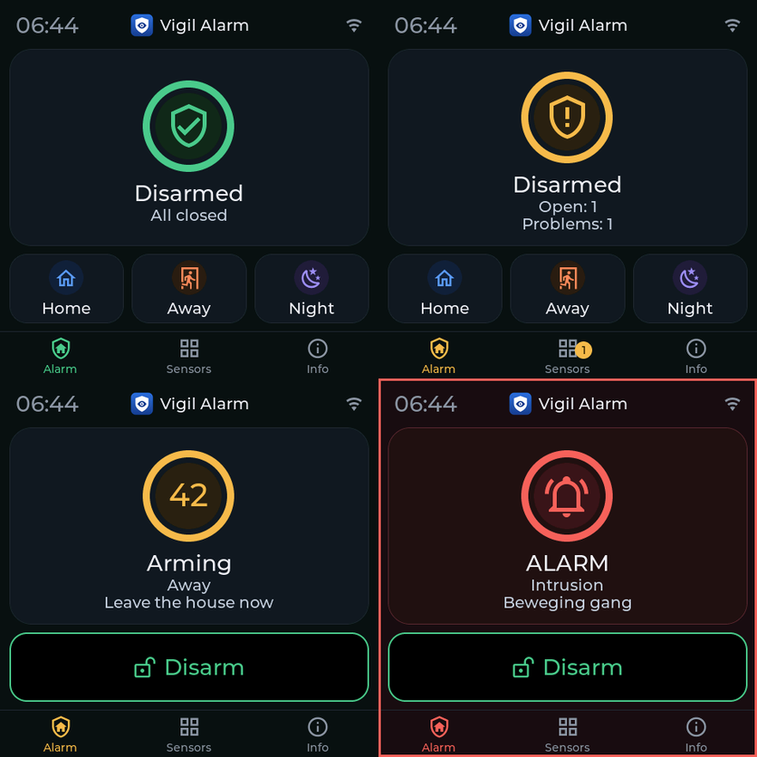
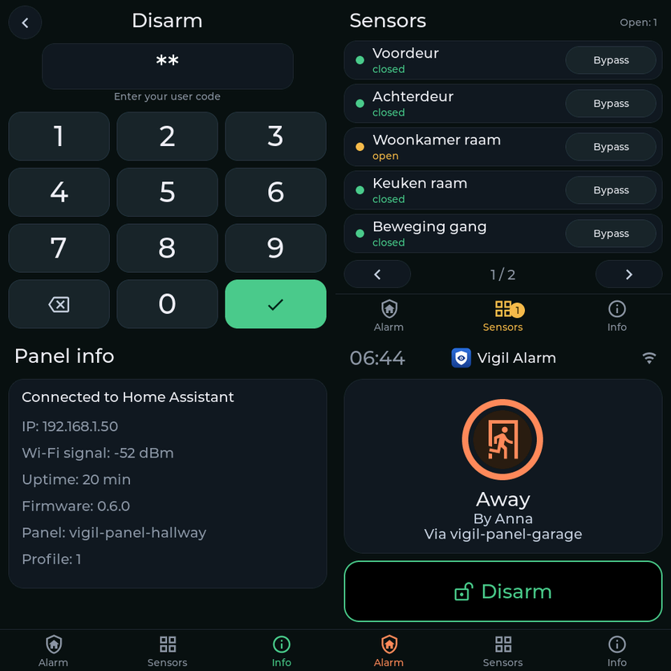
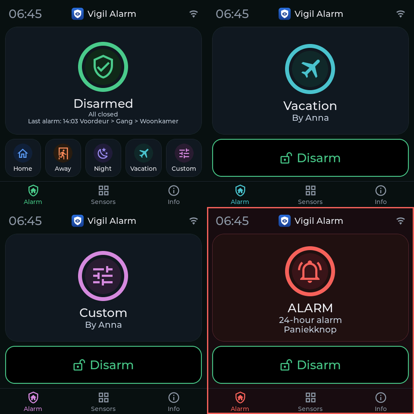

# Vigil touch panel (ESPHome)

A touch panel for Vigil Alarm: arm, disarm, see what is open and bypass a sensor, without a phone.
It runs on an ESP32 with an LVGL display. It is a *dumb terminal*: it decides nothing. What it may do
and show is set in Vigil (tab *Panels*) and the panel reads that from its **profile**.

Made for ESPHome 2026.9 and 2026.10 (`esphome config` and the simulator ran on 2026.9.1 and 2026.10.0; older versions were not tried, so 2026.9 is the minimum we can name). The hardware file is for the **Guition ESP32-S3-4848S040** (480x480).
Other displays work with another hardware file, see below.

> **Status:** the logic and the way the panel works with Home Assistant were tested on a real Guition 4848 panel,
> including the panel key (0.6.6). The look of the screens (ring, tabs, icons, the buttons for *Vacation* and *Custom*, the
> last alarm under the state and the six languages) is drawn on a computer by LVGL (see `tools/panel-simulator/`); the
> colours of the real LCD differ a little. Please report what you see, also on other hardware.

## Folder structure

```
esphome/
  example-garage.yaml      a device: name, Wi-Fi, keys  (copy this, one per panel)
  vigil_alarm/             the firmware and the hardware; the same for every panel, do not edit
    guition-esp32-s3-4840s40c_i.yaml      the hardware: display, touch, backlight  (one per kind of panel)
    vigil-panel.yaml                      the firmware; it includes the parts below (state, scripts, screen)
    vigil-panel-state.yaml                what Home Assistant tells the panel, and what the panel tells Vigil
    vigil-panel-scripts.yaml              the scripts: pages, keypad, actions
    vigil-panel-ui.yaml                   the screen: look, top layer, main page
    vigil-panel-ui-keypad.yaml            the screen: the keypad page
    vigil-panel-ui-lists.yaml             the screen: the sensor list and the information
    vigil-panel-sound.yaml                the sound, only for a panel with a speaker (optional)
    vigil-panel-row.yaml
    vigil-panel-row-script.yaml
    vigil_panel.h
    vigil_logo.h
```

An update of Vigil can bring a new `vigil_alarm/` folder; your own device files stay as they are.

## Installing

1. Copy `example-garage.yaml` and the whole folder `vigil_alarm` into your ESPHome folder (rename
   the example).
2. In the new file change `name` (lower case letters, digits and dashes; this is the **panel id**) and
   `friendly_name`. Add the encryption key to your `secrets.yaml`. Keep it: the key protects the link with
   Home Assistant (the codes pass through it) and is also what allows an update over Wi-Fi, so others
   on your network cannot flash the panel. (The example uses `encryption` under `ota`, as ESPHome advises, instead of an OTA password.)
3. Install it on the panel (the first time through USB).
4. In Home Assistant: **Settings → Devices & services → ESPHome → the device → Configure** and
   switch on **Allow the device to perform Home Assistant actions**. Without it the buttons do nothing.
5. In Vigil open the tab **Panels → Add panel**. Use the device name as *panel id* and set what the
   panel may do. Until you do, the panel says **Not linked** and shows the panel id it expects.
6. **Give the panel a key** (recommended). In *Panels* press the key button of the panel: Vigil shows a key **once**
   (and keeps only a digest of it). Put it in your `secrets.yaml` as `vigil_panel_garage_key` (the panel id with underscores and `_key`; the key dialog shows the line), remove the `#` before
   `panel_key` in your device file and install the panel again. From then on the panel sends the key with every call,
   and Vigil refuses any call in the name of this panel without it: a call that only *says* it comes from the panel
   (the `source` is plain text) no longer works, for example from another Home Assistant account. A new key replaces
   the old one at once; install the panel again with it. The panel does not need to be flashed before you make a key:
   a panel without a key works as before, but *Ready for use?* advises you to give it one.

For a second panel copy the example file again, with another `name`.

## What it does



- **Top bar**: the Vigil logo with *Vigil Alarm*, and under it the partition this panel operates now (*Garage*, or *All*). It shows also when the panel may operate one partition only.
- **Partitions**: every panel has a *default partition* (or *All*) set in Vigil. If the panel may operate more than one, a row of buttons under the state lets you switch (up to four partitions and *All* fit in the row; with more, the row shows four at a time with an arrow on each side, the right arrow stays at the far right, and *All* comes after the last partition, on the last page or on a page of its own if that one is full). On the *Sensors* page the button at the top steps through the partitions, *Always on* and *All* (the fire, gas, water, tamper and 24-hour sensors, which belong to no partition and are left out of the list of a partition). *All* arms and disarms every partition at once. After the time set in Vigil (*Settings*, *Panel screen*, *Return to default partition*, default 30 seconds; 0 = never) without touching the panel, it jumps back to its default partition.
- **Main page**: the state is a ring with an icon, in the colour of the state (green disarmed, amber arming or
  something open, orange entry delay, blue Home, coral Away, violet Night, teal Vacation, pink Custom, red alarm, grey no connection), with the
  state and what is the matter under it. While the exit or entry delay runs the ring is the countdown: the seconds in
  the middle, the ring running down from full to empty. Under it the buttons: *Home*, *Away*, *Night* and, if switched on in Vigil, *Vacation* and *Custom* (with five buttons the
  text is smaller), only for the modes this panel may arm in. Disarmed, the line *Last alarm: 14:03 Front door > Hall* (the
  alarm memory) and, if a sensor is still bypassed (permanent bypass), *Bypassed: Attic window* are under the state, when this panel may show sensor names. When the alarm is on, there is one big button: *Disarm* (if the panel may disarm). While
  the alarm is going off the screen has a red frame. At the bottom are the tabs *Alarm*, *Sensors* and *Info*.
- **Keypad**: never opens by itself. During the entry delay and an alarm the main page shows what is going on (entry delay with countdown, or ALARM with the cause), with the *Disarm* button; whoever wants to disarm presses it. Wrong code, a refused
  arming and other errors are shown with the text Home Assistant gives.
- **Sensors** (the *Sensors* tab, a button at the top chooses the partition, with the number of open sensors in a badge; not there if the list is set to *never*): the sensors with their state and a *Bypass* or *Restore* button (only if the panel may
  bypass). Fire and gas sensors have no button, they can never be bypassed.
- **Info** (the *Info* tab, behind the installer code of the panel): connection, IP address, Wi-Fi signal, uptime, firmware
  version, panel id, profile version and whether a panel key is set (*Panel key: set* or *not set*, from `panel_key` in the
  device file; never the key itself). Never the Wi-Fi password.
- **Not linked / Blocked**: a panel that is not in the register shows *Not linked*; a blocked panel
  shows *Blocked* and does nothing.
- The language is the one set for the panel in Vigil: Dutch, English, German, French, Italian or Spanish (from firmware 0.5.6; accents are left out on the screen).
- The screen goes dark after the time set in Vigil (*Settings*, *Panel screen*, default 30 seconds) and lights up on touch and when the alarm changes. It only goes dark in a steady state: alarm off or fully armed. While the alarm counts down (arming, entry delay) it never goes dark. During an alarm it stays on, unless you let it go dark in the same settings. Was a half typed code, the list or the info still open, then the panel first returns to the main page after that time (you see it), and the screen goes dark after the same time again.

### Codes

- **Disarming and bypassing** always ask for a user code.
- **Arming** asks for a code only if *a code is required to arm* is on in Vigil (Settings tab).
- The **list of sensors** opens with the code of **any Vigil user** (or the installer code of the panel). The
  **info page** opens with the **installer code of the panel** only, which you set in Vigil. The panel sends the
  code to `vigil_alarm.unlock_panel` (with `scope: sensors` or `scope: info`); Vigil checks it, counts a wrong
  code towards the lockout (the user code timer of the panel for the list, the installer code timer for the info)
  and unlocks for the time set in the profile. Unlocking never disarms. Without an installer code the panel
  says so when you open the info page, and it does not open.
- **Bypassing and restoring** a sensor need a user code of a user who has the right to bypass (set per user in
  Vigil); a tamper sensor needs the extra right to bypass tamper. Whoever may bypass may also restore.
- The keypad has digits only: give users a numeric code.

### What a passer-by can see

Someone standing at the panel should not learn what your house watches. Vigil sends the **names** of
sensors to the panel only while it may show them: always (`sensor_list: always`), or after the
installer code (`code`, the default), or never. While locked, the panel only shows *how many*
sensors are open ("Open: 3"). While the alarm is on, the main page shows no sensor names and no
names of people unless the panel is unlocked. The names are not in the history of Home Assistant.

### Who did it

The device name is the `source` of every call, so the history shows *Anna (vigil-panel-garage)*, or
just *vigil-panel-garage* when no code was needed. A wrong code is published as the event
`code_rejected` with that source, never with the code itself.

## Wrong codes, locks and blocked panels

- **Wrong code:** the code field shakes and gets a red border, and a larger red message stays under it until the next key press (with the low double buzz if the sound package is there).
- **Locked after too many wrong codes:** the keypad closes and the screen shows a lock with the time left counting down ("Try again in 4:32"). The buttons that need a code are gone until the lock ends. With a permanent lock the text says an administrator has to lift it in Vigil. Vigil tells the panel at once, so the lock shows without another try.
- **Blocked in Vigil:** an amber lock with "Blocked" and "This panel is blocked in Vigil", without buttons or tabs.

## Sound (optional)

A panel with a speaker beeps for what you are doing at the door:

| When | Sound |
|---|---|
| Entry delay | one short beep a second, two a second in the last 10 seconds |
| Exit delay | one beep every two seconds, one a second in the last 5 seconds |
| Armed | two rising tones |
| Disarmed | two falling tones |
| Wrong code (or an action that failed) | a low double buzz |

To switch it on, remove the `#` before `sound:` in your device file, so it includes `vigil_alarm/vigil-panel-sound.yaml`.
Whether this panel beeps and how loud is set by an administrator in Vigil, per panel (Panels, the panel, *Sound on the panel* and
*Sound volume*, *Tones for arming and disarming* and *Beeps during the exit and entry delay* for a panel nobody operates). The device itself gets two entities in Home Assistant: **Quiet in Night mode** (no sound when arming to, in or
leaving Night) and a **Test sound** button. A panel without the package stays silent.

**Guition ESP32-S3-4848S040 (the hardware file in this folder).** The board has a small class D amplifier (NS4168) and a connector
for a speaker (8 ohm, 1 to 3 W; a 28 mm 8 ohm 1 W speaker is fine). On a board like the one we looked at (the version without relays) the amplifier is not
connected to the ESP32 as delivered: next to the amplifier chip three 0 ohm resistors (**R25, R26 and R27**) sit on one set of pads, and the
three pads next to the chip (**R21, R22 and R23**) are empty. GPIO1, GPIO2 and GPIO40 are the I2S lines of the amplifier once the resistors
are on the pads next to the chip. So to use the speaker, move each 0 ohm resistor one place over, to the empty pads in the same row (R25 to R21,
R26 to R22, R27 to R23; small SMD soldering, check the markings on your own board first). On a board with relays they stop working then,
which Vigil does not use. If a board differs, try the sound first: with the package included and *Test sound* silent, look at these resistors. The hardware file
names the pins (`sound_bclk_pin: GPIO1`, `sound_lrclk_pin: GPIO2`, `sound_dout_pin: GPIO40`); another board sets its own. Keep the
volume well below 100% for a small speaker.

## Options

Set these as `substitutions:` in your device file, above the packages:

| Substitution | Default | Meaning |
|---|---|---|
| `name` | (required) | The device name and the panel id in Vigil. |
| `profile_entity` | `sensor.<name with underscores>_profile` | The profile sensor Vigil makes for this panel. Only change this if you changed its entity id. |
| `backlight_timeout_seconds` | `"30"` | Only the start value, until Vigil has told the panel. The real time is a setting in Vigil (*Settings*, *Panel screen*), the same for all panels. |

Everything else (modes, disarm, bypass, language, sensor list, unlock time) is in Vigil.

## Firmware version

The firmware has its own version, `firmware_version` in `vigil-panel.yaml`: *major.minor* (now `1.0`). It does **not** follow the version of Vigil: a release of Vigil without a change in the `vigil_alarm` folder keeps the firmware version, and the release notes say whether you have to flash again. The major number is the profile version panel and Vigil speak (`PROFILE_VERSION`); it goes up only when they no longer understand each other. The minor number goes up with every other change. When the profile of the panel and of Vigil differ, the whole screen of the panel says *Panel outdated* (flash new firmware) or *Vigil outdated* (update Vigil) and nothing can be operated until they match.

## What the panel tells Vigil

The firmware adds four diagnostic sensors to the device: *Hardware ID*, *Capabilities*, *Firmware
version* and *Profile version*. Vigil reads them in the Panels tab, and gives advice (never an
alarm) when the firmware does not understand the profile or when the hardware is not what you
registered.

## Another display

`vigil_alarm/` is for the screen only. For other hardware make a file like `vigil_alarm/guition-esp32-s3-4840s40c_i.yaml` (or send it to us to add). It
must provide:

- the substitutions `hardware_id`, `screen_width` and `screen_height` (reported to Vigil),
- a light with the id `display_backlight`,
- an `lvgl:` section with the `touchscreens:` and the display,
- a touch screen that runs `script.execute: wake` on touch (the touch that wakes a dark screen is then not passed on to the button below it).

The layout follows the size of the screen: the ring, the keys and the tabs are calculated from `screen_width` and
`screen_height`, and the main page grows with the screen (see the substitutions at the top of `vigil-panel.yaml`).
It is designed and checked for 480x480; a wider screen, for example 800x480, is drawn correctly (the picture below
was made with the simulator) but its proportions are not tuned yet.

## Seeing the screens without a panel

`tools/panel-simulator/run.sh` draws every screen of the panel on a computer, from the real YAML and `vigil_panel.h`
(see `tools/panel-simulator/README.md`): `run.sh out --lang en --size 800x480`. The icons come from a font file that
ESPHome downloads when you compile, so the first compile needs internet access.





## Another language

The panel speaks Dutch, English, German, French, Italian and Spanish. All texts are in
`vigil_alarm/vigil_panel.h`, one line per text with a column per language (in the order of `enum Language`).
To add a language: add a column to `TEXTS` and to `ERROR_ROWS` (the phrases the panel recognises in what Vigil
answers), a value to the enum and a line to `parse_language`, and add the language to Vigil (`languages.py`).
Use plain ASCII on the screen: the built-in fonts have no accented letters.

## What the panel reads from Vigil

From the **profile sensor** of the panel: `language`, `blocked`, `lock_left` (seconds of lock after wrong codes), `lock_permanent`, `modes_mask`, `can_disarm`,
`can_bypass`, `sensor_list`, `unlock_seconds`, `code_arm_required`, `has_admin_code`, `unlocked`,
`open_count`, `faults_count`, `problems_count`, the partition view (`view_*`: name, state, mode, delay, cause of the partition shown, and `partition_list`), and (only while allowed) `open_now_text`,
`open_sensors_text`, `faults_text` and `sensors`. The state, `mode`,
`delay_left` (seconds left; the panel counts down on its own clock), `changed_by`, `cause` and `cause_sensor`. They are plain text on purpose, because
ESPHome cannot read lists. The panel calls `vigil_alarm.arm`, `disarm`, `bypass`, `unbypass` and
`select_partition` and `unlock_panel` with the device name as `source`.

## Not on the panel

Silencing a siren and a tag reader. Disarming silences everything anyway. The panel makes no alarm sound: that is the job of the sirens.

## Tests

`tests/test_esphome_panel.py` runs the logic of `vigil_panel.h` with a C++ compiler and validates the
example with `esphome config`. A build for the ESP32 and the screen on the real LCD can only be tried on the panel; the simulator
(`tools/panel-simulator/`) draws the screens on a computer.


## About the warnings in the build

`GPIO19 is used by the USB-Serial-JTAG interface` and `GPIO20 ...` (twice) are expected for the
Guition 4848: the board itself connects the touch controller (GPIO19) and a data line of the display
(GPIO20) to those pins, so they cannot be moved. The warning only matters if you want to use the
chip's own USB port for logging or flashing while the panel runs; the panel then uses the USB-serial
adapter of the board, or Wi-Fi updates. Nothing to fix.
